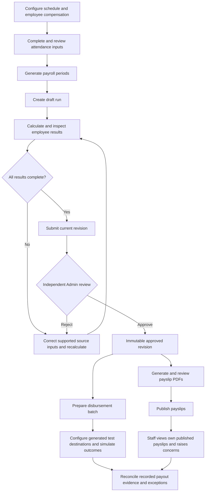
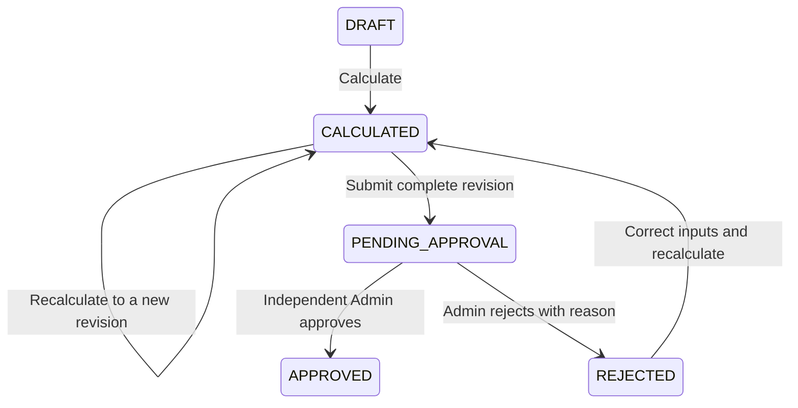

# Payroll workflow guide

Documented: 2026-11-20. Describes the current implementation; this is not a deployment or live-payment certification.

Use this guide to run Payroll from initial configuration through approval, document publication and reconciliation. The current payout workflow is a local simulator: generated destinations and simulated success do not establish that an employee received money.

## Who can do what

| Role       | Entry point                       | Access                                                                                                                                                                                                                       |
| ---------- | --------------------------------- | ---------------------------------------------------------------------------------------------------------------------------------------------------------------------------------------------------------------------------- |
| Admin      | People & HR → Payroll             | Configure compensation/schedules, prepare and calculate runs, submit/review eligible revisions, generate/publish payslips, manage concerns, simulate payouts and investigate reconciliation. Actor restrictions still apply. |
| Superadmin | People & HR → Payroll             | Read administrative Payroll, including Approved Runs and details. Cannot perform Payroll management writes or approve by virtue of the role.                                                                                 |
| Staff      | Workforce Compliance → My Payroll | Read their own published payslips and manage their own eligible payroll concerns. Requires an authenticated Staff account linked to an employee.                                                                             |
| Client     | None                              | No Payroll access.                                                                                                                                                                                                           |

Use two different Admin accounts for preparation and approval. Superadmin is not a substitute approver. A run's preparer and calculation author cannot approve that revision.

## The complete flow

The payslip and disbursement branches are independent after approval. Publishing a payslip does not pay an employee. Preparing, validating or simulating a batch does not automatically publish payslips. Reconciliation can identify missing payout records before a batch has been prepared.

## 1. Configure Payroll

### Schedule

Open **Payroll → Settings → Schedule**. Add the applicable effective-dated monthly or semi-monthly schedule, currency and cutoff information exposed by the form. Review the current schedule and configuration history before generating periods.

Schedule changes create versions. A change that conflicts with already generated periods may be rejected; do not attempt to overwrite historical periods to force it through. Refresh and review the effective dates and existing periods first.

### Employee compensation

Open **Compensation → Employee Compensation**. Find the employee and use the eye action to open their existing details or configuration flow. An Admin can add an effective-dated version with:

- Monthly, daily or hourly pay type.
- Positive base rate in PHP.
- Fixed allowances and recurring deductions, where applicable.
- Effective date and change reason.

Review the version history instead of editing historical salary amounts in place. Future compensation does not retroactively change an approved run. An employee may appear in the list before compensation has been configured; the absence must be corrected before their payroll can complete.

### Preferences and readiness

Settings exposes **Schedule, Payslips, Disbursements, Readiness and Audit History**. Persisted preferences include company-logo and employee-ID display in generated PDFs, publication confirmation and simulation confirmation. Save changes and check the success/error feedback.

Readiness reports whether the supporting capability is available. It does not certify that every employee has valid compensation, attendance or a payable result. Audit History provides attributable events; it is not a mechanism to alter financial records.

## 2. Review employee and attendance inputs

Confirm employment status, start date, effective compensation, assigned attendance policy, work sessions and breaks. Resolve pending corrections, open sessions and disputed data through their existing source workflows before final approval.

The calculator is conservative and policy-backed:

| Case                                                                               | Current behavior                                                                                                        |
| ---------------------------------------------------------------------------------- | ----------------------------------------------------------------------------------------------------------------------- |
| Monthly employee, full calendar month, one covering compensation version           | Can calculate base pay and applicable fixed components when the remaining inputs permit completion.                     |
| Daily/hourly employee, including a contractor                                      | Uses recorded attendance and applicable policy information. A contractor label alone does not define a payment formula. |
| Unpaid recorded breaks                                                             | Excluded from the applicable time calculation.                                                                          |
| Missing attendance or unresolved workday information                               | Requires review or blocks calculation; does not silently assume an unpaid absence.                                      |
| Mid-period monthly change/start or semi-monthly allocation of monthly compensation | Unsupported proration/allocation is flagged rather than invented.                                                       |
| Overtime without a configured payroll rate                                         | Recorded for review, not silently priced.                                                                               |
| Undefined leave-pay treatment                                                      | Unsupported; an ON_LEAVE employee receives the existing blocker.                                                        |
| Deductions exceeding known gross or amounts outside supported precision/range      | Blocks final financial amounts for review.                                                                              |

Currency inputs are exact decimal strings. Review displayed warnings even where known amounts exist. Do not treat a partial known total as the amount owed for all employees.

## 3. Generate periods and create a draft

Open **Payroll Runs**:

1. Choose **Generate periods**, select the year and confirm the applicable schedule.
2. Inspect the generated dates/frequency. Repeating generation preserves existing matching periods instead of duplicating them.
3. Choose **Create draft run** and select an eligible period. The selector can load the selected year's generated periods.
4. Open the created run's details.

Only one run may occupy the same period. A conflict or an already-used period is a reason to inspect the existing run, not repeatedly create another.

## 4. Calculate and review

Calculate the draft. Inspect the run summary, revision history and each employee's result:

- **Calculated:** the employee result has the supported calculation inputs.
- **Review required:** inspect the listed warnings; the run is not ready for approval.
- **Blocked:** correct the identified input or acknowledge that a required policy is unsupported. Do not substitute an assumed rate.

Run totals distinguish complete results from unresolved amounts. Review gross pay, recurring deductions, net pay, compensation versions, attendance evidence and component breakdowns.

For a supported input correction, update the source through its existing workflow and recalculate while the run is eligible. Recalculation appends a revision; it is not a harmless idempotent retry. Earlier revisions remain available. Pending-approval and approved runs cannot be recalculated through the normal calculation action.

## 5. Submit, approve or reject

The implemented run lifecycle is:

Submission requires a complete current revision with calculated employees and no blocked/review results. In **Approvals**, review the submitted revision's employee breakdown, totals, preparer, calculation author and activity history.

- Approve with a different eligible Admin from the preparer/calculation author.
- Reject with a meaningful reason if correction is needed. Correct the source, recalculate and resubmit the new revision.
- If another actor changed the run, refresh the details. Stale revision requests receive conflicts rather than approving an unseen version.

Approval freezes the financial source. Database guards protect approved calculations, employee items and components, including before PDF generation. Do not manually edit approved rows or describe reconciliation decisions as financial corrections. There is no general post-approval adjustment/reversal executor in this workflow.

## 6. Generate, review and publish payslips

Open **Payslips & History → Approved Runs**. Open the approved run, generate its payslips, and inspect employee documents and PDFs. Generation reads the approved snapshot; it does not recalculate salary.

Check employee identity, period, revision, earnings, deductions, net pay and document reference. Draft PDFs may use the supported regeneration action before publication; published documents are preserved. Updated template preferences do not silently rewrite a published PDF.

Publish when the required documents exist and review is complete. Use the publication confirmation where enabled. Generation alone does not make a payslip visible to Staff; Staff access requires publication and employee ownership.

The **Payslips** tab lists individual documents. **Approved Runs** groups the approved source revisions. **Payroll Requests** provides administrative concern management. Superadmin can inspect read-only; generation/publication remain Admin management actions.

## 7. Prepare and simulate disbursements

Open **Disbursements**, select an approved complete run and prepare its batch. Each persisted payout item references the approved calculation and employee amount. Preparation reuses the existing batch for that calculation, including after cancellation; it does not create an independent second payroll obligation.

Review the sidebar's Payroll source, Employee payouts and Activity history. Confirm approved net pay, proposed payout total and blocked employee count. Search, status filters, sorting and pagination affect the visible list, not the underlying batch obligation totals.

### What Validate does

Validation records the existing batch check and its audit event. In the current foundation it can leave the batch **Blocked** because external execution is disabled. It does not verify a real bank account, call PayMongo or send funds. Do not interpret a validation click as authorization for live transfers.

### Local simulation

Simulation requires the API's development mode and explicit `PAYROLL_LOCAL_SIMULATOR=true` setting. Use only a local/disposable test environment. Production mode rejects simulator writes even when the flag is set.

1. Open an employee payout and choose **Configure**.
2. Choose a generated test bank or test e-wallet destination. Only synthetic display digits are stored; this is not a verified employee account.
3. Choose the available simulated outcome: success, failure or pending.
4. Review the item state and persisted attempt in the batch/history and reconciliation views.

Positive net amounts without a test destination are blocked. Zero net requires no payment. Each item supports one immutable destination and one simulation attempt in the current implementation. An exact idempotency-key replay returns its original result; a new key does not authorize a second attempt or replace failed/pending evidence. Refresh after an uncertain response before attempting another action.

Cancellation closes the batch's supported management path. It does not reverse a payment, erase attempts or make the same calculation eligible for a new independent batch.

**There is no live payout completion step here.** PayMongo's adapter remains disabled, and adding credentials does not enable execution. A simulated success is testing evidence only.

## 8. Staff self-service and concerns

Staff opens **Workforce Compliance → My Payroll** to see their payroll summary and own published payslips. Empty states are valid when nothing has been published. An unlinked account cannot establish employee ownership; resolve the employee/account relationship through authorized employee management.

Staff can download an available PDF and raise a payroll concern, optionally referencing their own payslip. They can inspect status/history and Admin responses, and edit or withdraw an eligible open concern using the existing actions. These actions do not alter approved pay or published PDFs.

Admin reviews concerns through **Payroll Requests**, adds responses and moves them through the supported status transitions:

- Open → In review or Closed.
- In review → Resolved or Closed.

Closed/resolved concerns are not generally editable through the update workflow. A concern marked resolved records administrative handling; it does not certify a transfer occurred or a payroll adjustment was executed. Correction/discrepancy concerns can flag a need for financial correction without changing the approved snapshot.

## 9. Reconcile and investigate exceptions

Use **Reconciliation** to compare the approved obligation with persisted payout evidence. Review expected amounts, simulated outcomes, missing or unmatched items and amount discrepancies. Simulation is labelled separately from real payment confirmation.

Read operations evaluate evidence but do not silently record observations or close cases. Use the explicit record/review actions to persist an observation or decision. Supported review includes starting investigation, assessments, returning a case to the queue, administrative resolution/dismissal and reopening with reasons. Some final decisions require an independent attributable Admin, excluding actors involved in preparing/calculating the run or configuring/simulating the payout.

Administrative review status and financial discrepancy status are separate. A closed case may still be financially outstanding. Current or changed evidence may require a new observation/review cycle. A decision cannot manufacture provider confirmation, modify approved net pay, retry a transfer or execute a correction.

## 10. Reports and operational follow-up

Use **Overview** for the selected Payroll scope and **Reports** for summaries, compensation, disbursement and reconciliation records. Check period filters and underlying detail references before exporting CSV or Excel. Report read access does not imply export permission; the existing export action requires management permission.

For each cycle, confirm:

- The intended period and approved revision are identifiable.
- Employee amounts were reviewed and approval attribution is correct.
- Required payslips are generated/published and Staff ownership works.
- Disbursement evidence is accurately labelled as simulated in the prototype.
- Outstanding exceptions and concerns have an owner/reason and remain visible.

The current prototype's stopping point is an approved immutable payroll, published employee documents, persisted simulation evidence and reviewed reconciliation. It is not bank settlement.

## Common blockers and next actions

| Symptom                                   | Next action                                                                                                                                       |
| ----------------------------------------- | ------------------------------------------------------------------------------------------------------------------------------------------------- |
| No periods available                      | Check the selected year and effective schedule, then generate periods.                                                                            |
| Period already has a run                  | Inspect that run instead of creating another.                                                                                                     |
| Calculation blocked/requires review       | Open the employee breakdown, correct supported source inputs and recalculate if eligible.                                                         |
| Approval forbidden                        | Check Admin management permission and use an independent reviewer.                                                                                |
| Stale/conflict response                   | Refresh and review the current revision/state before acting.                                                                                      |
| Approved amount needs correction          | Record the concern/exception and investigate; do not edit the immutable snapshot. An authorized financial correction executor is not implemented. |
| Staff has no payslips                     | Check employee linkage, document generation/publication and that the Staff account owns the employee record.                                      |
| Batch remains blocked after Validate      | External execution is intentionally disabled; inspect item eligibility and use the local simulator only where enabled.                            |
| Failed/pending simulation cannot be rerun | Preserve the attempt and investigate through reconciliation; do not create a second payment attempt with a different key.                         |
| API/server error                          | Keep it visible and investigate configuration, connectivity or migration readiness. Do not interpret an error as an empty list.                   |

## Technical references and limits

- [Disbursement model and local setup](payroll-disbursement-foundation.md).
- [Reconciliation decisions and independent review](../payroll-reconciliation-7.3.md).
- [Reports and exports](../payroll-reports-8.2.md).
- [Settings readiness and audit visibility](../payroll-administration-8.3.md).
- [Final audit and verification history](../payroll-final-pre-push-audit.md).

Hosted database privileges/TLS, deployed migration state, live payment integration, a response lost after a proven commit, and attendance corrections racing calculation are not certified by this guide. The historical one-off invalid-reference HTTP 500 remains unattributed despite passing subsequent cases. See the final audit for evidence boundaries and current warnings.

Documentation reuse: this guide consolidates existing UI labels, source state transitions, role utilities and feature records. It adds no components, business policies, runtime configuration or execution path. Only documentation formatting and link targets were checked for this addition; existing test counts are not presented as new runs.
