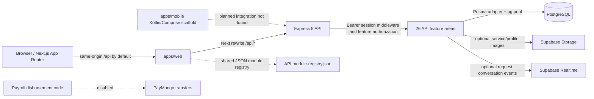
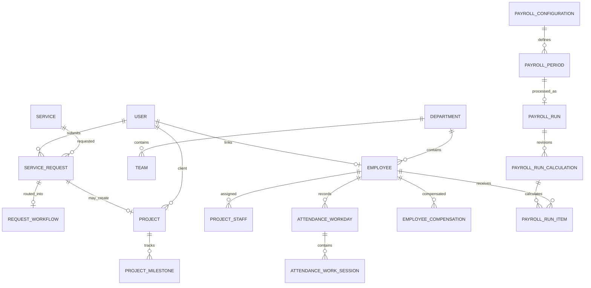
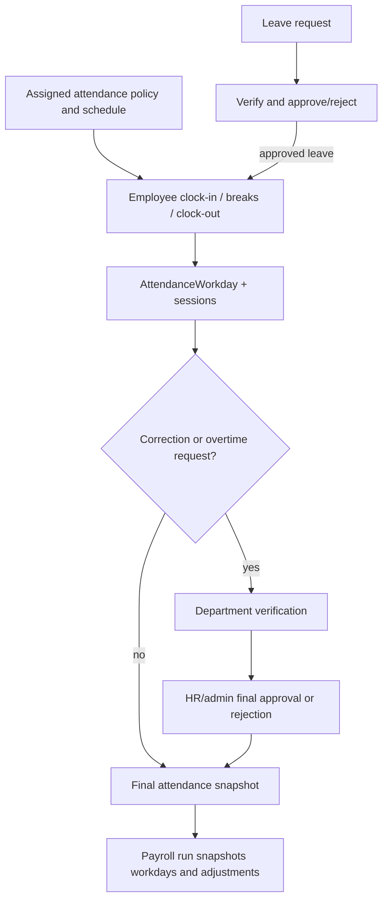

# CONVERYN Complete System Audit Report — November 23, 2026

**Audit classification:** COMPLETE — SOURCE INVENTORY  
**Project:** Converyn (formerly Nexus)  
**Audit date:** November 23, 2026 (Asia/Singapore)  
**Repository baseline:** branch 293-test-full-system-audit-for-verifying-recent-changes, commit a3d4c2b6b02f760eff31ec298bccb39222e3a24f

This report consolidates the ten source audit documents listed in Section 20. It distinguishes source and configuration evidence from runtime verification. Unless stated otherwise, implementation findings are source-confirmed and were not runtime-tested.

## Table of Contents

1. [Executive Summary](#1-executive-summary)
2. [Repository Baseline](#2-repository-baseline)
3. [Complete System Architecture](#3-complete-system-architecture)
4. [Complete Repository Structure](#4-complete-repository-structure)
5. [Frontend Routing Inventory](#5-frontend-routing-inventory)
6. [Functional Modules and Features](#6-functional-modules-and-features)
7. [Backend API Architecture and Inventory](#7-backend-api-architecture-and-inventory)
8. [Database Architecture](#8-database-architecture)
9. [Authentication and Authorization](#9-authentication-and-authorization)
10. [End-to-End Business Workflows](#10-end-to-end-business-workflows)
11. [Payroll and Workforce Compliance](#11-payroll-and-workforce-compliance)
12. [Validation, Security and Error Handling](#12-validation-security-and-error-handling)
13. [Testing and QA Infrastructure](#13-testing-and-qa-infrastructure)
14. [Build, Deployment and Infrastructure](#14-build-deployment-and-infrastructure)
15. [Latest Verified Development Changes](#15-latest-verified-development-changes)
16. [Confirmed Defects, Gaps and Limitations](#16-confirmed-defects-gaps-and-limitations)
17. [Complete Inventory Statistics](#17-complete-inventory-statistics)
18. [System Implementation Status](#18-system-implementation-status)
19. [Outstanding Verification Requirements](#19-outstanding-verification-requirements)
20. [Final System Baseline and Handoff Summary](#20-final-system-baseline-and-handoff-summary)

## 1. Executive Summary

Converyn is a pnpm workspace containing a substantial Next.js App Router web portal, an Express API, and a Kotlin Multiplatform/Compose mobile starter. Source covers service catalog and request processing, client and department workflows, project delivery and collaboration, employee and account administration, workforce compliance, payroll management, staff self-service payroll, and administrative history views. PostgreSQL persistence is described by a Prisma 7 schema. Supabase Storage and Realtime integrations are present in source for image storage and request-conversation events, but connectivity was not tested.

The registry has eight module entries: seven enabled modules and one disabled Billing & Finance entry. Payroll has source-defined compensation, run calculation, approvals, reconciliation, reports, payslips, requests, and disbursement state, but live PayMongo transfers are disabled. A local disbursement simulator is development-gated. The mobile app remains a Compose sample without a discovered Converyn API client. One source-level defect was confirmed: the login form’s orphan /forgot-password link.

The source audit counted 71 web page definitions, 248 Express router method-registration call sites, 76 Prisma models, 44 Prisma enums, 91 migration directories, and 251 test files. These counts do not indicate runtime success. The original audit did not execute browser flows, API requests, database connections, migrations, automated tests, builds, external integrations, or deployments. Latest remote state remains unverified.

## 2. Repository Baseline

| Field                         | Audited baseline                                                                                                 |
| ----------------------------- | ---------------------------------------------------------------------------------------------------------------- |
| Project                       | Converyn (formerly Nexus)                                                                                        |
| Audit date                    | 2026-11-23, Asia/Singapore                                                                                       |
| Repository root               | C:\Users\ADMIN\Documents\Thesis\Nexus                                                                            |
| Branch                        | 293-test-full-system-audit-for-verifying-recent-changes                                                          |
| HEAD                          | a3d4c2b6b02f760eff31ec298bccb39222e3a24f                                                                         |
| HEAD timestamp / subject      | 2026-11-22 16:28:21 +08:00; merge PR #289 payroll                                                                |
| Original working tree         | Clean at source audit start                                                                                      |
| Consolidation-time Git check  | Branch and HEAD still match; no tracked files changed; the temporary report builder was removed after generation |
| Local branches / tracking ref | 59 local branches; cached tracking ref matched HEAD                                                              |
| Latest remote state           | NOT VERIFIED; no fetch or remote comparison                                                                      |
| Audit classification          | COMPLETE — SOURCE INVENTORY                                                                                    |

Technology declarations: pnpm 12.7.0, CI Node 24, Next.js 16.4.6, React 19, TypeScript approximately 5.9, Tailwind CSS 4, Express 5, Prisma 7 with PostgreSQL adapter and pg, PostgreSQL, Kotlin 2.4.20, Compose Multiplatform 1.12.1, AGP 9.1.1, Android compile SDK 37 and minimum SDK 24. These are checked-in declarations, not proof of installed or deployed versions or a successful build.

The audit inspected source, schema, configuration, tests, local Git history, Docker/Compose, and CI definitions. It did not inspect runtime routes, API requests, live database state, applied migrations, external connectivity, production deployment, current CI outcomes, or refreshed upstream state. The original audit did not run tests. Its read-only quality evidence and the pnpm lint wrapper limitation are recorded in Sections 13 and 14.

## 3. Complete System Architecture

The system connects a browser-facing Next.js App Router application to an Express 5 API, then to feature routers/services and Prisma/PostgreSQL persistence. Supabase services are optional integrations in source. Mobile-to-API integration and live payment transfers are not established.
**Incorporated source report:** CONVERYN_ARCHITECTURE_OVERVIEW.md

Audit target: `C:\Users\ADMIN\Documents\Thesis\Nexus`, branch `293-test-full-system-audit-for-verifying-recent-changes`, HEAD `a3d4c2b6b02f760eff31ec298bccb39222e3a24f` (2026-11-22 16:28:21 +08:00). Source inspection only; services were not started.

### System shape

Converyn is a pnpm monorepo with a Next.js web application, an Express API, and a Kotlin Multiplatform mobile starter. Business logic is primarily organized by feature folders. Web and API share no pnpm workspace package; the API module registry JSON is imported into web code. Persistence uses Prisma 7 over PostgreSQL. Supabase provides optional service/profile image storage and request-conversation realtime. There is no verified live payment integration.



Dashed arrows represent unimplemented/disabled boundaries or registry sharing, not an active runtime call. Browser API requests use `apiUrl`; the default leaves them same-origin, while `NEXT_PUBLIC_API_URL` can override the origin. Next rewrites `/api/:path*` to `API_PROXY_TARGET` (default `http://localhost:3001`; Docker uses `http://api:3001`): `apps/web/next.config.ts:L62-L67`, `apps/web/src/lib/api-url.ts:L1-L10`, `Dockerfile:L51-L53`.

### Repository structure

```text
.
├─ apps/
│  ├─ web/       Next App Router, feature UI/API clients, shared UI, unit tests, Playwright
│  ├─ api/       Express app, feature routes/services, Prisma schema/migrations, API tests
│  └─ mobile/    Kotlin Multiplatform/Compose starter scaffold
├─ scripts/tests/ Root test orchestration
├─ docs/         Features, QA plans/audits, architecture and implementation records
├─ .github/      CI workflow and repository automation
├─ patches/      package patches
├─ certs/        Postgres/Supabase TLS root certificate used by the API connection helper
└─ node_modules/ local installed dependencies (not source inventory)
```

`pnpm-workspace.yaml` includes `apps/*`; no shared package workspace was found. Web contains 31 feature directories and API contains 26. API feature directories are below `apps/api/src/features`; web routes are below `apps/web/src/app`, reusable layout/UI below `src/components`, and client-domain code below `src/features`. The detailed route, module, API, and schema indexes are separate reports. Root `.tmp`, `.local-testing`, `test-results`, and local logs are artifacts/configuration, not evidence of current runtime success.

### Technology stack

| Layer                  | Current declaration                                                                                                                 |
| ---------------------- | ----------------------------------------------------------------------------------------------------------------------------------- |
| Package manager / Node | pnpm 12.7.0 (`package.json`); CI Node 24 (`.github/workflows/ci.yml:L40-L47`)                                                       |
| Web                    | Next.js 16.4.6, React 19, TypeScript ~5.9, Tailwind CSS 4 (`apps/web/package.json`)                                                 |
| API                    | Express 5, Prisma 7, `@prisma/adapter-pg`, `pg`, TypeScript ~5.9 (`apps/api/package.json`)                                          |
| Database               | PostgreSQL (Prisma datasource in `apps/api/prisma/schema.prisma`; adapter setup in `apps/api/src/lib/db.ts`)                        |
| Mobile scaffold        | Kotlin 2.4.20, Compose Multiplatform 1.12.1, AGP 9.1.1, Android compile SDK 37/min SDK 24 (`apps/mobile/gradle/libs.versions.toml`) |
| UI primitives          | Radix UI packages and Tailwind 4; Inter variable font package (`apps/web/package.json`)                                             |
| Tests                  | Node test runner, PGlite, Playwright, Kotlin test; detailed counts in test report                                                   |

Versions are the package/config declarations at this HEAD, not proof that dependencies were freshly installed or that builds succeed.

### Frontend architecture

- Next App Router pages are thin route entries; major behavior is in feature-owned pages/components and API clients. The census contains 71 `page.tsx` route sources, eight redirect aliases, dynamic module page and `not-found.tsx` fallback.
- Root layout mounts the auth provider (`apps/web/src/app/layout.tsx:L30-L35`). Portal layout delegates to `PortalLayout`; it loads the account, applies client route policy, then renders the portal shell (`apps/web/src/components/layout/portal-layout.tsx:L21-L82`).
- API access is through feature API modules and `apiUrl`; custom `useAsyncResource` provides loading/error/retry state (`apps/web/src/lib/use-async-resource.ts:L15-L95`). No React Query/SWR dependency was found in web package declarations.
- `src/proxy.ts` sets a CSP nonce/security header and does not authenticate (`apps/web/src/proxy.ts:L23-L42`). Therefore the portal route check is a UX/navigation guard; server API authorization remains the security boundary.
- Route policies, module registry, and generated attendance links drive role-filtered navigation. Distinct contextual runtime destination count was not determined.

### Backend request path

```text
HTTP request
  → Express security headers / CORS / no-store / health and optional readiness
  → logging context and JSON body-size policies
  → mounted feature router
  → route middleware (Bearer session, role/permission)
  → controller and feature service/repository/data access
  → Prisma Client adapter → pg pool → PostgreSQL
  → shared error handler
```

The actual ordering and mounts are in `apps/api/src/app.ts:L45-L143`. `apps/api/src/server.ts:L48-L128` validates production database/JWT configuration, enables readiness gating in production, runs timed log/message purges, and performs graceful shutdown. The codebase broadly follows feature layering, but it is not perfectly uniform: `apps/api/src/features/auth/settings.controller.ts:L1-L47` makes Prisma calls directly from route handlers. This contradicts the “controllers do not query the database directly” rule in `apps/api/ARCHITECTURE.md`; treat that document as an incomplete/stale architecture description, not a guarantee.

`apps/api/src/lib/db.ts:L1-L36` builds a shared Prisma client with PostgreSQL adapter, UTC pool connections and configurable pool size. Transaction use appears in workflow/service layers. Prisma schema and migrations are inventoried in `CONVERYN_DATABASE_INVENTORY.md`; applied database state remains unverified.

### Integrations and deployment

- Supabase Storage implementation is in `apps/api/src/features/services/service-image-storage.ts`; profile images reuse it and cap uploads at 2 MB (`apps/api/src/features/auth/profile-images.service.ts:L34-L41`).
- Supabase Realtime integration for request-conversation updates is in `apps/api/src/features/request-conversations/request-conversations.realtime.ts:L28-L157`; no live credentials/connection were tested.
- PostgreSQL production URL validation, TLS setup, and schema-readiness checks are present. Docker has API, migration, and web build stages. `compose.prod.yaml` gates API startup on a successful migration service and health check; source config is not a deployment result.
- CI runs format check, lint, typecheck+build, Gitleaks, and high/critical dependency audit; it contains no test-suite job (`.github/workflows/ci.yml`).
- Payroll stores disbursement operations and an environment-gated local simulator, while `paymongo-disbursements.ts` declares PayMongo transfers disabled. No real salary transfer was established.
- Mobile source currently renders a Compose sample button/greeting (`apps/mobile/shared/src/commonMain/kotlin/com/nexus/app/App.kt`); no implemented Converyn client or verified API integration.

### Evidence boundaries

Current sources and local Git history were read. Read-only Prettier check, direct ESLint and no-emit web/API TypeScript checks passed; the `pnpm lint` wrapper could not open the global store lock, so ESLint was also invoked directly. No `git fetch`, build, test suite, database connection, migration, API server, browser session, external integration or production environment was used. The current local tracking ref has not been refreshed; latest remote state is not verified.

## 4. Complete Repository Structure

| Path          | Responsibility                                                                                                                                                                                                                                                |
| ------------- | ------------------------------------------------------------------------------------------------------------------------------------------------------------------------------------------------------------------------------------------------------------- |
| apps/web      | Next App Router routes under src/app; 31 feature directories under src/features; shared layout/UI in src/components; API URL/resource helpers in src/lib; unit tests in test; Playwright in e2e and integrated payroll specs in e2e-integrated                |
| apps/api      | Express app/server; 26 domain feature areas under src/features; common middleware/database/security helpers under src/lib and src/shared; Prisma schema and migrations under prisma; API tests outside src under tests; deployment/test scripts under scripts |
| apps/mobile   | Kotlin Multiplatform/Compose starter scaffold; no discovered operational Converyn API workflow                                                                                                                                                                |
| scripts/tests | Root test orchestration for API, web unit, and browser suites                                                                                                                                                                                                 |
| docs          | Feature notes, QA plans/reports, architecture, implementation records                                                                                                                                                                                         |
| .github       | CI workflow and repository automation                                                                                                                                                                                                                         |
| patches       | Dependency/package patches                                                                                                                                                                                                                                    |
| certs         | PostgreSQL/Supabase TLS root certificate used by API connection helper                                                                                                                                                                                        |

The pnpm workspace includes apps/* and no shared package workspace was found. The API module registry JSON is imported into web code. Local node_modules, test-results, .tmp, .local-testing, and logs are not evidence of runtime success.

## 5. Frontend Routing Inventory

The complete source census follows. It contains all 71 page.tsx definitions after removing App Router route groups, including eight redirect-only aliases. not-found.tsx is a fallback and is excluded. Each source row retains URL, page source, route group, parent layout, purpose, role policy, API dependencies, and implementation status to the extent established by the audit. The report also reconciles literal/generated navigation, landing rules, redirects, dynamic routes, and inaccessible/orphaned destinations.

**Incorporated source report:** CONVERYN_FRONTEND_ROUTES.md

Audit target: local source at commit a3d4c2b6b02f760eff31ec298bccb39222e3a24f (2026-11-23 client date).

### Counting and route behavior

A route is counted once for each source page.tsx under apps/web/src/app after removing App Router route-group names. The 71 page files include the root page and eight redirect-only aliases. apps/web/src/app/not-found.tsx is a fallback, not a page route. Layout files and Next internal endpoints are not counted.

Portal routes share the (portal) layout and are account-gated by the client PortalLayout. That layout loads the current account, evaluates isRouteDenied, and redirects denied or legacy dashboard destinations. apps/web/src/proxy.ts builds security headers and a CSP; it does not perform authentication. The route policy is therefore a frontend gate. Every data mutation still depends on backend checks. Exact source: apps/web/src/components/layout/portal-layout.tsx:L19-L66, apps/web/src/features/workspaces/model/route-policy.ts:L711-L744, apps/web/src/proxy.ts:L1-L37.

### Complete page route census

| URL                                                     | Page source                                                                               | Route group | Parent layout                        | Purpose                                                       | Allowed-role policy                                                                                                      | API dependencies                                                                                                                 | Source status                                             |
| ------------------------------------------------------- | ----------------------------------------------------------------------------------------- | ----------- | ------------------------------------ | ------------------------------------------------------------- | ------------------------------------------------------------------------------------------------------------------------ | -------------------------------------------------------------------------------------------------------------------------------- | --------------------------------------------------------- |
| /                                                       | apps/web/src/app/page.tsx                                                                 | root        | apps/web/src/app/layout.tsx          | Token-aware home redirect                                     | Conditional client redirect: token present goes to /dashboard; otherwise /login                                          | Page dependencies are in the owning feature API client; not runtime-traced                                                       | source-defined page; not runtime exercised                |
| /internal/login                                         | apps/web/src/app/(auth)/internal/login/page.tsx                                           | auth        | apps/web/src/app/layout.tsx          | Authentication route                                          | Public auth page; form submits to API auth routes                                                                        | Page dependencies are in the owning feature API client; not runtime-traced                                                       | source-defined page; not runtime exercised                |
| /login                                                  | apps/web/src/app/(auth)/login/page.tsx                                                    | auth        | apps/web/src/app/layout.tsx          | Authentication route                                          | Public auth page; form submits to API auth routes                                                                        | Page dependencies are in the owning feature API client; not runtime-traced                                                       | source-defined page; not runtime exercised                |
| /register                                               | apps/web/src/app/(auth)/register/page.tsx                                                 | auth        | apps/web/src/app/layout.tsx          | Authentication route                                          | Public auth page; form submits to API auth routes                                                                        | Page dependencies are in the owning feature API client; not runtime-traced                                                       | source-defined page; not runtime exercised                |
| /accounts                                               | apps/web/src/app/(portal)/accounts/page.tsx                                               | portal      | apps/web/src/app/(portal)/layout.tsx | Administration route                                          | SUPERADMIN with accounts:read                                                                                            | /api/users                                                                                                                       | source-defined page; not runtime exercised                |
| /attendance                                             | apps/web/src/app/(portal)/attendance/page.tsx                                             | portal      | apps/web/src/app/(portal)/layout.tsx | Workforce Compliance route                                    | Active STAFF/ADMIN; SUPERADMIN also needs employee-read permission; personal and manager pages have narrower policy      | /api/attendance and /api/leave                                                                                                   | source-defined page; not runtime exercised                |
| /attendance/adjustments                                 | apps/web/src/app/(portal)/attendance/adjustments/page.tsx                                 | portal      | apps/web/src/app/(portal)/layout.tsx | Workforce Compliance adjustments                              | Active STAFF/ADMIN; SUPERADMIN also needs employee-read permission; personal and manager pages have narrower policy      | /api/attendance and /api/leave                                                                                                   | source-defined page; not runtime exercised                |
| /attendance/audit                                       | apps/web/src/app/(portal)/attendance/audit/page.tsx                                       | portal      | apps/web/src/app/(portal)/layout.tsx | Workforce Compliance audit                                    | Attendance managers: department-head STAFF or privileged role with employee-read permission                              | /api/attendance and /api/leave                                                                                                   | source-defined page; not runtime exercised                |
| /attendance/check-ins                                   | apps/web/src/app/(portal)/attendance/check-ins/page.tsx                                   | portal      | apps/web/src/app/(portal)/layout.tsx | Workforce Compliance check ins                                | Active STAFF/ADMIN; SUPERADMIN also needs employee-read permission; personal and manager pages have narrower policy      | /api/attendance and /api/leave                                                                                                   | source-defined page; not runtime exercised                |
| /attendance/my                                          | apps/web/src/app/(portal)/attendance/my/page.tsx                                          | portal      | apps/web/src/app/(portal)/layout.tsx | Workforce Compliance route                                    | Active STAFF/ADMIN; SUPERADMIN also needs employee-read permission; personal and manager pages have narrower policy      | /api/attendance and /api/leave                                                                                                   | redirects to /attendance/check-ins                        |
| /attendance/my-payroll                                  | apps/web/src/app/(portal)/attendance/my-payroll/page.tsx                                  | portal      | apps/web/src/app/(portal)/layout.tsx | Workforce Compliance route                                    | Active STAFF/ADMIN; SUPERADMIN also needs employee-read permission; personal and manager pages have narrower policy      | /api/attendance and /api/leave                                                                                                   | redirects to /my-payroll                                  |
| /attendance/overview                                    | apps/web/src/app/(portal)/attendance/overview/page.tsx                                    | portal      | apps/web/src/app/(portal)/layout.tsx | Workforce Compliance overview                                 | Active STAFF/ADMIN; SUPERADMIN also needs employee-read permission; personal and manager pages have narrower policy      | /api/attendance and /api/leave                                                                                                   | source-defined page; not runtime exercised                |
| /attendance/policies/assignments                        | apps/web/src/app/(portal)/attendance/policies/assignments/page.tsx                        | portal      | apps/web/src/app/(portal)/layout.tsx | Workforce Compliance route                                    | Active ADMIN/SUPERADMIN with employees:manage                                                                            | /api/attendance and /api/leave                                                                                                   | redirects to /attendance/policies/management              |
| /attendance/policies/management                         | apps/web/src/app/(portal)/attendance/policies/management/page.tsx                         | portal      | apps/web/src/app/(portal)/layout.tsx | Workforce Compliance management                               | Active ADMIN/SUPERADMIN with employees:manage                                                                            | /api/attendance and /api/leave                                                                                                   | source-defined page; not runtime exercised                |
| /attendance/policies/overview                           | apps/web/src/app/(portal)/attendance/policies/overview/page.tsx                           | portal      | apps/web/src/app/(portal)/layout.tsx | Workforce Compliance overview                                 | Active ADMIN/SUPERADMIN with employees:manage                                                                            | /api/attendance and /api/leave                                                                                                   | source-defined page; not runtime exercised                |
| /attendance/records                                     | apps/web/src/app/(portal)/attendance/records/page.tsx                                     | portal      | apps/web/src/app/(portal)/layout.tsx | Workforce Compliance records                                  | Active STAFF/ADMIN; SUPERADMIN also needs employee-read permission; personal and manager pages have narrower policy      | /api/attendance and /api/leave                                                                                                   | redirects to /attendance/time-logs/records                |
| /attendance/requests/corrections                        | apps/web/src/app/(portal)/attendance/requests/corrections/page.tsx                        | portal      | apps/web/src/app/(portal)/layout.tsx | Workforce Compliance route                                    | Attendance route policy; authenticated STAFF/ADMIN and eligible supervisory roles; API applies record and workflow scope | /api/attendance and /api/leave                                                                                                   | source-defined page; not runtime exercised                |
| /attendance/requests/leave                              | apps/web/src/app/(portal)/attendance/requests/leave/page.tsx                              | portal      | apps/web/src/app/(portal)/layout.tsx | Workforce Compliance route                                    | Attendance route policy; authenticated STAFF/ADMIN and eligible supervisory roles; API applies record and workflow scope | /api/attendance and /api/leave                                                                                                   | source-defined page; not runtime exercised                |
| /attendance/requests/overtime                           | apps/web/src/app/(portal)/attendance/requests/overtime/page.tsx                           | portal      | apps/web/src/app/(portal)/layout.tsx | Workforce Compliance route                                    | Attendance route policy; authenticated STAFF/ADMIN and eligible supervisory roles; API applies record and workflow scope | /api/attendance and /api/leave                                                                                                   | source-defined page; not runtime exercised                |
| /attendance/requests/overview                           | apps/web/src/app/(portal)/attendance/requests/overview/page.tsx                           | portal      | apps/web/src/app/(portal)/layout.tsx | Workforce Compliance overview                                 | Attendance route policy; authenticated STAFF/ADMIN and eligible supervisory roles; API applies record and workflow scope | /api/attendance and /api/leave                                                                                                   | source-defined page; not runtime exercised                |
| /attendance/settings                                    | apps/web/src/app/(portal)/attendance/settings/page.tsx                                    | portal      | apps/web/src/app/(portal)/layout.tsx | Workforce Compliance settings                                 | Active STAFF/ADMIN; SUPERADMIN also needs employee-read permission; personal and manager pages have narrower policy      | /api/attendance and /api/leave                                                                                                   | redirects to /attendance/policies/management              |
| /attendance/time-logs/audit                             | apps/web/src/app/(portal)/attendance/time-logs/audit/page.tsx                             | portal      | apps/web/src/app/(portal)/layout.tsx | Workforce Compliance audit                                    | Attendance managers: department-head STAFF or privileged role with employee-read permission                              | /api/attendance and /api/leave                                                                                                   | redirects to /attendance/audit                            |
| /attendance/time-logs/overview                          | apps/web/src/app/(portal)/attendance/time-logs/overview/page.tsx                          | portal      | apps/web/src/app/(portal)/layout.tsx | Workforce Compliance overview                                 | Attendance managers: department-head STAFF or privileged role with employee-read permission                              | /api/attendance and /api/leave                                                                                                   | source-defined page; not runtime exercised                |
| /attendance/time-logs/records                           | apps/web/src/app/(portal)/attendance/time-logs/records/page.tsx                           | portal      | apps/web/src/app/(portal)/layout.tsx | Workforce Compliance records                                  | Attendance managers: department-head STAFF or privileged role with employee-read permission                              | /api/attendance and /api/leave                                                                                                   | source-defined page; not runtime exercised                |
| /billing-logs                                           | apps/web/src/app/(portal)/billing-logs/page.tsx                                           | portal      | apps/web/src/app/(portal)/layout.tsx | Client Billing Logs route                                     | USER                                                                                                                     | /api/request-workflows/billing                                                                                                   | source-defined page; not runtime exercised                |
| /booked-services                                        | apps/web/src/app/(portal)/booked-services/page.tsx                                        | portal      | apps/web/src/app/(portal)/layout.tsx | Service Operations route                                      | USER                                                                                                                     | /api/client, /api/service-requests, /api/request-inbox, /api/request-workflows, /api/services, /api/clients                      | source-defined page; not runtime exercised                |
| /calendar                                               | apps/web/src/app/(portal)/calendar/page.tsx                                               | portal      | apps/web/src/app/(portal)/layout.tsx | Calendar route                                                | All four fixed roles, subject to active authenticated account loading                                                    | /api/projects/calendar and client workflow data as applicable                                                                    | source-defined page; not runtime exercised                |
| /clients                                                | apps/web/src/app/(portal)/clients/page.tsx                                                | portal      | apps/web/src/app/(portal)/layout.tsx | Service Operations route                                      | ADMIN/SUPERADMIN with clients:read                                                                                       | /api/client, /api/service-requests, /api/request-inbox, /api/request-workflows, /api/services, /api/clients                      | source-defined page; not runtime exercised                |
| /dashboard                                              | apps/web/src/app/(portal)/dashboard/page.tsx                                              | portal      | apps/web/src/app/(portal)/layout.tsx | Dashboard route                                               | USER; internal roles are redirected to /module                                                                           | Page dependencies are in the owning feature API client; not runtime-traced                                                       | source-defined page; not runtime exercised                |
| /departments                                            | apps/web/src/app/(portal)/departments/page.tsx                                            | portal      | apps/web/src/app/(portal)/layout.tsx | People & HR route                                             | ADMIN/SUPERADMIN with the corresponding employee/departments read permission                                             | /api/employees and /api/departments                                                                                              | source-defined page; not runtime exercised                |
| /departments/overview                                   | apps/web/src/app/(portal)/departments/overview/page.tsx                                   | portal      | apps/web/src/app/(portal)/layout.tsx | People & HR overview                                          | ADMIN/SUPERADMIN with the corresponding employee/departments read permission                                             | /api/employees and /api/departments                                                                                              | source-defined page; not runtime exercised                |
| /employees                                              | apps/web/src/app/(portal)/employees/page.tsx                                              | portal      | apps/web/src/app/(portal)/layout.tsx | People & HR route                                             | ADMIN/SUPERADMIN with the corresponding employee/departments read permission                                             | /api/employees and /api/departments                                                                                              | source-defined page; not runtime exercised                |
| /employees/overview                                     | apps/web/src/app/(portal)/employees/overview/page.tsx                                     | portal      | apps/web/src/app/(portal)/layout.tsx | People & HR overview                                          | ADMIN/SUPERADMIN with the corresponding employee/departments read permission                                             | /api/employees and /api/departments                                                                                              | source-defined page; not runtime exercised                |
| /help                                                   | apps/web/src/app/(portal)/help/page.tsx                                                   | portal      | apps/web/src/app/(portal)/layout.tsx | Help and Support route                                        | USER                                                                                                                     | Page dependencies are in the owning feature API client; not runtime-traced                                                       | source-defined page; not runtime exercised                |
| /messages                                               | apps/web/src/app/(portal)/messages/page.tsx                                               | portal      | apps/web/src/app/(portal)/layout.tsx | Messaging route                                               | All four fixed roles; conversation APIs enforce participant/ownership scope                                              | /api/request-conversations, /api/internal-conversations, /api/project-conversations; oversight uses administrative-conversations | source-defined page; not runtime exercised                |
| /messages/oversight                                     | apps/web/src/app/(portal)/messages/oversight/page.tsx                                     | portal      | apps/web/src/app/(portal)/layout.tsx | Messaging route                                               | SUPERADMIN with organization-read and business-conversation-inspection capabilities                                      | /api/request-conversations, /api/internal-conversations, /api/project-conversations; oversight uses administrative-conversations | source-defined page; not runtime exercised                |
| /module                                                 | apps/web/src/app/(portal)/module/page.tsx                                                 | portal      | apps/web/src/app/(portal)/layout.tsx | Portal route                                                  | Non-USER roles; available modules remain account and permission dependent                                                | Page dependencies are in the owning feature API client; not runtime-traced                                                       | source-defined page; not runtime exercised                |
| /module/attendance-monitoring/logs                      | apps/web/src/app/(portal)/module/attendance-monitoring/logs/page.tsx                      | portal      | apps/web/src/app/(portal)/layout.tsx | Administrative audit logs audit log                           | SUPERADMIN with organization-read capability; module access also required                                                | Page dependencies are in the owning feature API client; not runtime-traced                                                       | source-defined page; not runtime exercised                |
| /module/payroll/approvals                               | apps/web/src/app/(portal)/module/payroll/approvals/page.tsx                               | portal      | apps/web/src/app/(portal)/layout.tsx | Payroll approvals                                             | ADMIN or SUPERADMIN with payroll:read; mutations are ADMIN-only with payroll:manage                                      | /api/payroll and/or /api/staff/my-payroll                                                                                        | source-defined page; not runtime exercised                |
| /module/payroll/compensation                            | apps/web/src/app/(portal)/module/payroll/compensation/page.tsx                            | portal      | apps/web/src/app/(portal)/layout.tsx | Payroll compensation                                          | ADMIN or SUPERADMIN with payroll:read; mutations are ADMIN-only with payroll:manage                                      | /api/payroll and/or /api/staff/my-payroll                                                                                        | source-defined page; not runtime exercised                |
| /module/payroll/disbursements                           | apps/web/src/app/(portal)/module/payroll/disbursements/page.tsx                           | portal      | apps/web/src/app/(portal)/layout.tsx | Payroll disbursements                                         | ADMIN or SUPERADMIN with payroll:read; mutations are ADMIN-only with payroll:manage                                      | /api/payroll and/or /api/staff/my-payroll                                                                                        | source-defined page; not runtime exercised                |
| /module/payroll/payslips                                | apps/web/src/app/(portal)/module/payroll/payslips/page.tsx                                | portal      | apps/web/src/app/(portal)/layout.tsx | Payroll payslips                                              | ADMIN or SUPERADMIN with payroll:read; mutations are ADMIN-only with payroll:manage                                      | /api/payroll and/or /api/staff/my-payroll                                                                                        | source-defined page; not runtime exercised                |
| /module/payroll/reconciliation                          | apps/web/src/app/(portal)/module/payroll/reconciliation/page.tsx                          | portal      | apps/web/src/app/(portal)/layout.tsx | Payroll reconciliation                                        | ADMIN or SUPERADMIN with payroll:read; mutations are ADMIN-only with payroll:manage                                      | /api/payroll and/or /api/staff/my-payroll                                                                                        | source-defined page; not runtime exercised                |
| /module/payroll/reports                                 | apps/web/src/app/(portal)/module/payroll/reports/page.tsx                                 | portal      | apps/web/src/app/(portal)/layout.tsx | Payroll reports                                               | ADMIN or SUPERADMIN with payroll:read; mutations are ADMIN-only with payroll:manage                                      | /api/payroll and/or /api/staff/my-payroll                                                                                        | source-defined page; not runtime exercised                |
| /module/payroll/runs                                    | apps/web/src/app/(portal)/module/payroll/runs/page.tsx                                    | portal      | apps/web/src/app/(portal)/layout.tsx | Payroll runs                                                  | ADMIN or SUPERADMIN with payroll:read; mutations are ADMIN-only with payroll:manage                                      | /api/payroll and/or /api/staff/my-payroll                                                                                        | source-defined page; not runtime exercised                |
| /module/payroll/settings                                | apps/web/src/app/(portal)/module/payroll/settings/page.tsx                                | portal      | apps/web/src/app/(portal)/layout.tsx | Payroll settings                                              | ADMIN or SUPERADMIN with payroll:read; mutations are ADMIN-only with payroll:manage                                      | /api/payroll and/or /api/staff/my-payroll                                                                                        | source-defined page; not runtime exercised                |
| /module/people-hr/logs                                  | apps/web/src/app/(portal)/module/people-hr/logs/page.tsx                                  | portal      | apps/web/src/app/(portal)/layout.tsx | Administrative audit logs audit log                           | SUPERADMIN with organization-read capability; module access also required                                                | Page dependencies are in the owning feature API client; not runtime-traced                                                       | source-defined page; not runtime exercised                |
| /module/project-management/logs                         | apps/web/src/app/(portal)/module/project-management/logs/page.tsx                         | portal      | apps/web/src/app/(portal)/layout.tsx | Administrative audit logs audit log                           | SUPERADMIN with organization-read capability; module access also required                                                | Page dependencies are in the owning feature API client; not runtime-traced                                                       | source-defined page; not runtime exercised                |
| /module/service-operations/logs                         | apps/web/src/app/(portal)/module/service-operations/logs/page.tsx                         | portal      | apps/web/src/app/(portal)/layout.tsx | Administrative audit logs audit log                           | SUPERADMIN with organization-read capability; module access also required                                                | Page dependencies are in the owning feature API client; not runtime-traced                                                       | source-defined page; not runtime exercised                |
| /module/service-operations/workload                     | apps/web/src/app/(portal)/module/service-operations/workload/page.tsx                     | portal      | apps/web/src/app/(portal)/layout.tsx | Service Operations route                                      | PortalLayout loads authenticated account and applies the matching route policy; unmatched paths are denied               | Page dependencies are in the owning feature API client; not runtime-traced                                                       | source-defined page; not runtime exercised                |
| /module/[moduleId]                                      | apps/web/src/app/(portal)/module/[moduleId]/page.tsx                                      | portal      | apps/web/src/app/(portal)/layout.tsx | Registry-backed module entry and unavailable-module not-found | PortalLayout loads authenticated account and applies the matching route policy; unmatched paths are denied               | Page dependencies are in the owning feature API client; not runtime-traced                                                       | dynamic registry entry; calls notFound for unsupported id |
| /my-payroll                                             | apps/web/src/app/(portal)/my-payroll/page.tsx                                             | portal      | apps/web/src/app/(portal)/layout.tsx | My Payroll route                                              | STAFF only; legacy paths redirect to /my-payroll                                                                         | /api/payroll and/or /api/staff/my-payroll                                                                                        | source-defined page; not runtime exercised                |
| /profile                                                | apps/web/src/app/(portal)/profile/page.tsx                                                | portal      | apps/web/src/app/(portal)/layout.tsx | Profile route                                                 | Any authenticated role; API endpoints require current bearer session                                                     | /api/auth/profile and profile image routes                                                                                       | source-defined page; not runtime exercised                |
| /project-management                                     | apps/web/src/app/(portal)/project-management/page.tsx                                     | portal      | apps/web/src/app/(portal)/layout.tsx | Project Management route                                      | ADMIN/SUPERADMIN with organization-read and department-read permissions                                                  | /api/projects, /api/project-workspace, /api/project-management, and project conversations as applicable                          | source-defined page; not runtime exercised                |
| /project-management/departments/[departmentId]/projects | apps/web/src/app/(portal)/project-management/departments/[departmentId]/projects/page.tsx | portal      | apps/web/src/app/(portal)/layout.tsx | Project Management record detail or dynamic route             | ADMIN/SUPERADMIN with organization-read and department-read permissions                                                  | /api/projects, /api/project-workspace, /api/project-management, and project conversations as applicable                          | source-defined page; not runtime exercised                |
| /project-management/overview                            | apps/web/src/app/(portal)/project-management/overview/page.tsx                            | portal      | apps/web/src/app/(portal)/layout.tsx | Project Management overview                                   | ADMIN/SUPERADMIN with organization-read and department-read permissions                                                  | /api/projects, /api/project-workspace, /api/project-management, and project conversations as applicable                          | source-defined page; not runtime exercised                |
| /project-workspace                                      | apps/web/src/app/(portal)/project-workspace/page.tsx                                      | portal      | apps/web/src/app/(portal)/layout.tsx | Project Management route                                      | STAFF; server APIs also enforce assignment and workspace membership                                                      | /api/projects, /api/project-workspace, /api/project-management, and project conversations as applicable                          | source-defined page; not runtime exercised                |
| /project-workspace/new                                  | apps/web/src/app/(portal)/project-workspace/new/page.tsx                                  | portal      | apps/web/src/app/(portal)/layout.tsx | Project Management new                                        | STAFF; server APIs also enforce assignment and workspace membership                                                      | /api/projects, /api/project-workspace, /api/project-management, and project conversations as applicable                          | redirects to /project-workspace                           |
| /project-workspace/overview                             | apps/web/src/app/(portal)/project-workspace/overview/page.tsx                             | portal      | apps/web/src/app/(portal)/layout.tsx | Project Management overview                                   | STAFF who can create a workspace (department head)                                                                       | /api/projects, /api/project-workspace, /api/project-management, and project conversations as applicable                          | source-defined page; not runtime exercised                |
| /project-workspace/[id]                                 | apps/web/src/app/(portal)/project-workspace/[id]/page.tsx                                 | portal      | apps/web/src/app/(portal)/layout.tsx | Project Management record detail or dynamic route             | STAFF; server APIs also enforce assignment and workspace membership                                                      | /api/projects, /api/project-workspace, /api/project-management, and project conversations as applicable                          | source-defined page; not runtime exercised                |
| /projects                                               | apps/web/src/app/(portal)/projects/page.tsx                                               | portal      | apps/web/src/app/(portal)/layout.tsx | Project Management route                                      | USER or STAFF; server APIs further restrict client ownership, assignment, and review scope                               | /api/projects, /api/project-workspace, /api/project-management, and project conversations as applicable                          | source-defined page; not runtime exercised                |
| /projects/[id]                                          | apps/web/src/app/(portal)/projects/[id]/page.tsx                                          | portal      | apps/web/src/app/(portal)/layout.tsx | Project Management record detail or dynamic route             | USER or STAFF; server APIs further restrict client ownership, assignment, and review scope                               | /api/projects, /api/project-workspace, /api/project-management, and project conversations as applicable                          | source-defined page; not runtime exercised                |
| /projects/[id]/deliverables/[milestoneId]               | apps/web/src/app/(portal)/projects/[id]/deliverables/[milestoneId]/page.tsx               | portal      | apps/web/src/app/(portal)/layout.tsx | Project Management record detail or dynamic route             | USER or STAFF; server APIs further restrict client ownership, assignment, and review scope                               | /api/projects, /api/project-workspace, /api/project-management, and project conversations as applicable                          | source-defined page; not runtime exercised                |
| /request-inbox                                          | apps/web/src/app/(portal)/request-inbox/page.tsx                                          | portal      | apps/web/src/app/(portal)/layout.tsx | Service Operations route                                      | STAFF who is a department head                                                                                           | /api/client, /api/service-requests, /api/request-inbox, /api/request-workflows, /api/services, /api/clients                      | source-defined page; not runtime exercised                |
| /request-inbox/overview                                 | apps/web/src/app/(portal)/request-inbox/overview/page.tsx                                 | portal      | apps/web/src/app/(portal)/layout.tsx | Service Operations overview                                   | STAFF who is a department head                                                                                           | /api/client, /api/service-requests, /api/request-inbox, /api/request-workflows, /api/services, /api/clients                      | source-defined page; not runtime exercised                |
| /service-requests                                       | apps/web/src/app/(portal)/service-requests/page.tsx                                       | portal      | apps/web/src/app/(portal)/layout.tsx | Service Operations route                                      | USER                                                                                                                     | /api/client, /api/service-requests, /api/request-inbox, /api/request-workflows, /api/services, /api/clients                      | source-defined page; not runtime exercised                |
| /services                                               | apps/web/src/app/(portal)/services/page.tsx                                               | portal      | apps/web/src/app/(portal)/layout.tsx | Service Operations route                                      | USER catalog or privileged service-management access, depending on role                                                  | /api/client, /api/service-requests, /api/request-inbox, /api/request-workflows, /api/services, /api/clients                      | source-defined page; not runtime exercised                |
| /services/overview                                      | apps/web/src/app/(portal)/services/overview/page.tsx                                      | portal      | apps/web/src/app/(portal)/layout.tsx | Service Operations overview                                   | ADMIN/SUPERADMIN with services:read                                                                                      | /api/client, /api/service-requests, /api/request-inbox, /api/request-workflows, /api/services, /api/clients                      | source-defined page; not runtime exercised                |
| /settings                                               | apps/web/src/app/(portal)/settings/page.tsx                                               | portal      | apps/web/src/app/(portal)/layout.tsx | Account Settings settings                                     | Any authenticated role; API endpoints require current bearer session                                                     | /api/auth/settings and session routes                                                                                            | source-defined page; not runtime exercised                |
| /staff/my-payroll                                       | apps/web/src/app/(portal)/staff/my-payroll/page.tsx                                       | portal      | apps/web/src/app/(portal)/layout.tsx | My Payroll route                                              | STAFF only; legacy paths redirect to /my-payroll                                                                         | /api/payroll and/or /api/staff/my-payroll                                                                                        | redirects to /my-payroll                                  |
| /staff-workload                                         | apps/web/src/app/(portal)/staff-workload/page.tsx                                         | portal      | apps/web/src/app/(portal)/layout.tsx | Portal route                                                  | STAFF who is a department head                                                                                           | Page dependencies are in the owning feature API client; not runtime-traced                                                       | source-defined page; not runtime exercised                |

### Redirects, dynamic routes, and fallbacks

Eight page files are redirect-only aliases: /attendance/my to /attendance/check-ins; /attendance/records to /attendance/time-logs/records; /attendance/settings and /attendance/policies/assignments to /attendance/policies/management; /attendance/time-logs/audit to /attendance/audit; /attendance/my-payroll and /staff/my-payroll to /my-payroll; and /project-workspace/new to /project-workspace. The dynamic /module/[moduleId] page resolves registry entries and invokes notFound for unknown or unavailable module ids. The root page checks the client token and routes to /dashboard or /login.

The generic fallback is apps/web/src/app/not-found.tsx. No Next middleware-based authentication boundary was found; the source file named proxy.ts adds CSP and nonce headers only. This report records source behavior, not browser execution.

### Navigation destinations and reconciliation

There are 23 literal navigation policy blocks in apps/web/src/features/workspaces/model/route-policy.ts, plus policies generated from the module registry and attendance navigation data. The sidebar also contains three scope-specific message destinations: /messages?scope=project, /messages?scope=service, and /messages?mode=internal. The policy file has role-dependent href functions for dashboard/module and attendance. The workspace selector uses the shared registry and may omit unimplemented modules.

The count of distinct runtime navigation destinations is NOT DETERMINED: policy destinations vary with role, permission, module registry and contextual links. Every source page URL is listed above; the policy data is the source of visibility and destination behavior. Static policy hrefs are in route-policy.ts:L145-L690, attendance links in features/attendance/model/navigation.ts, module definitions in apps/api/src/features/modules/module-registry.json, and sidebar scope links in components/layout/sidebar.tsx.

### Literal and generated navigation destination reconciliation

A read-only static scan of 459 web source files found 83 root-relative literal href and navigation push/replace references, representing 52 unique literal destination strings. Query-string variants are kept distinct. This scan is a source inventory, not a runtime click-through.

| Destination                           | Route implementation                              | Source evidence (one representative; repeat count)                                                        |
| ------------------------------------- | ------------------------------------------------- | --------------------------------------------------------------------------------------------------------- |
| `/`                                   | Page source exists                                | `apps/web/src/components/layout/breadcrumbs.tsx:L171` (2 refs)                                            |
| `/accounts`                           | Page source exists                                | `apps/web/src/features/workspaces/model/route-policy.ts:L473` (1 refs)                                    |
| `/attendance/audit`                   | Page source exists                                | `apps/web/src/features/workspaces/model/route-policy.ts:L401` (1 refs)                                    |
| `/attendance/check-ins`               | Page source exists                                | `apps/web/src/features/attendance/model/navigation.ts:L16` (2 refs)                                       |
| `/attendance/overview`                | Page source exists                                | `apps/web/src/features/attendance/model/navigation.ts:L9` (1 refs)                                        |
| `/attendance/policies/management`     | Page source exists                                | `apps/web/src/features/attendance/model/navigation.ts:L88` (3 refs)                                       |
| `/attendance/policies/overview`       | Page source exists                                | `apps/web/src/features/attendance/model/navigation.ts:L81` (1 refs)                                       |
| `/attendance/requests/corrections`    | Page source exists                                | `apps/web/src/features/attendance/model/navigation.ts:L62` (2 refs)                                       |
| `/attendance/requests/leave`          | Page source exists                                | `apps/web/src/features/attendance/model/navigation.ts:L68` (2 refs)                                       |
| `/attendance/requests/overtime`       | Page source exists                                | `apps/web/src/features/attendance/model/navigation.ts:L56` (2 refs)                                       |
| `/attendance/requests/overview`       | Page source exists                                | `apps/web/src/features/attendance/model/navigation.ts:L49` (1 refs)                                       |
| `/attendance/time-logs/overview`      | Page source exists                                | `apps/web/src/features/attendance/model/navigation.ts:L29` (1 refs)                                       |
| `/attendance/time-logs/records`       | Page source exists                                | `apps/web/src/features/attendance/model/navigation.ts:L36` (2 refs)                                       |
| `/billing-logs`                       | Page source exists                                | `apps/web/src/features/auth/components/account-menu.tsx:L59` (1 refs)                                     |
| `/calendar`                           | Page source exists                                | `apps/web/src/features/workspaces/model/route-policy.ts:L625` (1 refs)                                    |
| `/clients`                            | Page source exists                                | `apps/web/src/features/workspaces/model/route-policy.ts:L667` (1 refs)                                    |
| `/dashboard`                          | Page source exists                                | `apps/web/src/features/accounts/pages/account-management-page.tsx:L226` (1 refs)                          |
| `/departments`                        | Page source exists                                | `apps/web/src/features/departments/pages/department-overview-page.tsx:L55` (2 refs)                       |
| `/employees`                          | Page source exists                                | `apps/web/src/features/employees/pages/employee-overview-page.tsx:L115` (2 refs)                          |
| `/forgot-password`                    | NO MATCHING PAGE OR REDIRECT SOURCE               | `apps/web/src/features/auth/components/auth-fields.tsx:L138` (1 refs)                                     |
| `/help`                               | Page source exists                                | `apps/web/src/features/workspaces/model/route-policy.ts:L685` (1 refs)                                    |
| `/login`                              | Page source exists                                | `apps/web/src/features/accounts/components/change-password-dialog.tsx:L106` (4 refs)                      |
| `/messages`                           | Page source exists                                | `apps/web/src/app/(portal)/help/page.tsx:L194` (2 refs)                                                   |
| `/messages/oversight`                 | Page source exists                                | `apps/web/src/features/request-conversations/pages/messages-page.tsx:L660` (1 refs)                       |
| `/messages?mode=internal`             | Page source exists                                | `apps/web/src/components/layout/sidebar.tsx:L905` (1 refs)                                                |
| `/messages?scope=project`             | Page source exists                                | `apps/web/src/components/layout/sidebar.tsx:L805` (1 refs)                                                |
| `/messages?scope=service`             | Page source exists                                | `apps/web/src/components/layout/sidebar.tsx:L841` (1 refs)                                                |
| `/module/attendance-monitoring/logs`  | Page source exists                                | `apps/web/src/features/workspaces/model/route-policy.ts:L223` (1 refs)                                    |
| `/module/payroll`                     | Dynamic page pattern `/module/[moduleId]` matches | `apps/web/src/components/layout/sidebar.tsx:L226` (1 refs)                                                |
| `/module/payroll/approvals`           | Page source exists                                | `apps/web/src/components/layout/sidebar.tsx:L236` (2 refs)                                                |
| `/module/payroll/compensation`        | Page source exists                                | `apps/web/src/components/layout/sidebar.tsx:L232` (1 refs)                                                |
| `/module/payroll/disbursements`       | Page source exists                                | `apps/web/src/components/layout/sidebar.tsx:L240` (1 refs)                                                |
| `/module/payroll/payslips`            | Page source exists                                | `apps/web/src/components/layout/sidebar.tsx:L248` (1 refs)                                                |
| `/module/payroll/reconciliation`      | Page source exists                                | `apps/web/src/components/layout/sidebar.tsx:L244` (2 refs)                                                |
| `/module/payroll/reports`             | Page source exists                                | `apps/web/src/components/layout/sidebar.tsx:L251` (1 refs)                                                |
| `/module/payroll/runs`                | Page source exists                                | `apps/web/src/components/layout/sidebar.tsx:L230` (1 refs)                                                |
| `/module/payroll/settings`            | Page source exists                                | `apps/web/src/components/layout/sidebar.tsx:L252` (1 refs)                                                |
| `/module/people-hr/logs`              | Page source exists                                | `apps/web/src/features/workspaces/model/route-policy.ts:L208` (1 refs)                                    |
| `/module/project-management/logs`     | Page source exists                                | `apps/web/src/features/workspaces/model/route-policy.ts:L178` (1 refs)                                    |
| `/module/service-operations/logs`     | Page source exists                                | `apps/web/src/features/workspaces/model/route-policy.ts:L193` (1 refs)                                    |
| `/module/service-operations/workload` | Page source exists                                | `apps/web/src/features/workspaces/model/route-policy.ts:L310` (1 refs)                                    |
| `/my-payroll`                         | Page source exists                                | `apps/web/src/features/workspaces/model/route-policy.ts:L279` (1 refs)                                    |
| `/profile`                            | Page source exists                                | `apps/web/src/features/auth/components/account-menu.tsx:L49` (1 refs)                                     |
| `/project-management`                 | Page source exists                                | `apps/web/src/features/admin-project-management/pages/project-management-overview-page.tsx:L416` (2 refs) |
| `/projects`                           | Page source exists                                | `apps/web/src/features/projects/components/client-project-sidebar-links.tsx:L81` (3 refs)                 |
| `/project-workspace`                  | Page source exists                                | `apps/web/src/features/project-workspace/pages/project-workspace-overview-page.tsx:L261` (2 refs)         |
| `/request-inbox`                      | Page source exists                                | `apps/web/src/components/layout/sidebar.tsx:L277` (3 refs)                                                |
| `/request-inbox/overview`             | Page source exists                                | `apps/web/src/components/layout/sidebar.tsx:L270` (1 refs)                                                |
| `/service-requests`                   | Page source exists                                | `apps/web/src/features/services/components/service-request-confirmation.tsx:L90` (2 refs)                 |
| `/services`                           | Page source exists                                | `apps/web/src/features/bookings/pages/booked-services-page.tsx:L114` (8 refs)                             |
| `/settings`                           | Page source exists                                | `apps/web/src/features/auth/components/account-menu.tsx:L69` (2 refs)                                     |
| `/staff-workload`                     | Page source exists                                | `apps/web/src/features/workspaces/model/route-policy.ts:L637` (1 refs)                                    |

#### Role- and data-generated navigation

- Route-policy navigation has 23 syntactic `navigation` declarations. They resolve to module-registry links, four log links, `/my-payroll`, workload/project-management entries, four attendance groups plus attendance audit, role-dependent Dashboard/Module, Accounts, Projects, Project Workspace, Departments, Employees, Services, Service Requests, Calendar, Staff Workload, Request Inbox, Clients, and Help. Exact policies are at `apps/web/src/features/workspaces/model/route-policy.ts:L145-L690`; hidden links are not API permissions.
- Attendance submenu provides 10 paths: `/attendance/overview`, `/attendance/check-ins`, `/attendance/time-logs/overview`, `/attendance/time-logs/records`, `/attendance/requests/overview`, `/attendance/requests/overtime`, `/attendance/requests/corrections`, `/attendance/requests/leave`, `/attendance/policies/overview`, `/attendance/policies/management` (`apps/web/src/features/attendance/model/navigation.ts:L1-L91`).
- Payroll sidebar provides `/module/payroll`, `/module/payroll/runs`, `/module/payroll/compensation`, `/module/payroll/approvals`, `/module/payroll/disbursements`, `/module/payroll/reconciliation`, `/module/payroll/payslips`, `/module/payroll/reports`, `/module/payroll/settings` (`apps/web/src/components/layout/sidebar.tsx:L220-L253`).
- Sidebar module groups construct Overview/Management links from `/departments`, `/employees`, and `/services`; the request group uses `/module/service-operations`, `/request-inbox/overview`, and `/request-inbox` (`sidebar.tsx:L200-L280`). The exact workspace-card destinations vary by role and permissions, and come from the module registry plus `apps/web/src/features/dashboard/model/workspace-modules.ts:L20-L76`.
- Sidebar contextual messages have `/messages?scope=project`, `/messages?scope=service`, and `/messages?mode=internal` (`sidebar.tsx:L805-L905`).
- Dynamic href expressions, generated breadcrumbs, and destinations held in variables are not fully reducible to one runtime destination set. Distinct runtime destination count remains NOT DETERMINED.

#### Confirmed orphan destination

- `/forgot-password` is rendered as a live recovery link when the auth field enables `recoveryLink` (`apps/web/src/features/auth/components/auth-fields.tsx:L132-L142`), but there is no matching `page.tsx` under `apps/web/src/app` and no self-service recovery API was found in `apps/api/src/features/auth`. This destination has no implemented route and falls through to the Next not-found behavior. Classified as a CONFIRMED DEFECT / orphan navigation destination by source inspection; not clicked in a browser.

### Access and landing rules

- Client role USER lands on /dashboard after login. Internal roles land on /module. The role mapping is in apps/web/src/features/auth/model/auth-portal.ts.
- Root / uses a token-presence client redirect. Portal routes load the account and display a loading/error state until current-account retrieval resolves.
- If a non-USER account opens /dashboard, PortalLayout redirects it to /module. If USER opens an internal-only route, route policy denies it and the layout redirects it to /dashboard.
- /module/[moduleId] is a dynamic source page; actual access requires a matching route-policy entry and registry availability.
- Hidden navigation is not API authorization. Backend route/service checks are inventoried separately.

### Route coverage limits

All page files and parent layouts were enumerated. Page purpose and API dependencies are summarized from route groups and source imports; the app was not started and no route was browser-tested. A complete per-link census of every contextual JSX Link and imperative router call is NOT DETERMINED. Redirect targets and primary sidebar/module-selector navigation were reconciled against the route census.

## 6. Functional Modules and Features

The registry declares eight entries: seven marked implemented and Billing & Finance marked false. Registry presence does not establish complete functionality. The full source matrix below records business responsibilities, routes, backend dependencies, principal persisted models, access rules, known limitations, cross-cutting features, and calculation rules.

**Incorporated source report:** CONVERYN_MODULE_FEATURE_MATRIX.md

Audit target: local HEAD `a3d4c2b6b02f760eff31ec298bccb39222e3a24f`. The registry declares eight module entries: seven have `implemented: true`; Billing & Finance is false. “Implemented — source only” means code exists across the relevant layers; it does not assert runtime success. API, model, and test names below are representative domain ownership references; complete catalogs are in the route, API, database, and test reports.

### Registry modules

| Module                                                     | Purpose / primary UI                                                                                                                                                                                                         | Backend/API areas                                                                                                        | Main persisted models                                                                                                                                                                                                                                                            | Roles and authorization                                                                                                                       | Status / limitations                                                                                                                                                                                                                  |
| ---------------------------------------------------------- | ---------------------------------------------------------------------------------------------------------------------------------------------------------------------------------------------------------------------------- | ------------------------------------------------------------------------------------------------------------------------ | -------------------------------------------------------------------------------------------------------------------------------------------------------------------------------------------------------------------------------------------------------------------------------- | --------------------------------------------------------------------------------------------------------------------------------------------- | ------------------------------------------------------------------------------------------------------------------------------------------------------------------------------------------------------------------------------------- |
| Service Operations                                         | Browse/manage service catalog, submit requests, department review/inbox, consultation, quotation and request conversations. `/services`, `/service-requests`, `/request-inbox`, `/booked-services`, `/calendar`, `/messages` | `services`, `clients`, `client-services`, `service-requests`, `request-inbox`, `request-workflow`, request conversations | `Service`, `ServiceBenefit`, `PricingTemplate`, `ServicePackage`, `ServiceRequest`, workflow requirement/quotation/agreement/payment/consultation/event/notification records, conversations and meeting records                                                                  | USER sees own client scope; eligible STAFF department heads review; ADMIN/SUPERADMIN manage catalog and clients subject to permission checks  | IMPLEMENTED — SOURCE ONLY. Agreement and payment verification are manual; no live payment gateway was found.                                                                                                                          |
| Project Management                                         | Client project list/detail, project workspace, staffing, tasks/milestones/deliverables, change/cancellation review, project conversations and overview/logs. `/projects`, `/project-workspace`, `/project-management/*`      | `projects`, `project-workspace`, `project-management`, `project-conversations`, `administrative-projects`                | `Project`, `ProjectStaff`, `ProjectMilestone` (deliverable record), `ProjectDeliverableClientReview`, `ProjectChangeRequest`, `ProjectWorkspaceGroup`, project conversations/messages/read records, `ProjectManagementLog`                                                       | USER limited to own project decisions; STAFF to assignment/membership; administrative overview requires explicit capability/scope             | IMPLEMENTED — SOURCE ONLY. Some workspace plan/task structures are JSON; full runtime/client notification behavior not verified.                                                                                                      |
| People & HR                                                | Employee/department/team directory and management, account linkage, specialist profile/portfolio. `/employees`, `/departments`, `/clients`, `/staff-workload` (where policy permits)                                         | `employees`, `departments`, `clients`, `workload`, `users` for linked accounts                                           | `Employee`, `Department`, `Team`, `SpecialistPortfolioProject`, `SpecialistSocialLink`, `WorkloadCapacity`, `User`                                                                                                                                                               | STAFF department read/own profile; ADMIN/SUPERADMIN employee and department management; account lifecycle itself is Superadmin-gated          | IMPLEMENTED — SOURCE ONLY. User-account and employee creation are coupled in source with transactional attribution paths; no live writes were tested.                                                                                 |
| Workforce Compliance (registry id `attendance-monitoring`) | Attendance policies and assignments, personal clocking/history, attendance records/audit, adjustments, leave and overtime review/reporting. `/attendance/*`, module logs                                                     | `attendance`, `leave`, workforce compliance logs                                                                         | `AttendancePolicy`, `AttendancePolicyAssignment`, `AttendanceWorkday`, `AttendanceWorkSession`, `AttendanceAdjustment`, `AttendanceAudit`, `LeaveRequest`, `LeaveRequestDay`, `LeaveDecision`, notification/history models                                                       | STAFF self scope and department-head review; ADMIN/SUPERADMIN management subject to employee-read/manage permissions and current record scope | IMPLEMENTED — SOURCE ONLY. Recent timezone, transfer, schedule and notification work is present in source; no live timezone/attendance run was performed.                                                                             |
| Administration                                             | Account lifecycle, role/access management, global module/org views and administrative logs. `/accounts`, `/billing-logs`, `/module/*/logs`                                                                                   | `users`, `modules`, administrative query routes, service/project/people/workforce logs                                   | `User`, `Session`, `RefreshToken`, `AccountManagementChange`, module definitions, audit/history records                                                                                                                                                                          | Account administration is SUPERADMIN only. Admin capability does not imply operation membership.                                              | IMPLEMENTED — SOURCE ONLY. `/billing-logs` is a read view; it does not establish a Billing & Finance workflow.                                                                                                                        |
| Payroll (nested under People & HR)                         | Compensation, preferences/schedules, periods, run calculation/reconciliation/approval, payslips, payroll requests, reports and disbursement state. `/module/payroll/*`                                                       | payroll, payroll documents, reports, reconciliation and disbursement routes                                              | `EmployeeCompensation`, `CompensationComponent`, `PayrollPreferences`, `PayrollConfiguration`, `PayrollPeriod`, `PayrollRun`, `PayrollRunCalculation`, `PayrollRunItem`, `PayrollRunItemComponent`, approval, payslip, request, disbursement, sandbox and reconciliation records | ADMIN has `payroll:read` and `payroll:manage`; SUPERADMIN has read only. Staff does not access management endpoints.                          | PARTIALLY IMPLEMENTED. Payroll calculation/publishing source exists; actual PayMongo transfer is disabled, and simulator is development-only/env-gated. Monthly-to-semi-monthly allocation and overtime pricing have explicit limits. |
| My Payroll (staff-only, nested under attendance)           | Staff own payslips and payroll concerns. `/my-payroll`; aliases redirect to it.                                                                                                                                              | `/api/staff/my-payroll`, plus shared payroll document handlers where noted                                               | `PayrollPayslip`, `PayrollEmployeeRequest`, request messages, `Employee` and session/user relation                                                                                                                                                                               | STAFF-only router gate plus employee-self scoping                                                                                             | IMPLEMENTED — SOURCE ONLY. No real data or user account was used.                                                                                                                                                                     |
| Billing & Finance                                          | Registry description says billing and finance tools are coming soon.                                                                                                                                                         | No Billing & Finance API router registered in `apps/api/src/app.ts`                                                      | No billing/finance module model set was identified from the registry; `BillingInterval` is a service price cadence enum, not proof of invoice/payment processing                                                                                                                 | No module access                                                                                                                              | DISABLED. Existing billing-log page is not equivalent to billing operations.                                                                                                                                                          |

Registry evidence: `apps/api/src/features/modules/module-registry.json` (8 entries, 7 `true`, one `false`); mounted API routers in `apps/api/src/app.ts:L68-L142`; route census in `CONVERYN_FRONTEND_ROUTES.md`.

### Cross-cutting implemented feature areas

These are source-defined features outside separate registry entries, so they are not added to the 7-module count:

| Feature area                        | Evidence / layers                                                                                                                  | Status                                                                      |
| ----------------------------------- | ---------------------------------------------------------------------------------------------------------------------------------- | --------------------------------------------------------------------------- |
| Authentication and account settings | auth pages/provider/client API; `/api/auth`; JWT/refresh sessions and settings persistence                                         | IMPLEMENTED — SOURCE ONLY                                                   |
| Internal/request/project messaging  | request, internal and project conversation routers; participant scopes; optional Supabase Realtime for request conversation events | IMPLEMENTED — SOURCE ONLY; external realtime not executed                   |
| Calendar and meeting bookings       | calendar and booked-service pages; request conversation meeting/booking records and APIs                                           | IMPLEMENTED — SOURCE ONLY; calendar external sync not established           |
| Workload planning                   | staff workload and administrative workload routes/UI; assignments/capacity records                                                 | IMPLEMENTED — SOURCE ONLY                                                   |
| Audit/history views                 | service operation, project management, people & HR, workforce compliance logs                                                      | IMPLEMENTED — SOURCE ONLY; Superadmin-gated API routers                     |
| Dashboard/module selector           | role-aware routes and module registry; unknown/unavailable dynamic module IDs return not found                                     | IMPLEMENTED — SOURCE ONLY                                                   |
| Mobile app                          | Compose sample screen and three Kotlin test files                                                                                  | UI PLACEHOLDER / starter scaffold; no Converyn workflow or API client found |

### Feature and business-rule cross-layer matrix

| Feature                                                | Frontend                                      | Backend                                         | Persistence                                                                | Authorization                                                                         | Test evidence found                                           | Status                                                    |
| ------------------------------------------------------ | --------------------------------------------- | ----------------------------------------------- | -------------------------------------------------------------------------- | ------------------------------------------------------------------------------------- | ------------------------------------------------------------- | --------------------------------------------------------- |
| Client service catalog and request submission          | service pages, client API                     | services + service request routers/services     | Service, ServicePackage, ServiceRequest                                    | USER own-client scope; admin service permissions                                      | API/service and Playwright suites exist; outcomes not checked | IMPLEMENTED — SOURCE ONLY                                 |
| Request review, quotation, agreement/payment checklist | inbox/workflow/message UI                     | workflow routes/service                         | RequestWorkflow and related requirement/quotation/document/payment records | Department head/assignment/client participant plus state checks                       | API workflow and integrated browser suites exist              | IMPLEMENTED — SOURCE ONLY; payment verification is manual |
| Project delivery and client decisions                  | project/workspace pages                       | projects, workspace and conversation APIs       | Project + work plan/milestone/deliverable/change request records           | Client owner, staff assignment/membership, workflow state                             | API and Playwright project suites exist                       | IMPLEMENTED — SOURCE ONLY                                 |
| Employee and account lifecycle                         | employee/account pages                        | employees/users services                        | Employee, User, Session, management history                                | SUPERADMIN for account role/status; employee permissions and self-change prohibitions | API and Playwright account/employee suites exist              | IMPLEMENTED — SOURCE ONLY                                 |
| Attendance clocking and history                        | self pages, history and policy pages          | attendance service and management               | workday, session, assignment, audit                                        | Active employee self; schedule/leave/department scope                                 | API PGlite and Playwright attendance suites exist             | IMPLEMENTED — SOURCE ONLY                                 |
| Leave/correction/overtime approvals                    | request tables and review panels              | leave + attendance management                   | request, day, decision/adjustment/audit                                    | Department verification plus HR/admin approval as current scope requires              | API and Playwright coverage exists                            | IMPLEMENTED — SOURCE ONLY                                 |
| Payroll calculation                                    | compensation, runs, reconciliation UI         | calculator and payroll run services             | snapshot-based payroll revisions/items                                     | ADMIN manage, SUPERADMIN read                                                         | payroll calculator/API suites and Playwright suites exist     | IMPLEMENTED — SOURCE ONLY                                 |
| Payroll export and payslips                            | reports/payslip pages                         | PDF/CSV/XLSX report and payslip services        | approved revision and payslip records                                      | Payroll permissions or STAFF self-scope                                               | API/integrated payroll suites exist                           | IMPLEMENTED — SOURCE ONLY                                 |
| Salary transfer                                        | disbursement UI and simulator                 | local simulation routes; PayMongo stub disabled | disbursement batch, sandbox destination, attempt                           | ADMIN manage; simulator env-gated                                                     | tests exist, not run in this audit                            | PARTIALLY IMPLEMENTED / DISABLED EXTERNAL TRANSFER        |
| Billing & Finance                                      | disabled module card; billing-log view exists | no finance API registered                       | no full finance entity flow verified                                       | no module grant                                                                       | no finance workflow test inventory found                      | DISABLED                                                  |

### Calculation and workflow rules confirmed in source

- Payroll monetary arithmetic converts decimal strings to integer cents with `BigInt`. Gross is base plus allowances; net is gross less deductions; negative net blocks calculation (`apps/api/src/features/payroll/payroll-calculator.ts:L120-L135,L938-L975`).
- Monthly compensation must cover the full supported period. Monthly amount is not split across semi-monthly runs without an allocation rule; fixed recurring components cannot be allocated to partial/semi-monthly periods (`payroll-calculator.ts:L671-L698,L900-L920`).
- Daily/hourly pay depends on an attendance policy and scheduled workdays; actual attendance snapshots are loaded from `AttendanceWorkday` and adjustments (`payroll-runs.service.ts:L570-L670`). Missing attendance does not automatically imply an absence deduction. Approved overtime has no configured payroll rate/multiplier (`payroll-calculator.ts:L601-L619,L731-L766`).
- API schemas and services enforce fields/state/ownership. A page or test file alone is not runtime proof; all features remain source-only in this audit.

### Counting and limits

- Functional modules: 7 registry entries marked implemented. Billing & Finance is the 8th registry entry but disabled.
- The 31 web and 26 API feature directories are architectural folders, not feature counts.
- Major feature count is NOT DETERMINED because “feature” has no stable repository taxonomy and nested payroll, logs, meetings, and workflow steps can be grouped at different levels.
- No feature-level tests were executed. Refer to the test report for file counts and runner behavior.

## 7. Backend API Architecture and Inventory

Express middleware and mounts are defined in apps/api/src/app.ts:L45-L143. The audit reports 248 router method-registration call sites, not 248 unique effective method/URL pairs: one registration may contain alternatives or loop-generated actions. It resolved all mounts and found no nonliteral route arguments in its static scan. No endpoint was executed. The mount/access summary is retained below, followed by every call site grouped by effective path family. All rows remain SOURCE-CONFIRMED / NOT EXECUTED.

Audit target: local source at commit `a3d4c2b6b02f760eff31ec298bccb39222e3a24f`. Router mounts were reconciled against `apps/api/src/app.ts` and nested mounts in feature source. No server was started and no endpoint was executed.

### Scope and counting

The inventory contains 248 router method-registration call sites under `apps/api/src`. A call site can register multiple path alternatives or be generated by a loop; grouped alternatives are shown together. This is not a count of unique runtime method/URL pairs.

Static path analysis left 0 call site(s) with a route argument that is not a string literal and 0 call site(s) without a resolved mount. The source reference is retained so those forms can be inspected. Every entry is source-confirmed / NOT EXECUTED.

### Router mount and access summary

| Effective prefix                                                                                                                    | Router/source                                | Source-confirmed access boundary                                                                               |
| ----------------------------------------------------------------------------------------------------------------------------------- | -------------------------------------------- | -------------------------------------------------------------------------------------------------------------- |
| `/api`                                                                                                                              | health router                                | Readiness endpoints are operational checks; optional readiness middleware can gate downstream routes.          |
| `/api/auth`                                                                                                                         | auth and nested settings routers             | Login/register/refresh rate limited; profile/session operations authenticate and apply account/session checks. |
| `/api/users`                                                                                                                        | users router                                 | SUPERADMIN router gate.                                                                                        |
| `/api/payroll`                                                                                                                      | payroll, documents, disbursement routers     | Payroll read/manage permission; ADMIN manages and SUPERADMIN is read-only; simulator is separately gated.      |
| `/api/staff/my-payroll`                                                                                                             | staff payroll router                         | STAFF and employee-self scope.                                                                                 |
| `/api/attendance`, `/api/leave`                                                                                                     | generated feature routers                    | Bearer session plus employee, department, supervisor, ownership and workflow checks by operation.              |
| `/api/services`, `/api/service-requests`, `/api/client`                                                                             | service and client request routers           | Bearer session; role, service capability and own-client scope vary by route.                                   |
| `/api/projects`, `/api/project-workspace`, `/api/project-management`, `/api/project-conversations`                                  | project routers                              | Bearer session plus project membership, assignment, administrative scope, and state checks.                    |
| `/api/request-workflows`, `/api/request-inbox`, `/api/request-conversations`                                                        | service workflow and conversation routers    | Bearer session; participant, department head, assignment, ownership and transition checks.                     |
| `/api/internal-conversations`                                                                                                       | internal conversation router                 | Bearer session and organization membership/participation scope.                                                |
| `/api/administrative-projects`, `/api/administrative-requests`, `/api/administrative-workload`, `/api/administrative-conversations` | administrative routers                       | Bearer session and corresponding global administrative capability/visibility rules.                            |
| `/api/departments`, `/api/employees`, `/api/clients`, `/api/modules`, `/api/workload`                                               | domain routers                               | Bearer session; per-operation role, permission, department or ownership checks.                                |
| `/api/*-logs`                                                                                                                       | service/project/people/workforce log routers | SUPERADMIN router gate.                                                                                        |

### Registered call sites grouped by functional domain

Each grouped row preserves the source report method, effective path, registration source/line, access and validation note, and execution status. Pipes in path alternatives are escaped for Markdown rendering.

#### Health and readiness

| Method | Effective endpoint | Registration source                                     | Authorization / validation note                                                                     | Execution status                |
| ------ | ------------------ | ------------------------------------------------------- | --------------------------------------------------------------------------------------------------- | ------------------------------- |
| GET    | `/api/health`      | `apps/api/src/features/health/health.controller.ts:L32` | Feature handler/service applies route-specific auth, validation, DB and error behavior; see source. | SOURCE-CONFIRMED / NOT EXECUTED |
| GET    | `/api/ready`       | `apps/api/src/features/health/health.controller.ts:L36` | Feature handler/service applies route-specific auth, validation, DB and error behavior; see source. | SOURCE-CONFIRMED / NOT EXECUTED |
| GET    | `/api/db-check`    | `apps/api/src/features/health/health.controller.ts:L50` | Feature handler/service applies route-specific auth, validation, DB and error behavior; see source. | SOURCE-CONFIRMED / NOT EXECUTED |

#### Authentication and sessions

| Method | Effective endpoint                 | Registration source                                     | Authorization / validation note                                                                     | Execution status                |
| ------ | ---------------------------------- | ------------------------------------------------------- | --------------------------------------------------------------------------------------------------- | ------------------------------- |
| POST   | `/api/auth/profile/images`         | `apps/api/src/features/auth/auth.controller.ts:L19`     | Feature handler/service applies route-specific auth, validation, DB and error behavior; see source. | SOURCE-CONFIRMED / NOT EXECUTED |
| GET    | `/api/auth/profile`                | `apps/api/src/features/auth/auth.controller.ts:L25`     | Feature handler/service applies route-specific auth, validation, DB and error behavior; see source. | SOURCE-CONFIRMED / NOT EXECUTED |
| PATCH  | `/api/auth/profile`                | `apps/api/src/features/auth/auth.controller.ts:L33`     | Feature handler/service applies route-specific auth, validation, DB and error behavior; see source. | SOURCE-CONFIRMED / NOT EXECUTED |
| PUT    | `/api/auth/profile/specialist`     | `apps/api/src/features/auth/auth.controller.ts:L42`     | Feature handler/service applies route-specific auth, validation, DB and error behavior; see source. | SOURCE-CONFIRMED / NOT EXECUTED |
| POST   | `/api/auth/register`               | `apps/api/src/features/auth/auth.controller.ts:L53`     | Feature handler/service applies route-specific auth, validation, DB and error behavior; see source. | SOURCE-CONFIRMED / NOT EXECUTED |
| POST   | `/api/auth/login`                  | `apps/api/src/features/auth/auth.controller.ts:L62`     | Feature handler/service applies route-specific auth, validation, DB and error behavior; see source. | SOURCE-CONFIRMED / NOT EXECUTED |
| POST   | `/api/auth/refresh`                | `apps/api/src/features/auth/auth.controller.ts:L72`     | Feature handler/service applies route-specific auth, validation, DB and error behavior; see source. | SOURCE-CONFIRMED / NOT EXECUTED |
| GET    | `/api/auth/me`                     | `apps/api/src/features/auth/auth.controller.ts:L76`     | Feature handler/service applies route-specific auth, validation, DB and error behavior; see source. | SOURCE-CONFIRMED / NOT EXECUTED |
| POST   | `/api/auth/logout`                 | `apps/api/src/features/auth/auth.controller.ts:L85`     | Feature handler/service applies route-specific auth, validation, DB and error behavior; see source. | SOURCE-CONFIRMED / NOT EXECUTED |
| POST   | `/api/auth/change-password`        | `apps/api/src/features/auth/auth.controller.ts:L90`     | Feature handler/service applies route-specific auth, validation, DB and error behavior; see source. | SOURCE-CONFIRMED / NOT EXECUTED |
| PATCH  | `/api/auth/settings`               | `apps/api/src/features/auth/settings.controller.ts:L11` | Feature handler/service applies route-specific auth, validation, DB and error behavior; see source. | SOURCE-CONFIRMED / NOT EXECUTED |
| POST   | `/api/auth/sessions/revoke-all`    | `apps/api/src/features/auth/settings.controller.ts:L19` | Feature handler/service applies route-specific auth, validation, DB and error behavior; see source. | SOURCE-CONFIRMED / NOT EXECUTED |
| POST   | `/api/auth/sessions/revoke-others` | `apps/api/src/features/auth/settings.controller.ts:L29` | Feature handler/service applies route-specific auth, validation, DB and error behavior; see source. | SOURCE-CONFIRMED / NOT EXECUTED |
| DELETE | `/api/auth/sessions/:id`           | `apps/api/src/features/auth/settings.controller.ts:L42` | Feature handler/service applies route-specific auth, validation, DB and error behavior; see source. | SOURCE-CONFIRMED / NOT EXECUTED |
| GET    | `/api/auth/settings`               | `apps/api/src/features/auth/settings.controller.ts:L6`  | Feature handler/service applies route-specific auth, validation, DB and error behavior; see source. | SOURCE-CONFIRMED / NOT EXECUTED |

#### Account administration

| Method | Effective endpoint         | Registration source                                    | Authorization / validation note                                                                     | Execution status                |
| ------ | -------------------------- | ------------------------------------------------------ | --------------------------------------------------------------------------------------------------- | ------------------------------- |
| PATCH  | `/api/users/:id/role`      | `apps/api/src/features/users/users.controller.ts:L112` | Feature handler/service applies route-specific auth, validation, DB and error behavior; see source. | SOURCE-CONFIRMED / NOT EXECUTED |
| POST   | `/api/users/:id/password`  | `apps/api/src/features/users/users.controller.ts:L15`  | Feature handler/service applies route-specific auth, validation, DB and error behavior; see source. | SOURCE-CONFIRMED / NOT EXECUTED |
| PATCH  | `/api/users/:id/status`    | `apps/api/src/features/users/users.controller.ts:L28`  | Feature handler/service applies route-specific auth, validation, DB and error behavior; see source. | SOURCE-CONFIRMED / NOT EXECUTED |
| POST   | `/api/users/:id/restore`   | `apps/api/src/features/users/users.controller.ts:L41`  | Feature handler/service applies route-specific auth, validation, DB and error behavior; see source. | SOURCE-CONFIRMED / NOT EXECUTED |
| DELETE | `/api/users/:id`           | `apps/api/src/features/users/users.controller.ts:L53`  | Feature handler/service applies route-specific auth, validation, DB and error behavior; see source. | SOURCE-CONFIRMED / NOT EXECUTED |
| DELETE | `/api/users/:id/permanent` | `apps/api/src/features/users/users.controller.ts:L65`  | Feature handler/service applies route-specific auth, validation, DB and error behavior; see source. | SOURCE-CONFIRMED / NOT EXECUTED |
| GET    | `/api/users/`              | `apps/api/src/features/users/users.controller.ts:L77`  | Feature handler/service applies route-specific auth, validation, DB and error behavior; see source. | SOURCE-CONFIRMED / NOT EXECUTED |
| POST   | `/api/users/`              | `apps/api/src/features/users/users.controller.ts:L86`  | Feature handler/service applies route-specific auth, validation, DB and error behavior; see source. | SOURCE-CONFIRMED / NOT EXECUTED |
| PATCH  | `/api/users/:id`           | `apps/api/src/features/users/users.controller.ts:L98`  | Feature handler/service applies route-specific auth, validation, DB and error behavior; see source. | SOURCE-CONFIRMED / NOT EXECUTED |

#### Service catalog and client services

| Method | Effective endpoint                            | Registration source                                                         | Authorization / validation note                                                                     | Execution status                |
| ------ | --------------------------------------------- | --------------------------------------------------------------------------- | --------------------------------------------------------------------------------------------------- | ------------------------------- |
| DELETE | `/api/clients/:id`                            | `apps/api/src/features/clients/clients.controller.ts:L49`                   | Feature handler/service applies route-specific auth, validation, DB and error behavior; see source. | SOURCE-CONFIRMED / NOT EXECUTED |
| GET    | `/api/clients/`                               | `apps/api/src/features/clients/clients.controller.ts:L70`                   | Feature handler/service applies route-specific auth, validation, DB and error behavior; see source. | SOURCE-CONFIRMED / NOT EXECUTED |
| GET    | `/api/clients/:id`                            | `apps/api/src/features/clients/clients.controller.ts:L76`                   | Feature handler/service applies route-specific auth, validation, DB and error behavior; see source. | SOURCE-CONFIRMED / NOT EXECUTED |
| GET    | `/api/clients/:id/service-requests`           | `apps/api/src/features/clients/clients.controller.ts:L84`                   | Feature handler/service applies route-specific auth, validation, DB and error behavior; see source. | SOURCE-CONFIRMED / NOT EXECUTED |
| GET    | `/api/clients/:id/projects`                   | `apps/api/src/features/clients/clients.controller.ts:L93`                   | Feature handler/service applies route-specific auth, validation, DB and error behavior; see source. | SOURCE-CONFIRMED / NOT EXECUTED |
| POST   | `/api/client/service-requests`                | `apps/api/src/features/client-services/client-services.controller.ts:L102`  | Feature handler/service applies route-specific auth, validation, DB and error behavior; see source. | SOURCE-CONFIRMED / NOT EXECUTED |
| GET    | `/api/client/service-requests`                | `apps/api/src/features/client-services/client-services.controller.ts:L108`  | Feature handler/service applies route-specific auth, validation, DB and error behavior; see source. | SOURCE-CONFIRMED / NOT EXECUTED |
| POST   | `/api/client/service-requests/:id/cancel`     | `apps/api/src/features/client-services/client-services.controller.ts:L17`   | Feature handler/service applies route-specific auth, validation, DB and error behavior; see source. | SOURCE-CONFIRMED / NOT EXECUTED |
| GET    | `/api/client/services`                        | `apps/api/src/features/client-services/client-services.controller.ts:L80`   | Feature handler/service applies route-specific auth, validation, DB and error behavior; see source. | SOURCE-CONFIRMED / NOT EXECUTED |
| GET    | `/api/client/services/:id`                    | `apps/api/src/features/client-services/client-services.controller.ts:L85`   | Feature handler/service applies route-specific auth, validation, DB and error behavior; see source. | SOURCE-CONFIRMED / NOT EXECUTED |
| GET    | `/api/client/services/:id/specialists`        | `apps/api/src/features/client-services/client-services.controller.ts:L92`   | Feature handler/service applies route-specific auth, validation, DB and error behavior; see source. | SOURCE-CONFIRMED / NOT EXECUTED |
| GET    | `/api/service-requests/`                      | `apps/api/src/features/service-requests/service-requests.controller.ts:L14` | Feature handler/service applies route-specific auth, validation, DB and error behavior; see source. | SOURCE-CONFIRMED / NOT EXECUTED |
| GET    | `/api/service-requests/:id`                   | `apps/api/src/features/service-requests/service-requests.controller.ts:L22` | Feature handler/service applies route-specific auth, validation, DB and error behavior; see source. | SOURCE-CONFIRMED / NOT EXECUTED |
| POST   | `/api/service-requests/`                      | `apps/api/src/features/service-requests/service-requests.controller.ts:L30` | Feature handler/service applies route-specific auth, validation, DB and error behavior; see source. | SOURCE-CONFIRMED / NOT EXECUTED |
| PATCH  | `/api/services/:id/status`                    | `apps/api/src/features/services/services.controller.ts:L105`                | Feature handler/service applies route-specific auth, validation, DB and error behavior; see source. | SOURCE-CONFIRMED / NOT EXECUTED |
| DELETE | `/api/services/:id`                           | `apps/api/src/features/services/services.controller.ts:L117`                | Feature handler/service applies route-specific auth, validation, DB and error behavior; see source. | SOURCE-CONFIRMED / NOT EXECUTED |
| GET    | `/api/services/available`                     | `apps/api/src/features/services/services.controller.ts:L12`                 | Feature handler/service applies route-specific auth, validation, DB and error behavior; see source. | SOURCE-CONFIRMED / NOT EXECUTED |
| GET    | `/api/services/`                              | `apps/api/src/features/services/services.controller.ts:L17`                 | Feature handler/service applies route-specific auth, validation, DB and error behavior; see source. | SOURCE-CONFIRMED / NOT EXECUTED |
| GET    | `/api/services/pricing-templates`             | `apps/api/src/features/services/services.controller.ts:L26`                 | Feature handler/service applies route-specific auth, validation, DB and error behavior; see source. | SOURCE-CONFIRMED / NOT EXECUTED |
| PUT    | `/api/services/pricing-templates/:id`         | `apps/api/src/features/services/services.controller.ts:L35`                 | Feature handler/service applies route-specific auth, validation, DB and error behavior; see source. | SOURCE-CONFIRMED / NOT EXECUTED |
| DELETE | `/api/services/pricing-templates/:id`         | `apps/api/src/features/services/services.controller.ts:L47`                 | Feature handler/service applies route-specific auth, validation, DB and error behavior; see source. | SOURCE-CONFIRMED / NOT EXECUTED |
| GET    | `/api/services/:id/specialists/:specialistId` | `apps/api/src/features/services/services.controller.ts:L57`                 | Feature handler/service applies route-specific auth, validation, DB and error behavior; see source. | SOURCE-CONFIRMED / NOT EXECUTED |
| GET    | `/api/services/:id/specialists`               | `apps/api/src/features/services/services.controller.ts:L68`                 | Feature handler/service applies route-specific auth, validation, DB and error behavior; see source. | SOURCE-CONFIRMED / NOT EXECUTED |
| GET    | `/api/services/:id`                           | `apps/api/src/features/services/services.controller.ts:L75`                 | Feature handler/service applies route-specific auth, validation, DB and error behavior; see source. | SOURCE-CONFIRMED / NOT EXECUTED |
| POST   | `/api/services/`                              | `apps/api/src/features/services/services.controller.ts:L84`                 | Feature handler/service applies route-specific auth, validation, DB and error behavior; see source. | SOURCE-CONFIRMED / NOT EXECUTED |
| PUT    | `/api/services/:id`                           | `apps/api/src/features/services/services.controller.ts:L93`                 | Feature handler/service applies route-specific auth, validation, DB and error behavior; see source. | SOURCE-CONFIRMED / NOT EXECUTED |

#### Service request workflow and conversations

| Method | Effective endpoint                                   | Registration source                                                                          | Authorization / validation note                                                                     | Execution status                |
| ------ | ---------------------------------------------------- | -------------------------------------------------------------------------------------------- | --------------------------------------------------------------------------------------------------- | ------------------------------- |
| GET    | `/api/administrative-conversations/`                 | `apps/api/src/features/request-conversations/administrative-conversations.controller.ts:L41` | Feature handler/service applies route-specific auth, validation, DB and error behavior; see source. | SOURCE-CONFIRMED / NOT EXECUTED |
| GET    | `/api/administrative-conversations/:kind/:id`        | `apps/api/src/features/request-conversations/administrative-conversations.controller.ts:L66` | Feature handler/service applies route-specific auth, validation, DB and error behavior; see source. | SOURCE-CONFIRMED / NOT EXECUTED |
| POST   | `/api/request-conversations/:id/messages`            | `apps/api/src/features/request-conversations/request-conversations.controller.ts:L105`       | Feature handler/service applies route-specific auth, validation, DB and error behavior; see source. | SOURCE-CONFIRMED / NOT EXECUTED |
| PATCH  | `/api/request-conversations/:id/messages/:messageId` | `apps/api/src/features/request-conversations/request-conversations.controller.ts:L132`       | Feature handler/service applies route-specific auth, validation, DB and error behavior; see source. | SOURCE-CONFIRMED / NOT EXECUTED |
| DELETE | `/api/request-conversations/:id/messages/:messageId` | `apps/api/src/features/request-conversations/request-conversations.controller.ts:L155`       | Feature handler/service applies route-specific auth, validation, DB and error behavior; see source. | SOURCE-CONFIRMED / NOT EXECUTED |
| GET    | `/api/request-conversations/:id/events`              | `apps/api/src/features/request-conversations/request-conversations.controller.ts:L167`       | Feature handler/service applies route-specific auth, validation, DB and error behavior; see source. | SOURCE-CONFIRMED / NOT EXECUTED |
| GET    | `/api/request-conversations/`                        | `apps/api/src/features/request-conversations/request-conversations.controller.ts:L37`        | Feature handler/service applies route-specific auth, validation, DB and error behavior; see source. | SOURCE-CONFIRMED / NOT EXECUTED |
| GET    | `/api/request-conversations/:id`                     | `apps/api/src/features/request-conversations/request-conversations.controller.ts:L48`        | Feature handler/service applies route-specific auth, validation, DB and error behavior; see source. | SOURCE-CONFIRMED / NOT EXECUTED |
| POST   | `/api/request-conversations/:id/meetings`            | `apps/api/src/features/request-conversations/request-conversations.controller.ts:L68`        | Feature handler/service applies route-specific auth, validation, DB and error behavior; see source. | SOURCE-CONFIRMED / NOT EXECUTED |
| PATCH  | `/api/request-conversations/:id/meetings/:meetingId` | `apps/api/src/features/request-conversations/request-conversations.controller.ts:L76`        | Feature handler/service applies route-specific auth, validation, DB and error behavior; see source. | SOURCE-CONFIRMED / NOT EXECUTED |
| PATCH  | `/api/request-conversations/:id/read`                | `apps/api/src/features/request-conversations/request-conversations.controller.ts:L88`        | Feature handler/service applies route-specific auth, validation, DB and error behavior; see source. | SOURCE-CONFIRMED / NOT EXECUTED |
| DELETE | `/api/request-conversations/:id`                     | `apps/api/src/features/request-conversations/request-conversations.controller.ts:L97`        | Feature handler/service applies route-specific auth, validation, DB and error behavior; see source. | SOURCE-CONFIRMED / NOT EXECUTED |
| GET    | `/api/administrative-requests/:id`                   | `apps/api/src/features/request-inbox/administrative-requests.ts:L157`                        | Feature handler/service applies route-specific auth, validation, DB and error behavior; see source. | SOURCE-CONFIRMED / NOT EXECUTED |
| GET    | `/api/administrative-requests/`                      | `apps/api/src/features/request-inbox/administrative-requests.ts:L90`                         | Feature handler/service applies route-specific auth, validation, DB and error behavior; see source. | SOURCE-CONFIRMED / NOT EXECUTED |
| GET    | `/api/request-inbox/`                                | `apps/api/src/features/request-inbox/request-inbox.controller.ts:L18`                        | Feature handler/service applies route-specific auth, validation, DB and error behavior; see source. | SOURCE-CONFIRMED / NOT EXECUTED |
| GET    | `/api/request-inbox/overview`                        | `apps/api/src/features/request-inbox/request-inbox.controller.ts:L24`                        | Feature handler/service applies route-specific auth, validation, DB and error behavior; see source. | SOURCE-CONFIRMED / NOT EXECUTED |
| GET    | `/api/request-inbox/:id`                             | `apps/api/src/features/request-inbox/request-inbox.controller.ts:L28`                        | Feature handler/service applies route-specific auth, validation, DB and error behavior; see source. | SOURCE-CONFIRMED / NOT EXECUTED |
| POST   | `/api/request-inbox/:id/accept`                      | `apps/api/src/features/request-inbox/request-inbox.controller.ts:L36`                        | Feature handler/service applies route-specific auth, validation, DB and error behavior; see source. | SOURCE-CONFIRMED / NOT EXECUTED |
| GET    | `/api/request-workflows/billing`                     | `apps/api/src/features/request-workflow/workflow.controller.ts:L17`                          | Feature handler/service applies route-specific auth, validation, DB and error behavior; see source. | SOURCE-CONFIRMED / NOT EXECUTED |
| GET    | `/api/request-workflows/notifications`               | `apps/api/src/features/request-workflow/workflow.controller.ts:L24`                          | Feature handler/service applies route-specific auth, validation, DB and error behavior; see source. | SOURCE-CONFIRMED / NOT EXECUTED |
| PATCH  | `/api/request-workflows/notifications/read-all`      | `apps/api/src/features/request-workflow/workflow.controller.ts:L27`                          | Feature handler/service applies route-specific auth, validation, DB and error behavior; see source. | SOURCE-CONFIRMED / NOT EXECUTED |
| PATCH  | `/api/request-workflows/notifications/:id/read`      | `apps/api/src/features/request-workflow/workflow.controller.ts:L33`                          | Feature handler/service applies route-specific auth, validation, DB and error behavior; see source. | SOURCE-CONFIRMED / NOT EXECUTED |
| GET    | `/api/request-workflows/approvals`                   | `apps/api/src/features/request-workflow/workflow.controller.ts:L44`                          | Feature handler/service applies route-specific auth, validation, DB and error behavior; see source. | SOURCE-CONFIRMED / NOT EXECUTED |
| GET    | `/api/request-workflows/:id`                         | `apps/api/src/features/request-workflow/workflow.controller.ts:L49`                          | Feature handler/service applies route-specific auth, validation, DB and error behavior; see source. | SOURCE-CONFIRMED / NOT EXECUTED |
| POST   | `/api/request-workflows/:id/actions`                 | `apps/api/src/features/request-workflow/workflow.controller.ts:L54`                          | Feature handler/service applies route-specific auth, validation, DB and error behavior; see source. | SOURCE-CONFIRMED / NOT EXECUTED |
| POST   | `/api/request-workflows/:id/files`                   | `apps/api/src/features/request-workflow/workflow.controller.ts:L67`                          | Feature handler/service applies route-specific auth, validation, DB and error behavior; see source. | SOURCE-CONFIRMED / NOT EXECUTED |
| GET    | `/api/request-workflows/:id/files/:fileId`           | `apps/api/src/features/request-workflow/workflow.controller.ts:L80`                          | Feature handler/service applies route-specific auth, validation, DB and error behavior; see source. | SOURCE-CONFIRMED / NOT EXECUTED |

#### Project management and delivery

| Method | Effective endpoint                                                                      | Registration source                                                                   | Authorization / validation note                                                                     | Execution status                |
| ------ | --------------------------------------------------------------------------------------- | ------------------------------------------------------------------------------------- | --------------------------------------------------------------------------------------------------- | ------------------------------- |
| GET    | `/api/project-management/overview`                                                      | `apps/api/src/features/admin-project-management/project-management.controller.ts:L9`  | Feature handler/service applies route-specific auth, validation, DB and error behavior; see source. | SOURCE-CONFIRMED / NOT EXECUTED |
| GET    | `/api/project-conversations/`                                                           | `apps/api/src/features/project-conversations/project-conversations.controller.ts:L31` | Feature handler/service applies route-specific auth, validation, DB and error behavior; see source. | SOURCE-CONFIRMED / NOT EXECUTED |
| GET    | `/api/project-conversations/:id`                                                        | `apps/api/src/features/project-conversations/project-conversations.controller.ts:L40` | Feature handler/service applies route-specific auth, validation, DB and error behavior; see source. | SOURCE-CONFIRMED / NOT EXECUTED |
| PATCH  | `/api/project-conversations/:id/read`                                                   | `apps/api/src/features/project-conversations/project-conversations.controller.ts:L49` | Feature handler/service applies route-specific auth, validation, DB and error behavior; see source. | SOURCE-CONFIRMED / NOT EXECUTED |
| POST   | `/api/project-conversations/:id/messages`                                               | `apps/api/src/features/project-conversations/project-conversations.controller.ts:L57` | Feature handler/service applies route-specific auth, validation, DB and error behavior; see source. | SOURCE-CONFIRMED / NOT EXECUTED |
| GET    | `/api/project-management-logs/`                                                         | `apps/api/src/features/project-management-logs/controller.ts:L73`                     | Feature handler/service applies route-specific auth, validation, DB and error behavior; see source. | SOURCE-CONFIRMED / NOT EXECUTED |
| GET    | `/api/administrative-projects/`                                                         | `apps/api/src/features/projects/administrative-projects.ts:L192`                      | Feature handler/service applies route-specific auth, validation, DB and error behavior; see source. | SOURCE-CONFIRMED / NOT EXECUTED |
| GET    | `/api/administrative-projects/:id`                                                      | `apps/api/src/features/projects/administrative-projects.ts:L250`                      | Feature handler/service applies route-specific auth, validation, DB and error behavior; see source. | SOURCE-CONFIRMED / NOT EXECUTED |
| PATCH  | `/api/administrative-projects/:id/workspace-name`                                       | `apps/api/src/features/projects/administrative-projects.ts:L266`                      | Feature handler/service applies route-specific auth, validation, DB and error behavior; see source. | SOURCE-CONFIRMED / NOT EXECUTED |
| PATCH  | `/api/projects/:id/cancellation-requests/:cancellationRequestId`                        | `apps/api/src/features/projects/projects.controller.ts:L102`                          | Feature handler/service applies route-specific auth, validation, DB and error behavior; see source. | SOURCE-CONFIRMED / NOT EXECUTED |
| PATCH  | `/api/projects/:id/change-requests/:changeRequestId`                                    | `apps/api/src/features/projects/projects.controller.ts:L115`                          | Feature handler/service applies route-specific auth, validation, DB and error behavior; see source. | SOURCE-CONFIRMED / NOT EXECUTED |
| PATCH  | `/api/projects/:id/brief`                                                               | `apps/api/src/features/projects/projects.controller.ts:L128`                          | Feature handler/service applies route-specific auth, validation, DB and error behavior; see source. | SOURCE-CONFIRMED / NOT EXECUTED |
| GET    | `/api/projects/:id`                                                                     | `apps/api/src/features/projects/projects.controller.ts:L137`                          | Feature handler/service applies route-specific auth, validation, DB and error behavior; see source. | SOURCE-CONFIRMED / NOT EXECUTED |
| PATCH  | `/api/projects/:id/milestones/:milestoneId`                                             | `apps/api/src/features/projects/projects.controller.ts:L142`                          | Feature handler/service applies route-specific auth, validation, DB and error behavior; see source. | SOURCE-CONFIRMED / NOT EXECUTED |
| GET    | `/api/projects/`                                                                        | `apps/api/src/features/projects/projects.controller.ts:L31`                           | Feature handler/service applies route-specific auth, validation, DB and error behavior; see source. | SOURCE-CONFIRMED / NOT EXECUTED |
| GET    | `/api/projects/calendar`                                                                | `apps/api/src/features/projects/projects.controller.ts:L34`                           | Feature handler/service applies route-specific auth, validation, DB and error behavior; see source. | SOURCE-CONFIRMED / NOT EXECUTED |
| GET    | `/api/projects/:id/deliverables/:milestoneId/file`                                      | `apps/api/src/features/projects/projects.controller.ts:L46`                           | Feature handler/service applies route-specific auth, validation, DB and error behavior; see source. | SOURCE-CONFIRMED / NOT EXECUTED |
| POST   | `/api/projects/:id/deliverables/:milestoneId/review`                                    | `apps/api/src/features/projects/projects.controller.ts:L67`                           | Feature handler/service applies route-specific auth, validation, DB and error behavior; see source. | SOURCE-CONFIRMED / NOT EXECUTED |
| POST   | `/api/projects/:id/change-requests`                                                     | `apps/api/src/features/projects/projects.controller.ts:L80`                           | Feature handler/service applies route-specific auth, validation, DB and error behavior; see source. | SOURCE-CONFIRMED / NOT EXECUTED |
| POST   | `/api/projects/:id/cancellation-requests`                                               | `apps/api/src/features/projects/projects.controller.ts:L91`                           | Feature handler/service applies route-specific auth, validation, DB and error behavior; see source. | SOURCE-CONFIRMED / NOT EXECUTED |
| GET    | `/api/project-workspace/admin/departments/:departmentId/workspaces/:identity`           | `apps/api/src/features/project-workspace/project-workspace.controller.ts:L119`        | Feature handler/service applies route-specific auth, validation, DB and error behavior; see source. | SOURCE-CONFIRMED / NOT EXECUTED |
| GET    | `/api/project-workspace/overview`                                                       | `apps/api/src/features/project-workspace/project-workspace.controller.ts:L135`        | Feature handler/service applies route-specific auth, validation, DB and error behavior; see source. | SOURCE-CONFIRMED / NOT EXECUTED |
| GET    | `/api/project-workspace/templates`                                                      | `apps/api/src/features/project-workspace/project-workspace.controller.ts:L139`        | Feature handler/service applies route-specific auth, validation, DB and error behavior; see source. | SOURCE-CONFIRMED / NOT EXECUTED |
| GET    | `/api/project-workspace/approved-bookings`                                              | `apps/api/src/features/project-workspace/project-workspace.controller.ts:L143`        | Feature handler/service applies route-specific auth, validation, DB and error behavior; see source. | SOURCE-CONFIRMED / NOT EXECUTED |
| POST   | `/api/project-workspace/`                                                               | `apps/api/src/features/project-workspace/project-workspace.controller.ts:L147`        | Feature handler/service applies route-specific auth, validation, DB and error behavior; see source. | SOURCE-CONFIRMED / NOT EXECUTED |
| GET    | `/api/project-workspace/:id`                                                            | `apps/api/src/features/project-workspace/project-workspace.controller.ts:L158`        | Feature handler/service applies route-specific auth, validation, DB and error behavior; see source. | SOURCE-CONFIRMED / NOT EXECUTED |
| PATCH  | `/api/project-workspace/:id`                                                            | `apps/api/src/features/project-workspace/project-workspace.controller.ts:L164`        | Feature handler/service applies route-specific auth, validation, DB and error behavior; see source. | SOURCE-CONFIRMED / NOT EXECUTED |
| POST   | `/api/project-workspace/:id/cancel`                                                     | `apps/api/src/features/project-workspace/project-workspace.controller.ts:L174`        | Feature handler/service applies route-specific auth, validation, DB and error behavior; see source. | SOURCE-CONFIRMED / NOT EXECUTED |
| POST   | `/api/project-workspace/:id/status`                                                     | `apps/api/src/features/project-workspace/project-workspace.controller.ts:L183`        | Feature handler/service applies route-specific auth, validation, DB and error behavior; see source. | SOURCE-CONFIRMED / NOT EXECUTED |
| PUT    | `/api/project-workspace/:id/projects/:projectId/team-lead`                              | `apps/api/src/features/project-workspace/project-workspace.controller.ts:L198`        | Feature handler/service applies route-specific auth, validation, DB and error behavior; see source. | SOURCE-CONFIRMED / NOT EXECUTED |
| PUT    | `/api/project-workspace/:id/projects/:projectId/plan`                                   | `apps/api/src/features/project-workspace/project-workspace.controller.ts:L213`        | Feature handler/service applies route-specific auth, validation, DB and error behavior; see source. | SOURCE-CONFIRMED / NOT EXECUTED |
| POST   | `/api/project-workspace/:id/projects/:projectId/tasks`                                  | `apps/api/src/features/project-workspace/project-workspace.controller.ts:L227`        | Feature handler/service applies route-specific auth, validation, DB and error behavior; see source. | SOURCE-CONFIRMED / NOT EXECUTED |
| PATCH  | `/api/project-workspace/:id/projects/:projectId/tasks/:taskId`                          | `apps/api/src/features/project-workspace/project-workspace.controller.ts:L241`        | Feature handler/service applies route-specific auth, validation, DB and error behavior; see source. | SOURCE-CONFIRMED / NOT EXECUTED |
| PATCH  | `/api/project-workspace/:id/projects/:projectId/deliverables/:deliverableId`            | `apps/api/src/features/project-workspace/project-workspace.controller.ts:L265`        | Feature handler/service applies route-specific auth, validation, DB and error behavior; see source. | SOURCE-CONFIRMED / NOT EXECUTED |
| POST   | `/api/project-workspace/:id/projects/:projectId/deliverables/:deliverableId/attachment` | `apps/api/src/features/project-workspace/project-workspace.controller.ts:L280`        | Feature handler/service applies route-specific auth, validation, DB and error behavior; see source. | SOURCE-CONFIRMED / NOT EXECUTED |
| DELETE | `/api/project-workspace/:id/projects/:projectId/deliverables/:deliverableId/attachment` | `apps/api/src/features/project-workspace/project-workspace.controller.ts:L298`        | Feature handler/service applies route-specific auth, validation, DB and error behavior; see source. | SOURCE-CONFIRMED / NOT EXECUTED |
| POST   | `/api/project-workspace/:id/projects/:projectId/deliverables/:deliverableId/approve`    | `apps/api/src/features/project-workspace/project-workspace.controller.ts:L312`        | Feature handler/service applies route-specific auth, validation, DB and error behavior; see source. | SOURCE-CONFIRMED / NOT EXECUTED |
| POST   | `/api/project-workspace/:id/projects/:projectId/deliverables/:deliverableId/reject`     | `apps/api/src/features/project-workspace/project-workspace.controller.ts:L327`        | Feature handler/service applies route-specific auth, validation, DB and error behavior; see source. | SOURCE-CONFIRMED / NOT EXECUTED |
| POST   | `/api/project-workspace/:id/projects/:projectId/deliverables/:deliverableId/send`       | `apps/api/src/features/project-workspace/project-workspace.controller.ts:L344`        | Feature handler/service applies route-specific auth, validation, DB and error behavior; see source. | SOURCE-CONFIRMED / NOT EXECUTED |
| GET    | `/api/project-workspace/:id/projects/:projectId/deliverables/:deliverableId/attachment` | `apps/api/src/features/project-workspace/project-workspace.controller.ts:L358`        | Feature handler/service applies route-specific auth, validation, DB and error behavior; see source. | SOURCE-CONFIRMED / NOT EXECUTED |
| GET    | `/api/project-workspace/`                                                               | `apps/api/src/features/project-workspace/project-workspace.controller.ts:L61`         | Feature handler/service applies route-specific auth, validation, DB and error behavior; see source. | SOURCE-CONFIRMED / NOT EXECUTED |
| GET    | `/api/project-workspace/directory`                                                      | `apps/api/src/features/project-workspace/project-workspace.controller.ts:L71`         | Feature handler/service applies route-specific auth, validation, DB and error behavior; see source. | SOURCE-CONFIRMED / NOT EXECUTED |

#### Workforce compliance

| Method | Effective endpoint                                                          | Registration source                                                 | Authorization / validation note                                                                     | Execution status                |
| ------ | --------------------------------------------------------------------------- | ------------------------------------------------------------------- | --------------------------------------------------------------------------------------------------- | ------------------------------- |
| GET    | `/api/attendance/adjustments/overview`                                      | `apps/api/src/features/attendance/routes.ts:L101`                   | Feature handler/service applies route-specific auth, validation, DB and error behavior; see source. | SOURCE-CONFIRMED / NOT EXECUTED |
| GET    | `/api/attendance/adjustments/:adjustmentId`                                 | `apps/api/src/features/attendance/routes.ts:L104`                   | Feature handler/service applies route-specific auth, validation, DB and error behavior; see source. | SOURCE-CONFIRMED / NOT EXECUTED |
| GET    | `/api/attendance/adjustments`                                               | `apps/api/src/features/attendance/routes.ts:L112`                   | Feature handler/service applies route-specific auth, validation, DB and error behavior; see source. | SOURCE-CONFIRMED / NOT EXECUTED |
| POST   | `/api/attendance/adjustments`                                               | `apps/api/src/features/attendance/routes.ts:L115`                   | Feature handler/service applies route-specific auth, validation, DB and error behavior; see source. | SOURCE-CONFIRMED / NOT EXECUTED |
| POST   | `/api/attendance/adjustments/:adjustmentId/review`                          | `apps/api/src/features/attendance/routes.ts:L120`                   | Feature handler/service applies route-specific auth, validation, DB and error behavior; see source. | SOURCE-CONFIRMED / NOT EXECUTED |
| POST   | `/api/attendance/employees/:employeeId/sessions/:sessionId/reconcile`       | `apps/api/src/features/attendance/routes.ts:L130`                   | Feature handler/service applies route-specific auth, validation, DB and error behavior; see source. | SOURCE-CONFIRMED / NOT EXECUTED |
| GET    | `/api/attendance/me/overview`                                               | `apps/api/src/features/attendance/routes.ts:L159`                   | Feature handler/service applies route-specific auth, validation, DB and error behavior; see source. | SOURCE-CONFIRMED / NOT EXECUTED |
| GET    | `/api/attendance/me/current`                                                | `apps/api/src/features/attendance/routes.ts:L162`                   | Feature handler/service applies route-specific auth, validation, DB and error behavior; see source. | SOURCE-CONFIRMED / NOT EXECUTED |
| GET    | `/api/attendance/me/history`                                                | `apps/api/src/features/attendance/routes.ts:L163`                   | Feature handler/service applies route-specific auth, validation, DB and error behavior; see source. | SOURCE-CONFIRMED / NOT EXECUTED |
| POST   | `/api/attendance/me/clock-in`                                               | `apps/api/src/features/attendance/routes.ts:L164`                   | Feature handler/service applies route-specific auth, validation, DB and error behavior; see source. | SOURCE-CONFIRMED / NOT EXECUTED |
| POST   | `/api/attendance/me/clock-out`                                              | `apps/api/src/features/attendance/routes.ts:L165`                   | Feature handler/service applies route-specific auth, validation, DB and error behavior; see source. | SOURCE-CONFIRMED / NOT EXECUTED |
| POST   | `/api/attendance/me/breaks/start`                                           | `apps/api/src/features/attendance/routes.ts:L166`                   | Feature handler/service applies route-specific auth, validation, DB and error behavior; see source. | SOURCE-CONFIRMED / NOT EXECUTED |
| POST   | `/api/attendance/me/breaks/end`                                             | `apps/api/src/features/attendance/routes.ts:L167`                   | Feature handler/service applies route-specific auth, validation, DB and error behavior; see source. | SOURCE-CONFIRMED / NOT EXECUTED |
| GET    | `/api/attendance/employees/:employeeId/history`                             | `apps/api/src/features/attendance/routes.ts:L168`                   | Feature handler/service applies route-specific auth, validation, DB and error behavior; see source. | SOURCE-CONFIRMED / NOT EXECUTED |
| GET    | `/api/attendance/departments`                                               | `apps/api/src/features/attendance/routes.ts:L20`                    | Feature handler/service applies route-specific auth, validation, DB and error behavior; see source. | SOURCE-CONFIRMED / NOT EXECUTED |
| GET    | `/api/attendance/records`                                                   | `apps/api/src/features/attendance/routes.ts:L23`                    | Feature handler/service applies route-specific auth, validation, DB and error behavior; see source. | SOURCE-CONFIRMED / NOT EXECUTED |
| GET    | `/api/attendance/audit`                                                     | `apps/api/src/features/attendance/routes.ts:L26`                    | Feature handler/service applies route-specific auth, validation, DB and error behavior; see source. | SOURCE-CONFIRMED / NOT EXECUTED |
| GET    | `/api/attendance/employees`                                                 | `apps/api/src/features/attendance/routes.ts:L29`                    | Feature handler/service applies route-specific auth, validation, DB and error behavior; see source. | SOURCE-CONFIRMED / NOT EXECUTED |
| GET    | `/api/attendance/overview`                                                  | `apps/api/src/features/attendance/routes.ts:L32`                    | Feature handler/service applies route-specific auth, validation, DB and error behavior; see source. | SOURCE-CONFIRMED / NOT EXECUTED |
| GET    | `/api/attendance/policies`                                                  | `apps/api/src/features/attendance/routes.ts:L35`                    | Feature handler/service applies route-specific auth, validation, DB and error behavior; see source. | SOURCE-CONFIRMED / NOT EXECUTED |
| POST   | `/api/attendance/policies`                                                  | `apps/api/src/features/attendance/routes.ts:L38`                    | Feature handler/service applies route-specific auth, validation, DB and error behavior; see source. | SOURCE-CONFIRMED / NOT EXECUTED |
| PATCH  | `/api/attendance/policies/:policyId`                                        | `apps/api/src/features/attendance/routes.ts:L43`                    | Feature handler/service applies route-specific auth, validation, DB and error behavior; see source. | SOURCE-CONFIRMED / NOT EXECUTED |
| GET    | `/api/attendance/policies/:policyId/assignments`                            | `apps/api/src/features/attendance/routes.ts:L52`                    | Feature handler/service applies route-specific auth, validation, DB and error behavior; see source. | SOURCE-CONFIRMED / NOT EXECUTED |
| POST   | `/api/attendance/policies/:policyId/archive`                                | `apps/api/src/features/attendance/routes.ts:L61`                    | Feature handler/service applies route-specific auth, validation, DB and error behavior; see source. | SOURCE-CONFIRMED / NOT EXECUTED |
| POST   | `/api/attendance/policies/:policyId/restore`                                | `apps/api/src/features/attendance/routes.ts:L70`                    | Feature handler/service applies route-specific auth, validation, DB and error behavior; see source. | SOURCE-CONFIRMED / NOT EXECUTED |
| DELETE | `/api/attendance/policies/:policyId`                                        | `apps/api/src/features/attendance/routes.ts:L79`                    | Feature handler/service applies route-specific auth, validation, DB and error behavior; see source. | SOURCE-CONFIRMED / NOT EXECUTED |
| POST   | `/api/attendance/assignments`                                               | `apps/api/src/features/attendance/routes.ts:L87`                    | Feature handler/service applies route-specific auth, validation, DB and error behavior; see source. | SOURCE-CONFIRMED / NOT EXECUTED |
| POST   | `/api/attendance/assignments/:assignmentId/unassign`                        | `apps/api/src/features/attendance/routes.ts:L92`                    | Feature handler/service applies route-specific auth, validation, DB and error behavior; see source. | SOURCE-CONFIRMED / NOT EXECUTED |
| POST   | `/api/leave/preview`                                                        | `apps/api/src/features/leave/routes.ts:L11`                         | Feature handler/service applies route-specific auth, validation, DB and error behavior; see source. | SOURCE-CONFIRMED / NOT EXECUTED |
| GET    | `/api/leave/requests`                                                       | `apps/api/src/features/leave/routes.ts:L14`                         | Feature handler/service applies route-specific auth, validation, DB and error behavior; see source. | SOURCE-CONFIRMED / NOT EXECUTED |
| GET    | `/api/leave/overview`                                                       | `apps/api/src/features/leave/routes.ts:L17`                         | Feature handler/service applies route-specific auth, validation, DB and error behavior; see source. | SOURCE-CONFIRMED / NOT EXECUTED |
| GET    | `/api/leave/requests/:requestId`                                            | `apps/api/src/features/leave/routes.ts:L20`                         | Feature handler/service applies route-specific auth, validation, DB and error behavior; see source. | SOURCE-CONFIRMED / NOT EXECUTED |
| POST   | `/api/leave/requests`                                                       | `apps/api/src/features/leave/routes.ts:L28`                         | Feature handler/service applies route-specific auth, validation, DB and error behavior; see source. | SOURCE-CONFIRMED / NOT EXECUTED |
| POST   | `/api/leave/requests/:requestId/{verify\|approve\|reject\|cancel\|reverse}` | `apps/api/src/features/leave/routes.ts:L40`                         | Feature handler/service applies route-specific auth, validation, DB and error behavior; see source. | SOURCE-CONFIRMED / NOT EXECUTED |
| GET    | `/api/workforce-compliance-logs/`                                           | `apps/api/src/features/workforce-compliance-logs/controller.ts:L32` | Feature handler/service applies route-specific auth, validation, DB and error behavior; see source. | SOURCE-CONFIRMED / NOT EXECUTED |

#### Payroll and staff self-service

| Method | Effective endpoint                                                                  | Registration source                                                      | Authorization / validation note                                                                     | Execution status                |
| ------ | ----------------------------------------------------------------------------------- | ------------------------------------------------------------------------ | --------------------------------------------------------------------------------------------------- | ------------------------------- |
| GET    | `/api/payroll/periods/current`                                                      | `apps/api/src/features/payroll/payroll.controller.ts:L108`               | Feature handler/service applies route-specific auth, validation, DB and error behavior; see source. | SOURCE-CONFIRMED / NOT EXECUTED |
| GET    | `/api/payroll/periods`                                                              | `apps/api/src/features/payroll/payroll.controller.ts:L115`               | Feature handler/service applies route-specific auth, validation, DB and error behavior; see source. | SOURCE-CONFIRMED / NOT EXECUTED |
| POST   | `/api/payroll/periods`                                                              | `apps/api/src/features/payroll/payroll.controller.ts:L139`               | Feature handler/service applies route-specific auth, validation, DB and error behavior; see source. | SOURCE-CONFIRMED / NOT EXECUTED |
| GET    | `/api/payroll/runs OR /api/payroll/approvals`                                       | `apps/api/src/features/payroll/payroll.controller.ts:L157`               | Feature handler/service applies route-specific auth, validation, DB and error behavior; see source. | SOURCE-CONFIRMED / NOT EXECUTED |
| POST   | `/api/payroll/runs`                                                                 | `apps/api/src/features/payroll/payroll.controller.ts:L193`               | Feature handler/service applies route-specific auth, validation, DB and error behavior; see source. | SOURCE-CONFIRMED / NOT EXECUTED |
| GET    | `/api/payroll/runs/:runId/reconciliation`                                           | `apps/api/src/features/payroll/payroll.controller.ts:L213`               | Feature handler/service applies route-specific auth, validation, DB and error behavior; see source. | SOURCE-CONFIRMED / NOT EXECUTED |
| POST   | `/api/payroll/runs/:runId/reconciliation/observations`                              | `apps/api/src/features/payroll/payroll.controller.ts:L262`               | Feature handler/service applies route-specific auth, validation, DB and error behavior; see source. | SOURCE-CONFIRMED / NOT EXECUTED |
| GET    | `/api/payroll/runs/:runId/reconciliation/exceptions/:category/:subjectId/decisions` | `apps/api/src/features/payroll/payroll.controller.ts:L275`               | Feature handler/service applies route-specific auth, validation, DB and error behavior; see source. | SOURCE-CONFIRMED / NOT EXECUTED |
| POST   | `/api/payroll/runs/:runId/reconciliation/decisions`                                 | `apps/api/src/features/payroll/payroll.controller.ts:L290`               | Feature handler/service applies route-specific auth, validation, DB and error behavior; see source. | SOURCE-CONFIRMED / NOT EXECUTED |
| GET    | `/api/payroll/runs/:runId/items/:itemId`                                            | `apps/api/src/features/payroll/payroll.controller.ts:L307`               | Feature handler/service applies route-specific auth, validation, DB and error behavior; see source. | SOURCE-CONFIRMED / NOT EXECUTED |
| GET    | `/api/payroll/runs/:runId/items`                                                    | `apps/api/src/features/payroll/payroll.controller.ts:L319`               | Feature handler/service applies route-specific auth, validation, DB and error behavior; see source. | SOURCE-CONFIRMED / NOT EXECUTED |
| POST   | `/api/payroll/runs/:runId/calculate`                                                | `apps/api/src/features/payroll/payroll.controller.ts:L347`               | Feature handler/service applies route-specific auth, validation, DB and error behavior; see source. | SOURCE-CONFIRMED / NOT EXECUTED |
| GET    | `/api/payroll/runs/:runId/approval-history`                                         | `apps/api/src/features/payroll/payroll.controller.ts:L359`               | Feature handler/service applies route-specific auth, validation, DB and error behavior; see source. | SOURCE-CONFIRMED / NOT EXECUTED |
| POST   | `/api/payroll/runs/:runId/`                                                         | `apps/api/src/features/payroll/payroll.controller.ts:L376`               | Feature handler/service applies route-specific auth, validation, DB and error behavior; see source. | SOURCE-CONFIRMED / NOT EXECUTED |
| GET    | `/api/payroll/runs/:runId`                                                          | `apps/api/src/features/payroll/payroll.controller.ts:L405`               | Feature handler/service applies route-specific auth, validation, DB and error behavior; see source. | SOURCE-CONFIRMED / NOT EXECUTED |
| GET    | `/api/payroll/compensation`                                                         | `apps/api/src/features/payroll/payroll.controller.ts:L414`               | Feature handler/service applies route-specific auth, validation, DB and error behavior; see source. | SOURCE-CONFIRMED / NOT EXECUTED |
| GET    | `/api/payroll/compensation/:employeeId/history`                                     | `apps/api/src/features/payroll/payroll.controller.ts:L459`               | Feature handler/service applies route-specific auth, validation, DB and error behavior; see source. | SOURCE-CONFIRMED / NOT EXECUTED |
| GET    | `/api/payroll/compensation/:employeeId`                                             | `apps/api/src/features/payroll/payroll.controller.ts:L469`               | Feature handler/service applies route-specific auth, validation, DB and error behavior; see source. | SOURCE-CONFIRMED / NOT EXECUTED |
| POST   | `/api/payroll/compensation/:employeeId/versions`                                    | `apps/api/src/features/payroll/payroll.controller.ts:L479`               | Feature handler/service applies route-specific auth, validation, DB and error behavior; see source. | SOURCE-CONFIRMED / NOT EXECUTED |
| GET    | `/api/payroll/settings/readiness`                                                   | `apps/api/src/features/payroll/payroll.controller.ts:L498`               | Feature handler/service applies route-specific auth, validation, DB and error behavior; see source. | SOURCE-CONFIRMED / NOT EXECUTED |
| GET    | `/api/payroll/settings/audit`                                                       | `apps/api/src/features/payroll/payroll.controller.ts:L507`               | Feature handler/service applies route-specific auth, validation, DB and error behavior; see source. | SOURCE-CONFIRMED / NOT EXECUTED |
| GET    | `/api/payroll/settings/history`                                                     | `apps/api/src/features/payroll/payroll.controller.ts:L517`               | Feature handler/service applies route-specific auth, validation, DB and error behavior; see source. | SOURCE-CONFIRMED / NOT EXECUTED |
| GET    | `/api/payroll/settings`                                                             | `apps/api/src/features/payroll/payroll.controller.ts:L523`               | Feature handler/service applies route-specific auth, validation, DB and error behavior; see source. | SOURCE-CONFIRMED / NOT EXECUTED |
| POST   | `/api/payroll/settings/versions`                                                    | `apps/api/src/features/payroll/payroll.controller.ts:L536`               | Feature handler/service applies route-specific auth, validation, DB and error behavior; see source. | SOURCE-CONFIRMED / NOT EXECUTED |
| GET    | `/api/payroll/settings/preferences`                                                 | `apps/api/src/features/payroll/payroll.controller.ts:L554`               | Feature handler/service applies route-specific auth, validation, DB and error behavior; see source. | SOURCE-CONFIRMED / NOT EXECUTED |
| GET    | `/api/payroll/reports`                                                              | `apps/api/src/features/payroll/payroll.controller.ts:L56`                | Feature handler/service applies route-specific auth, validation, DB and error behavior; see source. | SOURCE-CONFIRMED / NOT EXECUTED |
| PUT    | `/api/payroll/settings/preferences`                                                 | `apps/api/src/features/payroll/payroll.controller.ts:L562`               | Feature handler/service applies route-specific auth, validation, DB and error behavior; see source. | SOURCE-CONFIRMED / NOT EXECUTED |
| GET    | `/api/payroll/reports/export`                                                       | `apps/api/src/features/payroll/payroll.controller.ts:L69`                | Feature handler/service applies route-specific auth, validation, DB and error behavior; see source. | SOURCE-CONFIRMED / NOT EXECUTED |
| GET    | `/api/payroll/overview`                                                             | `apps/api/src/features/payroll/payroll.controller.ts:L96`                | Feature handler/service applies route-specific auth, validation, DB and error behavior; see source. | SOURCE-CONFIRMED / NOT EXECUTED |
| GET    | `/api/payroll/disbursements`                                                        | `apps/api/src/features/payroll/payroll-disbursements.controller.ts:L181` | Feature handler/service applies route-specific auth, validation, DB and error behavior; see source. | SOURCE-CONFIRMED / NOT EXECUTED |
| GET    | `/api/payroll/disbursements/:id`                                                    | `apps/api/src/features/payroll/payroll-disbursements.controller.ts:L223` | Feature handler/service applies route-specific auth, validation, DB and error behavior; see source. | SOURCE-CONFIRMED / NOT EXECUTED |
| POST   | `/api/payroll/disbursements`                                                        | `apps/api/src/features/payroll/payroll-disbursements.controller.ts:L348` | Feature handler/service applies route-specific auth, validation, DB and error behavior; see source. | SOURCE-CONFIRMED / NOT EXECUTED |
| POST   | `/api/payroll/disbursements/:id/{validate\|cancel}`                                 | `apps/api/src/features/payroll/payroll-disbursements.controller.ts:L401` | Feature handler/service applies route-specific auth, validation, DB and error behavior; see source. | SOURCE-CONFIRMED / NOT EXECUTED |
| POST   | `/api/payroll/disbursements/:id/items/:itemId/{destination\|simulate}`              | `apps/api/src/features/payroll/payroll-disbursements.controller.ts:L454` | Feature handler/service applies route-specific auth, validation, DB and error behavior; see source. | SOURCE-CONFIRMED / NOT EXECUTED |
| GET    | `/api/payroll/payslips`                                                             | `apps/api/src/features/payroll/payroll-documents.controller.ts:L276`     | Feature handler/service applies route-specific auth, validation, DB and error behavior; see source. | SOURCE-CONFIRMED / NOT EXECUTED |
| GET    | `/api/payroll/payslips/:id`                                                         | `apps/api/src/features/payroll/payroll-documents.controller.ts:L314`     | Feature handler/service applies route-specific auth, validation, DB and error behavior; see source. | SOURCE-CONFIRMED / NOT EXECUTED |
| GET    | `/api/payroll/payslips/:id/download OR /api/staff/my-payroll/payslips/:id/download` | `apps/api/src/features/payroll/payroll-documents.controller.ts:L322`     | Feature handler/service applies route-specific auth, validation, DB and error behavior; see source. | SOURCE-CONFIRMED / NOT EXECUTED |
| GET    | `/api/payroll/payslips/:id/preview OR /api/staff/my-payroll/payslips/:id/preview`   | `apps/api/src/features/payroll/payroll-documents.controller.ts:L335`     | Feature handler/service applies route-specific auth, validation, DB and error behavior; see source. | SOURCE-CONFIRMED / NOT EXECUTED |
| POST   | `/api/payroll/runs/:id/`                                                            | `apps/api/src/features/payroll/payroll-documents.controller.ts:L385`     | Feature handler/service applies route-specific auth, validation, DB and error behavior; see source. | SOURCE-CONFIRMED / NOT EXECUTED |
| POST   | `/api/payroll/payslips/:id/regenerate`                                              | `apps/api/src/features/payroll/payroll-documents.controller.ts:L448`     | Feature handler/service applies route-specific auth, validation, DB and error behavior; see source. | SOURCE-CONFIRMED / NOT EXECUTED |
| GET    | `/api/payroll/requests`                                                             | `apps/api/src/features/payroll/payroll-documents.controller.ts:L639`     | Feature handler/service applies route-specific auth, validation, DB and error behavior; see source. | SOURCE-CONFIRMED / NOT EXECUTED |
| GET    | `/api/payroll/requests/:id`                                                         | `apps/api/src/features/payroll/payroll-documents.controller.ts:L644`     | Feature handler/service applies route-specific auth, validation, DB and error behavior; see source. | SOURCE-CONFIRMED / NOT EXECUTED |
| PATCH  | `/api/payroll/requests/:id`                                                         | `apps/api/src/features/payroll/payroll-documents.controller.ts:L860`     | Feature handler/service applies route-specific auth, validation, DB and error behavior; see source. | SOURCE-CONFIRMED / NOT EXECUTED |
| GET    | `/api/staff/my-payroll/`                                                            | `apps/api/src/features/payroll/payroll-documents.controller.ts:L878`     | Feature handler/service applies route-specific auth, validation, DB and error behavior; see source. | SOURCE-CONFIRMED / NOT EXECUTED |
| GET    | `/api/staff/my-payroll/payslips`                                                    | `apps/api/src/features/payroll/payroll-documents.controller.ts:L905`     | Feature handler/service applies route-specific auth, validation, DB and error behavior; see source. | SOURCE-CONFIRMED / NOT EXECUTED |
| GET    | `/api/staff/my-payroll/payslips/:id`                                                | `apps/api/src/features/payroll/payroll-documents.controller.ts:L914`     | Feature handler/service applies route-specific auth, validation, DB and error behavior; see source. | SOURCE-CONFIRMED / NOT EXECUTED |
| GET    | `/api/staff/my-payroll/requests`                                                    | `apps/api/src/features/payroll/payroll-documents.controller.ts:L919`     | Feature handler/service applies route-specific auth, validation, DB and error behavior; see source. | SOURCE-CONFIRMED / NOT EXECUTED |
| GET    | `/api/staff/my-payroll/requests/:id`                                                | `apps/api/src/features/payroll/payroll-documents.controller.ts:L932`     | Feature handler/service applies route-specific auth, validation, DB and error behavior; see source. | SOURCE-CONFIRMED / NOT EXECUTED |
| POST   | `/api/staff/my-payroll/requests`                                                    | `apps/api/src/features/payroll/payroll-documents.controller.ts:L937`     | Feature handler/service applies route-specific auth, validation, DB and error behavior; see source. | SOURCE-CONFIRMED / NOT EXECUTED |
| PATCH  | `/api/staff/my-payroll/requests/:id`                                                | `apps/api/src/features/payroll/payroll-documents.controller.ts:L968`     | Feature handler/service applies route-specific auth, validation, DB and error behavior; see source. | SOURCE-CONFIRMED / NOT EXECUTED |
| DELETE | `/api/staff/my-payroll/requests/:id`                                                | `apps/api/src/features/payroll/payroll-documents.controller.ts:L991`     | Feature handler/service applies route-specific auth, validation, DB and error behavior; see source. | SOURCE-CONFIRMED / NOT EXECUTED |
| POST   | `/api/staff/my-payroll/requests/:id/messages`                                       | `apps/api/src/features/payroll/payroll-documents.controller.ts:L998`     | Feature handler/service applies route-specific auth, validation, DB and error behavior; see source. | SOURCE-CONFIRMED / NOT EXECUTED |

#### People, organization, and workload

| Method | Effective endpoint                                                   | Registration source                                                        | Authorization / validation note                                                                     | Execution status                |
| ------ | -------------------------------------------------------------------- | -------------------------------------------------------------------------- | --------------------------------------------------------------------------------------------------- | ------------------------------- |
| PUT    | `/api/departments/:id`                                               | `apps/api/src/features/departments/departments.controller.ts:L101`         | Feature handler/service applies route-specific auth, validation, DB and error behavior; see source. | SOURCE-CONFIRMED / NOT EXECUTED |
| POST   | `/api/departments/:id/members`                                       | `apps/api/src/features/departments/departments.controller.ts:L116`         | Feature handler/service applies route-specific auth, validation, DB and error behavior; see source. | SOURCE-CONFIRMED / NOT EXECUTED |
| DELETE | `/api/departments/:id/members/:memberId`                             | `apps/api/src/features/departments/departments.controller.ts:L131`         | Feature handler/service applies route-specific auth, validation, DB and error behavior; see source. | SOURCE-CONFIRMED / NOT EXECUTED |
| DELETE | `/api/departments/:id`                                               | `apps/api/src/features/departments/departments.controller.ts:L146`         | Feature handler/service applies route-specific auth, validation, DB and error behavior; see source. | SOURCE-CONFIRMED / NOT EXECUTED |
| POST   | `/api/departments/:id/teams`                                         | `apps/api/src/features/departments/departments.controller.ts:L160`         | Feature handler/service applies route-specific auth, validation, DB and error behavior; see source. | SOURCE-CONFIRMED / NOT EXECUTED |
| GET    | `/api/departments/project-management-directory`                      | `apps/api/src/features/departments/departments.controller.ts:L17`          | Feature handler/service applies route-specific auth, validation, DB and error behavior; see source. | SOURCE-CONFIRMED / NOT EXECUTED |
| PUT    | `/api/departments/:id/teams/:teamId`                                 | `apps/api/src/features/departments/departments.controller.ts:L177`         | Feature handler/service applies route-specific auth, validation, DB and error behavior; see source. | SOURCE-CONFIRMED / NOT EXECUTED |
| DELETE | `/api/departments/:id/teams/:teamId`                                 | `apps/api/src/features/departments/departments.controller.ts:L193`         | Feature handler/service applies route-specific auth, validation, DB and error behavior; see source. | SOURCE-CONFIRMED / NOT EXECUTED |
| PATCH  | `/api/departments/:id/members/:memberId`                             | `apps/api/src/features/departments/departments.controller.ts:L208`         | Feature handler/service applies route-specific auth, validation, DB and error behavior; see source. | SOURCE-CONFIRMED / NOT EXECUTED |
| GET    | `/api/departments/project-management-directory/:departmentId`        | `apps/api/src/features/departments/departments.controller.ts:L27`          | Feature handler/service applies route-specific auth, validation, DB and error behavior; see source. | SOURCE-CONFIRMED / NOT EXECUTED |
| GET    | `/api/departments/`                                                  | `apps/api/src/features/departments/departments.controller.ts:L42`          | Feature handler/service applies route-specific auth, validation, DB and error behavior; see source. | SOURCE-CONFIRMED / NOT EXECUTED |
| GET    | `/api/departments/eligible-heads`                                    | `apps/api/src/features/departments/departments.controller.ts:L53`          | Feature handler/service applies route-specific auth, validation, DB and error behavior; see source. | SOURCE-CONFIRMED / NOT EXECUTED |
| GET    | `/api/departments/employee-options`                                  | `apps/api/src/features/departments/departments.controller.ts:L62`          | Feature handler/service applies route-specific auth, validation, DB and error behavior; see source. | SOURCE-CONFIRMED / NOT EXECUTED |
| GET    | `/api/departments/:id`                                               | `apps/api/src/features/departments/departments.controller.ts:L71`          | Feature handler/service applies route-specific auth, validation, DB and error behavior; see source. | SOURCE-CONFIRMED / NOT EXECUTED |
| POST   | `/api/departments/`                                                  | `apps/api/src/features/departments/departments.controller.ts:L85`          | Feature handler/service applies route-specific auth, validation, DB and error behavior; see source. | SOURCE-CONFIRMED / NOT EXECUTED |
| GET    | `/api/employees/:id/status-options`                                  | `apps/api/src/features/employees/employees.controller.ts:L127`             | Feature handler/service applies route-specific auth, validation, DB and error behavior; see source. | SOURCE-CONFIRMED / NOT EXECUTED |
| GET    | `/api/employees/:id`                                                 | `apps/api/src/features/employees/employees.controller.ts:L139`             | Feature handler/service applies route-specific auth, validation, DB and error behavior; see source. | SOURCE-CONFIRMED / NOT EXECUTED |
| POST   | `/api/employees/accounts/:accountId/profile`                         | `apps/api/src/features/employees/employees.controller.ts:L153`             | Feature handler/service applies route-specific auth, validation, DB and error behavior; see source. | SOURCE-CONFIRMED / NOT EXECUTED |
| PUT    | `/api/employees/:id`                                                 | `apps/api/src/features/employees/employees.controller.ts:L203`             | Feature handler/service applies route-specific auth, validation, DB and error behavior; see source. | SOURCE-CONFIRMED / NOT EXECUTED |
| POST   | `/api/employees/:id/account`                                         | `apps/api/src/features/employees/employees.controller.ts:L227`             | Feature handler/service applies route-specific auth, validation, DB and error behavior; see source. | SOURCE-CONFIRMED / NOT EXECUTED |
| PATCH  | `/api/employees/:id/account/status`                                  | `apps/api/src/features/employees/employees.controller.ts:L326`             | Feature handler/service applies route-specific auth, validation, DB and error behavior; see source. | SOURCE-CONFIRMED / NOT EXECUTED |
| DELETE | `/api/employees/:id/account/permanent OR /api/employees/:id/account` | `apps/api/src/features/employees/employees.controller.ts:L345`             | Feature handler/service applies route-specific auth, validation, DB and error behavior; see source. | SOURCE-CONFIRMED / NOT EXECUTED |
| GET    | `/api/employees/`                                                    | `apps/api/src/features/employees/employees.controller.ts:L41`              | Feature handler/service applies route-specific auth, validation, DB and error behavior; see source. | SOURCE-CONFIRMED / NOT EXECUTED |
| POST   | `/api/employees/`                                                    | `apps/api/src/features/employees/employees.controller.ts:L86`              | Feature handler/service applies route-specific auth, validation, DB and error behavior; see source. | SOURCE-CONFIRMED / NOT EXECUTED |
| GET    | `/api/modules/`                                                      | `apps/api/src/features/modules/modules.controller.ts:L10`                  | Feature handler/service applies route-specific auth, validation, DB and error behavior; see source. | SOURCE-CONFIRMED / NOT EXECUTED |
| GET    | `/api/modules/:id`                                                   | `apps/api/src/features/modules/modules.controller.ts:L13`                  | Feature handler/service applies route-specific auth, validation, DB and error behavior; see source. | SOURCE-CONFIRMED / NOT EXECUTED |
| GET    | `/api/administrative-workload/`                                      | `apps/api/src/features/workload/administrative-workload.controller.ts:L29` | Feature handler/service applies route-specific auth, validation, DB and error behavior; see source. | SOURCE-CONFIRMED / NOT EXECUTED |
| PUT    | `/api/workload/capacity`                                             | `apps/api/src/features/workload/workload.controller.ts:L109`               | Feature handler/service applies route-specific auth, validation, DB and error behavior; see source. | SOURCE-CONFIRMED / NOT EXECUTED |
| PUT    | `/api/workload/assignment`                                           | `apps/api/src/features/workload/workload.controller.ts:L173`               | Feature handler/service applies route-specific auth, validation, DB and error behavior; see source. | SOURCE-CONFIRMED / NOT EXECUTED |
| DELETE | `/api/workload/assignment/:id`                                       | `apps/api/src/features/workload/workload.controller.ts:L352`               | Feature handler/service applies route-specific auth, validation, DB and error behavior; see source. | SOURCE-CONFIRMED / NOT EXECUTED |
| GET    | `/api/workload/`                                                     | `apps/api/src/features/workload/workload.controller.ts:L38`                | Feature handler/service applies route-specific auth, validation, DB and error behavior; see source. | SOURCE-CONFIRMED / NOT EXECUTED |

#### Administrative and audit logs

| Method | Effective endpoint                         | Registration source                                                                     | Authorization / validation note                                                                     | Execution status                |
| ------ | ------------------------------------------ | --------------------------------------------------------------------------------------- | --------------------------------------------------------------------------------------------------- | ------------------------------- |
| GET    | `/api/internal-conversations/contacts`     | `apps/api/src/features/internal-conversations/internal-conversations.controller.ts:L30` | Feature handler/service applies route-specific auth, validation, DB and error behavior; see source. | SOURCE-CONFIRMED / NOT EXECUTED |
| GET    | `/api/internal-conversations/`             | `apps/api/src/features/internal-conversations/internal-conversations.controller.ts:L34` | Feature handler/service applies route-specific auth, validation, DB and error behavior; see source. | SOURCE-CONFIRMED / NOT EXECUTED |
| POST   | `/api/internal-conversations/`             | `apps/api/src/features/internal-conversations/internal-conversations.controller.ts:L43` | Feature handler/service applies route-specific auth, validation, DB and error behavior; see source. | SOURCE-CONFIRMED / NOT EXECUTED |
| GET    | `/api/internal-conversations/:id`          | `apps/api/src/features/internal-conversations/internal-conversations.controller.ts:L69` | Feature handler/service applies route-specific auth, validation, DB and error behavior; see source. | SOURCE-CONFIRMED / NOT EXECUTED |
| PATCH  | `/api/internal-conversations/:id/read`     | `apps/api/src/features/internal-conversations/internal-conversations.controller.ts:L84` | Feature handler/service applies route-specific auth, validation, DB and error behavior; see source. | SOURCE-CONFIRMED / NOT EXECUTED |
| POST   | `/api/internal-conversations/:id/messages` | `apps/api/src/features/internal-conversations/internal-conversations.controller.ts:L93` | Feature handler/service applies route-specific auth, validation, DB and error behavior; see source. | SOURCE-CONFIRMED / NOT EXECUTED |
| GET    | `/api/people-hr-logs/`                     | `apps/api/src/features/people-hr-logs/controller.ts:L40`                                | Feature handler/service applies route-specific auth, validation, DB and error behavior; see source. | SOURCE-CONFIRMED / NOT EXECUTED |
| GET    | `/api/service-operation-logs/`             | `apps/api/src/features/service-operation-logs/log-controller.ts:L42`                    | Feature handler/service applies route-specific auth, validation, DB and error behavior; see source. | SOURCE-CONFIRMED / NOT EXECUTED |

### Interpretation and known scope limits

- `app.ts` composes global security headers, CORS, no-store API responses, health/readiness, request logging context, JSON body limits, routers, and the terminal error handler; middleware order matters (`apps/api/src/app.ts:L54-L142`).
- Request/response schemas and domain checks live in feature source. The table is a route-registration inventory, not a fully verified OpenAPI contract; it does not assert response status/body for every route.
- Route registration is not runtime reachability evidence. Database state, configuration, external service availability and production deployment were not exercised.
- No billing/finance API router was found in the app registration map; the presence of billing-log UI is separately described in the module inventory.
- Frontend API consumers are identified by domain in the module and route reports; exhaustive one-to-one consumer matching for every callsite was not determined.

## 8. Database Architecture

The schema report inventories 76 Prisma models, 44 enums, 91 migration directories, declared fields/defaults/attributes, relations, indexes and constraints, a principal ER diagram, and migration names. These counts describe checked-in source only; no live database was queried and applied migration state is not verified.

**Incorporated source report:** CONVERYN_DATABASE_INVENTORY.md

Audit target is local HEAD. Evidence is the Prisma schema and migration directory names. No database was connected and migration application state was not checked.

### Persistence architecture

- PostgreSQL is the Prisma provider. API code uses Prisma 7, PostgreSQL adapter and `pg`; see `apps/api/src/lib/db.ts` and `apps/api/src/lib/postgres-connection.ts`.
- API imports its generated Prisma client from `apps/api/src/generated/prisma`. Explicit feature transactions are visible in feature services; this inventory does not assume all multi-record writes are transactional.
- Source migrations do not establish the state of any deployed database.

### Complete model inventory

Model count: 76. Each field retains its Prisma type and declared attributes. Relations and model-level constraints are extracted from schema declarations.

#### ExampleItem — Initial placeholder model (schema line 10)

Schema source: `apps/api/prisma/schema.prisma:L10`.

Purpose/domain classification: Initial placeholder model. Source usage references: no direct Prisma accessor match found in API TypeScript (raw SQL/indirect accesses are not exhaustive).

Fields: id String @id @default(cuid()); title String; createdAt DateTime @default(now())
Relations: none declared to another model
Unique/index constraints: none declared at model level

#### ServiceOperationLog — Service operations / request workflow (schema line 167)

Schema source: `apps/api/prisma/schema.prisma:L167`.

Purpose/domain classification: Service operations / request workflow. Source usage references (first direct Prisma accessor matches): `apps/api/src/features/service-operation-logs/log-controller.ts`, `apps/api/src/features/service-operation-logs/log-incidents.ts`, `apps/api/src/features/service-operation-logs/log-writer.ts`.

Fields: id String @id @default(cuid()); event String @db.VarChar(60); action String? @db.VarChar(60); endpoint String? @db.VarChar(160); source String @db.VarChar(40); outcome String @db.VarChar(20); actorId String? @db.VarChar(80); actorName String? @db.VarChar(100); actorRole Role?; subjectId String? @db.VarChar(80); targetType String? @db.VarChar(60); targetLabel String? @db.VarChar(160); changes Json?; requestId String? @db.VarChar(80); correlationId String @db.Uuid; status Int?; failureCode String? @db.VarChar(60); failureReason String? @db.VarChar(240); createdAt DateTime @default(now()) @db.Timestamptz(3)
Relations: none declared to another model
Unique/index constraints: @@index([createdAt, id]); @@index([outcome, createdAt, id]); @@index([requestId, createdAt, id]); @@index([actorId, createdAt, id]); @@index([correlationId])

#### ProjectManagementLog — Project management (schema line 196)

Schema source: `apps/api/prisma/schema.prisma:L196`.

Purpose/domain classification: Project management. Source usage references (first direct Prisma accessor matches): `apps/api/src/features/project-management-logs/controller.ts`, `apps/api/src/features/project-management-logs/incidents.ts`, `apps/api/src/features/project-management-logs/writer.ts`.

Fields: id String @id @default(cuid()); event String @db.VarChar(60); source String @db.VarChar(40); outcome String @db.VarChar(20); actorId String? @db.VarChar(80); actorName String? @db.VarChar(100); actorRole Role?; projectId String? @db.VarChar(80); projectName String? @db.VarChar(160); workspaceId String? @db.VarChar(80); targetId String? @db.VarChar(80); targetLabel String? @db.VarChar(160); requestId String? @db.VarChar(80); changes Json?; endpoint String? @db.VarChar(160); correlationId String @db.Uuid; status Int?; failureCode String? @db.VarChar(60); failureReason String? @db.VarChar(240); createdAt DateTime @default(now()) @db.Timestamptz(3)
Relations: none declared to another model
Unique/index constraints: @@index([createdAt, id]); @@index([outcome, createdAt, id]); @@index([actorId, createdAt, id]); @@index([projectId, createdAt, id]); @@index([workspaceId, createdAt, id]); @@index([correlationId])

#### AccountManagementChange — Administration / audit history (schema line 226)

Schema source: `apps/api/prisma/schema.prisma:L226`.

Purpose/domain classification: Administration / audit history. Source usage references (first direct Prisma accessor matches): `apps/api/src/features/users/account-management-history.ts`.

Fields: id String @id @default(cuid()); actorAccountId String @db.VarChar(80); actorRoleAtTime Role; operationId String @db.Uuid; subjectAccountId String @db.VarChar(80); action AccountManagementAction; origin AccountManagementOrigin; changedFields String[]; changes Json; createdAt DateTime @default(now()) @db.Timestamptz(3)
Relations: none declared to another model
Unique/index constraints: @@index([subjectAccountId, createdAt, id], map: "account_change_subject_time_idx"); @@index([actorAccountId, createdAt, id], map: "account_change_actor_time_idx"); @@index([operationId], map: "account_change_operation_idx")

#### WorkforceManagementChange — Administration / audit history (schema line 243)

Schema source: `apps/api/prisma/schema.prisma:L243`.

Purpose/domain classification: Administration / audit history. Source usage references (first direct Prisma accessor matches): `apps/api/src/features/employees/workforce-management-history.ts`, `apps/api/src/features/payroll/payroll-disbursements.controller.ts`, `apps/api/src/features/payroll/payroll-documents.controller.ts`.

Fields: id String @id @default(cuid()); actorAccountId String @db.VarChar(80); actorRoleAtTime Role; operationId String @db.Uuid; subjectType WorkforceManagementSubject; subjectId String @db.VarChar(80); action WorkforceManagementAction; origin WorkforceManagementOrigin; changedFields String[]; changes Json; createdAt DateTime @default(now()) @db.Timestamptz(3)
Relations: none declared to another model
Unique/index constraints: @@index([subjectType, subjectId, createdAt, id], map: "workforce_change_subject_time_idx"); @@index([actorAccountId, createdAt, id], map: "workforce_change_actor_time_idx"); @@index([operationId], map: "workforce_change_operation_idx")

#### User — Identity / account (schema line 384)

Schema source: `apps/api/prisma/schema.prisma:L384`.

Purpose/domain classification: Identity / account. Source usage references (first direct Prisma accessor matches): `apps/api/src/features/attendance/attendance.overtime.ts`, `apps/api/src/features/attendance/attendance.service.ts`, `apps/api/src/features/auth/auth.repository.ts`, `apps/api/src/features/auth/profile-images.service.ts`, `apps/api/src/features/auth/profile.service.ts`.

Fields: attendanceRequests AttendanceAdjustment[] @relation("AttendanceRequester"); attendanceReviews AttendanceAdjustment[] @relation("AttendanceReviewer"); attendanceVerifications AttendanceAdjustment[] @relation("AttendanceVerifier"); attendanceAudit AttendanceAudit[]; leaveRequests LeaveRequest[] @relation("LeaveRequester"); leaveDecisions LeaveDecision[]; leaveVerifications LeaveRequest[] @relation("LeaveVerifier"); id String @id @default(cuid()); email String @unique; fullName String?; contactNumber String?; profileImagePath String?; profileBannerPath String?; position String?; settings Json @default("{}"); passwordHash String; role Role @default(USER); isActive Boolean @default(true); accountDeletedAt DateTime?; createdAt DateTime @default(now()); updatedAt DateTime @updatedAt; departmentId String?; department Department? @relation("DepartmentMembers", fields: [departmentId], references: [id], onDelete: SetNull); headOf Department? @relation("DepartmentHead"); teamId String?; team Team? @relation("TeamMembers", fields: [teamId], references: [id], onDelete: SetNull); leadOfTeam Team? @relation("TeamLead"); employee Employee?; temporaryOriginalDepartmentHeadOf Department? @relation("DepartmentTemporaryOriginalHead"); temporaryAssignedDepartmentHeadOf Department? @relation("DepartmentTemporaryAssignedHead"); sessions Session[]; serviceRequests ServiceRequest[]; acceptedServiceRequests ServiceRequest[] @relation("RequestAcceptedBy"); requestMessages ServiceRequestMessage[]; requestConversations RequestConversation[] @relation("RequestConversationClient"); conversationDeletions RequestConversationDeletion[]; internalConversationsAsFirst InternalConversation[] @relation("InternalConversationFirstParticipant"); internalConversationsAsSecond InternalConversation[] @relation("InternalConversationSecondParticipant"); internalConversationParticipants InternalConversationParticipant[]; internalMessages InternalMessage[] @relation("InternalMessageSender"); projectMessages ProjectMessage[]; projectConversationReads ProjectConversationRead[]; projects Project[]; createdProjectWorkspaces ProjectWorkspaceGroup[] @relation("ProjectWorkspaceCreator"); clientProjectWorkspaces ProjectWorkspaceGroup[] @relation("ProjectWorkspaceClient"); projectChangeRequests ProjectChangeRequest[] @relation("ProjectChangeRequester"); reviewedProjectChangeRequests ProjectChangeRequest[] @relation("ProjectChangeReviewer"); projectDeliverableReviews ProjectDeliverableClientReview[] @relation("ProjectDeliverableReviewClient"); workflowEvents WorkflowEvent[]; workflowFiles WorkflowFile[]; workflowApprovals WorkflowApproval[]; workflowNotifications WorkflowNotification[]; quotationApprovalAssignments RequestWorkflow[] @relation("WorkflowQuotationApprover"); paymentVerificationAssignments RequestWorkflow[] @relation("WorkflowPaymentVerifier"); createdPayrollCompensations EmployeeCompensation[] @relation("CompensationCreator"); createdPayrollConfigurations PayrollConfiguration[] @relation("PayrollConfigurationCreator"); createdPayrollPeriods PayrollPeriod[] @relation("PayrollPeriodCreator"); createdPayrollRuns PayrollRun[] @relation("PayrollRunCreator"); payrollCalculations PayrollRunCalculation[] @relation("PayrollCalculationCreator")
Relations: department -> Department (optional one); headOf -> Department (optional one); team -> Team (optional one); leadOfTeam -> Team (optional one); employee -> Employee (optional one); temporaryOriginalDepartmentHeadOf -> Department (optional one); temporaryAssignedDepartmentHeadOf -> Department (optional one)
Unique/index constraints: @@index([departmentId]); @@index([teamId]); @@index([accountDeletedAt])

#### Department — People & HR / organization (schema line 450)

Schema source: `apps/api/prisma/schema.prisma:L450`.

Purpose/domain classification: People & HR / organization. Source usage references (first direct Prisma accessor matches): `apps/api/src/features/attendance/attendance.management.ts`, `apps/api/src/features/attendance/attendance.service.ts`, `apps/api/src/features/departments/department-deletion-history.ts`, `apps/api/src/features/departments/departments.repository.ts`, `apps/api/src/features/departments/departments.service.ts`.

Fields: id String @id @default(cuid()); name String @unique; color String @default("blue") @db.VarChar(16); code String? @unique; description String?; headId String? @unique; head User? @relation("DepartmentHead", fields: [headId], references: [id], onDelete: SetNull); temporaryHeadOriginalId String? @unique; temporaryHeadOriginal User? @relation("DepartmentTemporaryOriginalHead", fields: [temporaryHeadOriginalId], references: [id], onDelete: SetNull); temporaryHeadAssignedId String? @unique; temporaryHeadAssigned User? @relation("DepartmentTemporaryAssignedHead", fields: [temporaryHeadAssignedId], references: [id], onDelete: SetNull); members User[] @relation("DepartmentMembers"); employees Employee[]; teams Team[]; services Service[] @relation("ServiceDepartments"); acceptedServiceRequests ServiceRequest[] @relation("RequestAcceptedDepartment"); requestConversations RequestConversation[]; createdAt DateTime @default(now()); updatedAt DateTime @updatedAt
Relations: head -> User (optional one); temporaryHeadOriginal -> User (optional one); temporaryHeadAssigned -> User (optional one)
Unique/index constraints: @@index([headId])

#### Service — Service operations / request workflow (schema line 474)

Schema source: `apps/api/prisma/schema.prisma:L474`.

Purpose/domain classification: Service operations / request workflow. Source usage references (first direct Prisma accessor matches): `apps/api/src/features/departments/department-deletion-history.ts`, `apps/api/src/features/service-operation-logs/incident-audit-context.ts`, `apps/api/src/features/service-requests/service-requests.service.ts`, `apps/api/src/features/services/services.repository.ts`.

Fields: id String @id @default(cuid()); name String @unique; description String; iconKey String @default("sparkles") @db.VarChar(32); imagePath String?; imageAltText String?; clientRequirements String[] @default([]); requiresConsultation Boolean @default(false); requiresAgreement Boolean @default(true); requiresPayment Boolean @default(true); requiresQuotationApproval Boolean @default(false); consultationNotes String?; isActive Boolean @default(true); pricingTemplateId String?; pricingTemplate PricingTemplate? @relation(fields: [pricingTemplateId], references: [id], onDelete: SetNull); departments Department[] @relation("ServiceDepartments"); keyBenefits ServiceBenefit[]; packages ServicePackage[]; createdAt DateTime @default(now()); updatedAt DateTime @updatedAt; serviceRequests ServiceRequest[]
Relations: pricingTemplate -> PricingTemplate (optional one)
Unique/index constraints: @@index([isActive]); @@index([pricingTemplateId])

#### ServiceBenefit — Service operations / request workflow (schema line 501)

Schema source: `apps/api/prisma/schema.prisma:L501`.

Purpose/domain classification: Service operations / request workflow. Source usage references: no direct Prisma accessor match found in API TypeScript (raw SQL/indirect accesses are not exhaustive).

Fields: id String @id @default(cuid()); serviceId String; service Service @relation(fields: [serviceId], references: [id], onDelete: Cascade); title String; description String; displayOrder Int @default(0)
Relations: service -> Service (one)
Unique/index constraints: @@index([serviceId, displayOrder])

#### PricingTemplate — Cross-cutting (schema line 512)

Schema source: `apps/api/prisma/schema.prisma:L512`.

Purpose/domain classification: Cross-cutting. Source usage references (first direct Prisma accessor matches): `apps/api/src/features/service-operation-logs/incident-audit-context.ts`, `apps/api/src/features/services/services.repository.ts`.

Fields: id String @id @default(cuid()); name String @unique; pricingModel PricingModel; currency String @default("PHP"); amount Decimal? @db.Decimal(12, 2); billingInterval BillingInterval?; isPublic Boolean @default(true); services Service[]; createdAt DateTime @default(now()); updatedAt DateTime @updatedAt
Relations: none declared to another model
Unique/index constraints: @@index([pricingModel])

#### ServicePackage — Service operations / request workflow (schema line 527)

Schema source: `apps/api/prisma/schema.prisma:L527`.

Purpose/domain classification: Service operations / request workflow. Source usage references (first direct Prisma accessor matches): `apps/api/src/features/services/services.repository.ts`.

Fields: id String @id @default(cuid()); serviceId String; service Service @relation(fields: [serviceId], references: [id], onDelete: Cascade); name String; description String; includedFeatures String[] @default([]); pricingModel PricingModel; currency String @default("PHP"); amount Decimal? @db.Decimal(12, 2); billingInterval BillingInterval?; isPricingPublic Boolean @default(true); isActive Boolean @default(true); displayOrder Int @default(0); isRecommended Boolean @default(false); createdAt DateTime @default(now()); updatedAt DateTime @updatedAt; serviceRequests ServiceRequest[]
Relations: service -> Service (one)
Unique/index constraints: @@unique([serviceId, name]); @@index([serviceId, isActive, displayOrder])

#### ServiceRequest — Service operations / request workflow (schema line 550)

Schema source: `apps/api/prisma/schema.prisma:L550`.

Purpose/domain classification: Service operations / request workflow. Source usage references (first direct Prisma accessor matches): `apps/api/src/features/client-services/client-services.controller.ts`, `apps/api/src/features/client-services/client-services.repository.ts`, `apps/api/src/features/clients/clients.repository.ts`, `apps/api/src/features/departments/department-deletion-history.ts`, `apps/api/src/features/project-workspace/project-workspace.service.ts`.

Fields: id String @id @default(cuid()); referenceNumber String? @unique; clientId String; client User @relation(fields: [clientId], references: [id], onDelete: Restrict); serviceId String; service Service @relation(fields: [serviceId], references: [id], onDelete: Restrict); packageId String?; package ServicePackage? @relation(fields: [packageId], references: [id], onDelete: SetNull); preferredSpecialistId String?; preferredSpecialist Employee? @relation(fields: [preferredSpecialistId], references: [id], onDelete: SetNull); preferredSpecialistName String?; title String; description String?; requirementsPayload Json?; projectGoals String @default(""); projectRequirements String @default(""); expectedTimeline String @default("") @db.VarChar(300); additionalDetails String?; status ServiceRequestStatus @default(SUBMITTED); acceptedDepartmentId String?; acceptedDepartment Department? @relation("RequestAcceptedDepartment", fields: [acceptedDepartmentId], references: [id], onDelete: Restrict); acceptedById String?; acceptedBy User? @relation("RequestAcceptedBy", fields: [acceptedById], references: [id], onDelete: Restrict); acceptedAt DateTime?; clientReadAt DateTime?; staffReadAt DateTime?; conversationId String?; conversation RequestConversation? @relation(fields: [conversationId], references: [id], onDelete: SetNull); messages ServiceRequestMessage[]; meetings ConversationMeetingBooking[]; workflow RequestWorkflow?; project Project?; pricingModel PricingModel?; agreedPrice Decimal? @db.Decimal(12, 2); quotedPrice Decimal? @db.Decimal(12, 2); currency String?; billingInterval BillingInterval?; packageName String?; submissionKey String? @db.VarChar(36); createdAt DateTime @default(now()); updatedAt DateTime @updatedAt
Relations: client -> User (one); service -> Service (one); package -> ServicePackage (optional one); preferredSpecialist -> Employee (optional one); acceptedDepartment -> Department (optional one); acceptedBy -> User (optional one); conversation -> RequestConversation (optional one); workflow -> RequestWorkflow (optional one); project -> Project (optional one)
Unique/index constraints: @@unique([clientId, submissionKey]); @@index([clientId, createdAt, id]); @@index([serviceId]); @@index([packageId]); @@index([preferredSpecialistId]); @@index([referenceNumber]); @@index([acceptedDepartmentId, createdAt]); @@index([conversationId, createdAt, id])

#### RequestConversation — Service operations / request workflow (schema line 603)

Schema source: `apps/api/prisma/schema.prisma:L603`.

Purpose/domain classification: Service operations / request workflow. Source usage references (first direct Prisma accessor matches): `apps/api/src/features/departments/department-deletion-history.ts`, `apps/api/src/features/request-conversations/administrative-conversations.service.ts`, `apps/api/src/features/request-conversations/request-conversations.service.ts`, `apps/api/src/features/request-inbox/request-inbox.service.ts`, `apps/api/src/features/request-workflow/workflow.access.ts`.

Fields: id String @id @default(cuid()); clientId String; client User @relation("RequestConversationClient", fields: [clientId], references: [id], onDelete: Restrict); departmentId String; department Department @relation(fields: [departmentId], references: [id], onDelete: Restrict); clientReadAt DateTime?; managerReadAt DateTime?; bookings ServiceRequest[]; messages ServiceRequestMessage[]; meetings ConversationMeeting[]; deletions RequestConversationDeletion[]; createdAt DateTime @default(now()); updatedAt DateTime @updatedAt
Relations: client -> User (one); department -> Department (one)
Unique/index constraints: @@unique([clientId, departmentId]); @@index([departmentId, updatedAt, id]); @@index([clientId, updatedAt, id])

#### ConversationMeeting — Messaging / collaboration (schema line 623)

Schema source: `apps/api/prisma/schema.prisma:L623`.

Purpose/domain classification: Messaging / collaboration. Source usage references (first direct Prisma accessor matches): `apps/api/src/features/projects/calendar.service.ts`, `apps/api/src/features/projects/client-calendar.service.ts`, `apps/api/src/features/request-conversations/request-conversations.service.ts`, `apps/api/src/features/workload/workload-availability.service.ts`.

Fields: id String @id @default(cuid()); conversationId String; conversation RequestConversation @relation(fields: [conversationId], references: [id], onDelete: Cascade); clientActionId String @db.VarChar(36); startsAt DateTime; endsAt DateTime; location String @db.VarChar(1000); notes String @db.VarChar(2000); status WorkflowConsultationStatus @default(SCHEDULED); version Int @default(0); proposedStartsAt DateTime?; rescheduleNote String? @db.VarChar(2000); bookings ConversationMeetingBooking[]; createdAt DateTime @default(now()); updatedAt DateTime @updatedAt
Relations: conversation -> RequestConversation (one)
Unique/index constraints: @@unique([conversationId, clientActionId]); @@index([conversationId, createdAt, id])

#### ConversationMeetingBooking — Service operations / request workflow (schema line 644)

Schema source: `apps/api/prisma/schema.prisma:L644`.

Purpose/domain classification: Service operations / request workflow. Source usage references (first direct Prisma accessor matches): `apps/api/src/features/request-workflow/workflow.service.ts`, `apps/api/src/features/request-workflow/workflow.snapshot.ts`.

Fields: meetingId String; meeting ConversationMeeting @relation(fields: [meetingId], references: [id], onDelete: Cascade); bookingId String; booking ServiceRequest @relation(fields: [bookingId], references: [id], onDelete: Restrict)
Relations: meeting -> ConversationMeeting (one); booking -> ServiceRequest (one)
Unique/index constraints: @@id([meetingId, bookingId]); @@index([bookingId])

#### RequestConversationDeletion — Service operations / request workflow (schema line 654)

Schema source: `apps/api/prisma/schema.prisma:L654`.

Purpose/domain classification: Service operations / request workflow. Source usage references (first direct Prisma accessor matches): `apps/api/src/features/request-conversations/request-conversations.service.ts`.

Fields: conversationId String; conversation RequestConversation @relation(fields: [conversationId], references: [id], onDelete: Cascade); userId String; user User @relation(fields: [userId], references: [id], onDelete: Cascade); deletedAt DateTime @default(now())
Relations: conversation -> RequestConversation (one); user -> User (one)
Unique/index constraints: @@id([conversationId, userId]); @@index([userId])

#### ServiceRequestMessage — Service operations / request workflow (schema line 665)

Schema source: `apps/api/prisma/schema.prisma:L665`.

Purpose/domain classification: Service operations / request workflow. Source usage references (first direct Prisma accessor matches): `apps/api/src/features/request-conversations/request-conversations.service.ts`.

Fields: id String @id @default(cuid()); conversationId String; conversation RequestConversation @relation(fields: [conversationId], references: [id], onDelete: Cascade); requestId String?; request ServiceRequest? @relation(fields: [requestId], references: [id], onDelete: SetNull); senderId String; sender User @relation(fields: [senderId], references: [id], onDelete: Restrict); clientMessageId String @db.VarChar(36); body String? @db.VarChar(4000); createdAt DateTime @default(now()); editedAt DateTime?; deletedAt DateTime?; purgeAt DateTime?
Relations: conversation -> RequestConversation (one); request -> ServiceRequest (optional one); sender -> User (one)
Unique/index constraints: @@unique([conversationId, senderId, clientMessageId]); @@index([conversationId, createdAt, id]); @@index([conversationId, senderId, createdAt]); @@index([requestId, createdAt, id]); @@index([purgeAt])

#### InternalConversation — Messaging / collaboration (schema line 687)

Schema source: `apps/api/prisma/schema.prisma:L687`.

Purpose/domain classification: Messaging / collaboration. Source usage references (first direct Prisma accessor matches): `apps/api/src/features/internal-conversations/internal-conversations.service.ts`.

Fields: id String @id @default(cuid()); participantKey String @unique; participantOneId String; participantOne User @relation("InternalConversationFirstParticipant", fields: [participantOneId], references: [id], onDelete: Cascade); participantTwoId String; participantTwo User @relation("InternalConversationSecondParticipant", fields: [participantTwoId], references: [id], onDelete: Cascade); participants InternalConversationParticipant[]; messages InternalMessage[]; createdAt DateTime @default(now()); updatedAt DateTime @updatedAt
Relations: participantOne -> User (one); participantTwo -> User (one)
Unique/index constraints: @@index([participantOneId]); @@index([participantTwoId]); @@index([updatedAt, id])

#### InternalConversationParticipant — Messaging / collaboration (schema line 704)

Schema source: `apps/api/prisma/schema.prisma:L704`.

Purpose/domain classification: Messaging / collaboration. Source usage references (first direct Prisma accessor matches): `apps/api/src/features/internal-conversations/internal-conversations.service.ts`.

Fields: conversationId String; conversation InternalConversation @relation(fields: [conversationId], references: [id], onDelete: Cascade); userId String; user User @relation(fields: [userId], references: [id], onDelete: Cascade); readAt DateTime?
Relations: conversation -> InternalConversation (one); user -> User (one)
Unique/index constraints: @@id([conversationId, userId]); @@index([userId])

#### InternalMessage — Messaging / collaboration (schema line 715)

Schema source: `apps/api/prisma/schema.prisma:L715`.

Purpose/domain classification: Messaging / collaboration. Source usage references (first direct Prisma accessor matches): `apps/api/src/features/internal-conversations/internal-conversations.service.ts`.

Fields: id String @id @default(cuid()); conversationId String; conversation InternalConversation @relation(fields: [conversationId], references: [id], onDelete: Cascade); senderId String; sender User @relation("InternalMessageSender", fields: [senderId], references: [id], onDelete: Restrict); clientMessageId String @db.VarChar(36); body String @db.VarChar(4000); createdAt DateTime @default(now()); editedAt DateTime?; deletedAt DateTime?; purgeAt DateTime?
Relations: conversation -> InternalConversation (one); sender -> User (one)
Unique/index constraints: @@unique([conversationId, senderId, clientMessageId]); @@index([conversationId, createdAt, id]); @@index([conversationId, senderId, createdAt]); @@index([purgeAt])

#### Project — Project management (schema line 734)

Schema source: `apps/api/prisma/schema.prisma:L734`.

Purpose/domain classification: Project management. Source usage references (first direct Prisma accessor matches): `apps/api/src/features/admin-project-management/project-management-overview.service.ts`, `apps/api/src/features/clients/clients.repository.ts`, `apps/api/src/features/project-conversations/project-conversations.service.ts`, `apps/api/src/features/project-management-logs/writer.ts`, `apps/api/src/features/project-workspace/project-workspace-overview.service.ts`.

Fields: id String @id @default(cuid()); clientId String; client User @relation(fields: [clientId], references: [id], onDelete: Restrict); name String; description String?; status ProjectStatus @default(PLANNED); startDate DateTime?; createdAt DateTime @default(now()); updatedAt DateTime @updatedAt; requestId String? @unique; request ServiceRequest? @relation(fields: [requestId], references: [id], onDelete: Restrict); quotationId String? @unique; quotation WorkflowQuotation? @relation(fields: [quotationId], references: [id], onDelete: Restrict); templateKey String? @db.VarChar(60); workPlan Json?; workspaceGroupId String?; workspaceGroup ProjectWorkspaceGroup? @relation(fields: [workspaceGroupId], references: [id], onDelete: SetNull); staff ProjectStaff[]; milestones ProjectMilestone[]; changeRequests ProjectChangeRequest[]; messages ProjectMessage[]; conversationReads ProjectConversationRead[]
Relations: client -> User (one); request -> ServiceRequest (optional one); quotation -> WorkflowQuotation (optional one); workspaceGroup -> ProjectWorkspaceGroup (optional one)
Unique/index constraints: @@index([clientId, createdAt, id]); @@index([workspaceGroupId])

#### ProjectMessage — Project management (schema line 762)

Schema source: `apps/api/prisma/schema.prisma:L762`.

Purpose/domain classification: Project management. Source usage references (first direct Prisma accessor matches): `apps/api/src/features/project-conversations/deliverable-messages.ts`, `apps/api/src/features/project-conversations/project-conversations.service.ts`, `apps/api/src/features/project-workspace/project-workspace.service.ts`.

Fields: id String @id @default(cuid()); projectId String; project Project @relation(fields: [projectId], references: [id], onDelete: Cascade); senderId String; sender User @relation(fields: [senderId], references: [id], onDelete: Restrict); clientMessageId String @db.VarChar(36); body String @db.VarChar(4000); clientVisible Boolean @default(true); deliverable Json?; createdAt DateTime @default(now())
Relations: project -> Project (one); sender -> User (one)
Unique/index constraints: @@unique([projectId, senderId, clientMessageId]); @@index([projectId, createdAt, id])

#### ProjectConversationRead — Project management (schema line 778)

Schema source: `apps/api/prisma/schema.prisma:L778`.

Purpose/domain classification: Project management. Source usage references (first direct Prisma accessor matches): `apps/api/src/features/project-conversations/project-conversations.service.ts`.

Fields: projectId String; project Project @relation(fields: [projectId], references: [id], onDelete: Cascade); userId String; user User @relation(fields: [userId], references: [id], onDelete: Cascade); readAt DateTime
Relations: project -> Project (one); user -> User (one)
Unique/index constraints: @@id([projectId, userId]); @@index([userId])

#### ProjectWorkspaceGroup — Project management (schema line 789)

Schema source: `apps/api/prisma/schema.prisma:L789`.

Purpose/domain classification: Project management. Source usage references (first direct Prisma accessor matches): `apps/api/src/features/admin-project-management/project-management-overview.service.ts`, `apps/api/src/features/project-workspace/project-workspace.service.ts`.

Fields: id String @id @default(cuid()); name String @db.VarChar(200); structure ProjectWorkspaceStructure; clientId String; client User @relation("ProjectWorkspaceClient", fields: [clientId], references: [id], onDelete: Restrict); createdById String; createdBy User @relation("ProjectWorkspaceCreator", fields: [createdById], references: [id], onDelete: Restrict); createdAt DateTime @default(now()); updatedAt DateTime @updatedAt; projects Project[]
Relations: client -> User (one); createdBy -> User (one)
Unique/index constraints: @@index([clientId, createdAt, id])

#### Team — People & HR / organization (schema line 804)

Schema source: `apps/api/prisma/schema.prisma:L804`.

Purpose/domain classification: People & HR / organization. Source usage references (first direct Prisma accessor matches): `apps/api/src/features/departments/department-deletion-history.ts`, `apps/api/src/features/departments/departments.repository.ts`, `apps/api/src/features/departments/departments.service.ts`, `apps/api/src/features/departments/team-management-history.ts`, `apps/api/src/features/departments/teams.service.ts`.

Fields: id String @id @default(cuid()); name String; description String?; departmentId String; department Department @relation(fields: [departmentId], references: [id], onDelete: Cascade); leadId String? @unique; lead User? @relation("TeamLead", fields: [leadId], references: [id], onDelete: SetNull); members User[] @relation("TeamMembers"); employees Employee[]; createdAt DateTime @default(now()); updatedAt DateTime @updatedAt
Relations: department -> Department (one); lead -> User (optional one)
Unique/index constraints: @@unique([departmentId, name]); @@index([departmentId]); @@index([leadId])

#### Employee — People & HR / organization (schema line 822)

Schema source: `apps/api/prisma/schema.prisma:L822`.

Purpose/domain classification: People & HR / organization. Source usage references (first direct Prisma accessor matches): `apps/api/src/features/attendance/attendance.management.ts`, `apps/api/src/features/attendance/attendance.service.ts`, `apps/api/src/features/auth/profile-images.service.ts`, `apps/api/src/features/auth/profile.service.ts`, `apps/api/src/features/departments/department-deletion-history.ts`.

Fields: attendanceAdjustments AttendanceAdjustment[]; attendanceAudit AttendanceAudit[]; attendanceAssignments AttendancePolicyAssignment[]; attendanceWorkdays AttendanceWorkday[]; leaveRequests LeaveRequest[]; leaveRequestDays LeaveRequestDay[]; id String @id @default(cuid()); employeeId String @unique; fullName String; email String?; contactNumber String?; position String?; employmentType EmploymentType @default(FULL_TIME); status EmployeeStatus @default(ACTIVE); startDate DateTime?; departmentId String?; department Department? @relation(fields: [departmentId], references: [id], onDelete: SetNull); teamId String?; team Team? @relation(fields: [teamId], references: [id], onDelete: SetNull); userId String? @unique; user User? @relation(fields: [userId], references: [id], onDelete: SetNull); createdAt DateTime @default(now()); updatedAt DateTime @updatedAt; preferredServiceRequests ServiceRequest[]; profileBio String? @db.VarChar(2000); profileImageUrl String? @db.VarChar(2048); profileBannerUrl String? @db.VarChar(2048); profileSpecialties String[] @default([]); portfolioProjects SpecialistPortfolioProject[]; socialLinks SpecialistSocialLink[]; projectAssignments ProjectStaff[]; workloadCapacities WorkloadCapacity[]; compensations EmployeeCompensation[]; payrollRunItems PayrollRunItem[]; payrollRequests PayrollEmployeeRequest[]
Relations: department -> Department (optional one); team -> Team (optional one); user -> User (optional one)
Unique/index constraints: @@index([departmentId]); @@index([teamId]); @@index([status]); @@index([employmentType]); @@index([fullName])

#### EmployeeCompensation — Payroll (schema line 866)

Schema source: `apps/api/prisma/schema.prisma:L866`.

Purpose/domain classification: Payroll. Source usage references (first direct Prisma accessor matches): `apps/api/src/features/payroll/payroll.service.ts`.

Fields: id String @id @default(cuid()); employeeId String; employee Employee @relation(fields: [employeeId], references: [id], onDelete: Restrict); payType PayrollPayType; baseRate Decimal @db.Decimal(12, 2); currency String @default("PHP") @db.Char(3); effectiveFrom DateTime @db.Date; effectiveTo DateTime? @db.Date; createdById String; createdBy User @relation("CompensationCreator", fields: [createdById], references: [id], onDelete: Restrict); changeReason String @db.VarChar(500); components CompensationComponent[]; createdAt DateTime @default(now()) @db.Timestamptz(3); updatedAt DateTime @updatedAt @db.Timestamptz(3)
Relations: employee -> Employee (one); createdBy -> User (one)
Unique/index constraints: @@unique([employeeId, effectiveFrom], map: "employee_compensation_employee_start_uq"); @@index([employeeId, effectiveFrom], map: "employee_compensation_timeline_idx"); @@index([effectiveFrom, effectiveTo], map: "employee_compensation_effective_idx")

#### CompensationComponent — Payroll (schema line 887)

Schema source: `apps/api/prisma/schema.prisma:L887`.

Purpose/domain classification: Payroll. Source usage references: no direct Prisma accessor match found in API TypeScript (raw SQL/indirect accesses are not exhaustive).

Fields: id String @id @default(cuid()); compensationId String; compensation EmployeeCompensation @relation(fields: [compensationId], references: [id], onDelete: Cascade); type CompensationComponentType; name String @db.VarChar(80); amount Decimal @db.Decimal(12, 2); calculationType CompensationCalculationType @default(FIXED); createdAt DateTime @default(now()) @db.Timestamptz(3)
Relations: compensation -> EmployeeCompensation (one)
Unique/index constraints: @@index([compensationId, type], map: "compensation_component_type_idx")

#### PayrollPreferences — Payroll (schema line 900)

Schema source: `apps/api/prisma/schema.prisma:L900`.

Purpose/domain classification: Payroll. Source usage references (first direct Prisma accessor matches): `apps/api/src/features/payroll/payroll-preferences.ts`.

Fields: id String @id; revision Int; showCompanyLogo Boolean; showEmployeeId Boolean; requirePublicationConfirmation Boolean; requireSimulationConfirmation Boolean
Relations: none declared to another model
Unique/index constraints: none declared at model level

#### PayrollConfiguration — Payroll (schema line 909)

Schema source: `apps/api/prisma/schema.prisma:L909`.

Purpose/domain classification: Payroll. Source usage references (first direct Prisma accessor matches): `apps/api/src/features/payroll/payroll-runs.service.ts`, `apps/api/src/features/payroll/payroll.service.ts`.

Fields: id String @id @default(cuid()); frequency PayrollFrequency; firstCutoffDay Int?; currency String @default("PHP") @db.Char(3); effectiveFrom DateTime @db.Date; effectiveTo DateTime? @db.Date; createdById String; createdBy User @relation("PayrollConfigurationCreator", fields: [createdById], references: [id], onDelete: Restrict); changeReason String @db.VarChar(500); createdAt DateTime @default(now()) @db.Timestamptz(3); updatedAt DateTime @updatedAt @db.Timestamptz(3); periods PayrollPeriod[]
Relations: createdBy -> User (one)
Unique/index constraints: @@unique([effectiveFrom], map: "payroll_configuration_start_uq"); @@index([effectiveFrom, effectiveTo], map: "payroll_configuration_effective_idx")

#### PayrollPeriod — Payroll (schema line 927)

Schema source: `apps/api/prisma/schema.prisma:L927`.

Purpose/domain classification: Payroll. Source usage references (first direct Prisma accessor matches): `apps/api/src/features/payroll/payroll-overview.service.ts`, `apps/api/src/features/payroll/payroll-reports.service.ts`, `apps/api/src/features/payroll/payroll-runs.service.ts`, `apps/api/src/features/payroll/payroll.service.ts`.

Fields: id String @id @default(cuid()); configurationId String; configuration PayrollConfiguration @relation(fields: [configurationId], references: [id], onDelete: Restrict); startDate DateTime @db.Date; endDate DateTime @db.Date; cutoffLabel String @db.VarChar(80); status PayrollPeriodStatus @default(OPEN); createdById String; createdBy User @relation("PayrollPeriodCreator", fields: [createdById], references: [id], onDelete: Restrict); createdAt DateTime @default(now()) @db.Timestamptz(3); run PayrollRun?
Relations: configuration -> PayrollConfiguration (one); createdBy -> User (one); run -> PayrollRun (optional one)
Unique/index constraints: @@unique([configurationId, startDate, endDate], map: "payroll_period_configuration_boundary_uq"); @@index([startDate, endDate], map: "payroll_period_date_range_idx"); @@index([configurationId, startDate], map: "payroll_period_configuration_start_idx")

#### PayrollRun — Payroll (schema line 945)

Schema source: `apps/api/prisma/schema.prisma:L945`.

Purpose/domain classification: Payroll. Source usage references (first direct Prisma accessor matches): `apps/api/src/features/payroll/payroll-documents.controller.ts`, `apps/api/src/features/payroll/payroll-runs.service.ts`.

Fields: id String @id @default(cuid()); periodId String @unique(map: "payroll_run_period_uq"); period PayrollPeriod @relation(fields: [periodId], references: [id], onDelete: Restrict); status PayrollRunStatus @default(DRAFT); calculationCount Int @default(0); createdById String; createdBy User @relation("PayrollRunCreator", fields: [createdById], references: [id], onDelete: Restrict); createdAt DateTime @default(now()) @db.Timestamptz(3); updatedAt DateTime @updatedAt @db.Timestamptz(3); calculations PayrollRunCalculation[]
Relations: period -> PayrollPeriod (one); createdBy -> User (one)
Unique/index constraints: @@index([status, createdAt], map: "payroll_run_status_created_idx")

#### PayrollRunCalculation — Payroll (schema line 960)

Schema source: `apps/api/prisma/schema.prisma:L960`.

Purpose/domain classification: Payroll. Source usage references (first direct Prisma accessor matches): `apps/api/src/features/payroll/payroll-documents.controller.ts`, `apps/api/src/features/payroll/payroll-overview.service.ts`, `apps/api/src/features/payroll/payroll-reconciliation.service.ts`, `apps/api/src/features/payroll/payroll-reports.service.ts`, `apps/api/src/features/payroll/payroll-runs.service.ts`.

Fields: reconciliationExceptions PayrollReconciliationException[]; disbursement PayrollDisbursementBatch?; id String @id @default(cuid()); runId String; run PayrollRun @relation(fields: [runId], references: [id], onDelete: Restrict); revision Int; status PayrollCalculationStatus; calculatedAt DateTime @default(now()) @db.Timestamptz(3); createdById String; createdBy User @relation("PayrollCalculationCreator", fields: [createdById], references: [id], onDelete: Restrict); currency String @default("PHP") @db.Char(3); grossTotal Decimal @default(0) @db.Decimal(14, 2); deductionsTotal Decimal @default(0) @db.Decimal(14, 2); netTotal Decimal @default(0) @db.Decimal(14, 2); calculatedItemCount Int @default(0); reviewItemCount Int @default(0); blockedItemCount Int @default(0); inputSnapshot Json; items PayrollRunItem[]; approvalEvents PayrollApprovalEvent[]
Relations: disbursement -> PayrollDisbursementBatch (optional one); run -> PayrollRun (one); createdBy -> User (one)
Unique/index constraints: @@unique([runId, revision], map: "payroll_run_calculation_revision_uq"); @@index([runId, revision], map: "payroll_run_calculation_history_idx"); @@index([status, calculatedAt], map: "payroll_run_calculation_status_idx")

#### PayrollApprovalEvent — Payroll (schema line 987)

Schema source: `apps/api/prisma/schema.prisma:L987`.

Purpose/domain classification: Payroll. Source usage references (first direct Prisma accessor matches): `apps/api/src/features/payroll/payroll-reconciliation.service.ts`, `apps/api/src/features/payroll/payroll-runs.service.ts`.

Fields: id String @id @default(cuid()); calculationId String; calculation PayrollRunCalculation @relation(fields: [calculationId], references: [id], onDelete: Restrict); action WorkforceManagementAction; actorId String; actorName String?; reason String? @db.VarChar(500); createdAt DateTime @default(now()) @db.Timestamptz(3)
Relations: calculation -> PayrollRunCalculation (one)
Unique/index constraints: @@unique([calculationId, action])

#### PayrollRunItem — Payroll (schema line 1000)

Schema source: `apps/api/prisma/schema.prisma:L1000`.

Purpose/domain classification: Payroll. Source usage references (first direct Prisma accessor matches): `apps/api/src/features/payroll/payroll-reports.service.ts`, `apps/api/src/features/payroll/payroll-runs.service.ts`.

Fields: payout PayrollDisbursementItem?; id String @id @default(cuid()); calculationId String; calculation PayrollRunCalculation @relation(fields: [calculationId], references: [id], onDelete: Restrict); employeeId String; employee Employee @relation(fields: [employeeId], references: [id], onDelete: Restrict); employeeNumberSnapshot String; employeeNameSnapshot String; employmentTypeSnapshot EmploymentType; status PayrollRunItemStatus; currency String @default("PHP") @db.Char(3); grossAmount Decimal? @db.Decimal(14, 2); deductionsAmount Decimal? @db.Decimal(14, 2); netAmount Decimal? @db.Decimal(14, 2); compensationSnapshot Json; attendanceSnapshot Json; warnings Json; blocks Json; components PayrollRunItemComponent[]; payslip PayrollPayslip?
Relations: payout -> PayrollDisbursementItem (optional one); calculation -> PayrollRunCalculation (one); employee -> Employee (one); payslip -> PayrollPayslip (optional one)
Unique/index constraints: @@unique([calculationId, employeeId], map: "payroll_run_item_calculation_employee_uq"); @@index([calculationId, status], map: "payroll_run_item_status_idx"); @@index([employeeId, calculationId], map: "payroll_run_item_employee_idx")

#### PayrollRunItemComponent — Payroll (schema line 1027)

Schema source: `apps/api/prisma/schema.prisma:L1027`.

Purpose/domain classification: Payroll. Source usage references (first direct Prisma accessor matches): `apps/api/src/features/payroll/payroll-reports.service.ts`, `apps/api/src/features/payroll/payroll-runs.service.ts`.

Fields: id String @id @default(cuid()); itemId String; item PayrollRunItem @relation(fields: [itemId], references: [id], onDelete: Restrict); componentType PayrollRunItemComponentType; status PayrollRunItemComponentStatus; sourceId String?; name String @db.VarChar(120); amount Decimal? @db.Decimal(14, 2); metadata Json
Relations: item -> PayrollRunItem (one)
Unique/index constraints: @@index([itemId, componentType], map: "payroll_run_item_component_type_idx"); @@index([sourceId], map: "payroll_run_item_component_source_idx")

#### RequestWorkflow — Service operations / request workflow (schema line 1043)

Schema source: `apps/api/prisma/schema.prisma:L1043`.

Purpose/domain classification: Service operations / request workflow. Source usage references (first direct Prisma accessor matches): `apps/api/src/features/project-workspace/project-workspace.service.ts`, `apps/api/src/features/projects/projects.service.ts`, `apps/api/src/features/request-workflow/workflow.access.ts`, `apps/api/src/features/request-workflow/workflow.files.ts`, `apps/api/src/features/request-workflow/workflow.notifications.ts`.

Fields: requestId String @id; request ServiceRequest @relation(fields: [requestId], references: [id], onDelete: Restrict); state RequestWorkflowState @default(CONSULTATION); previousState RequestWorkflowState?; version Int @default(1); consultationRequired Boolean @default(false); agreementRequired Boolean @default(true); paymentRequired Boolean @default(true); quotationApprovalRequired Boolean @default(false); quotationApproverId String?; quotationApprover User? @relation("WorkflowQuotationApprover", fields: [quotationApproverId], references: [id], onDelete: Restrict); paymentVerifierId String?; paymentVerifier User? @relation("WorkflowPaymentVerifier", fields: [paymentVerifierId], references: [id], onDelete: Restrict); createdAt DateTime @default(now()); updatedAt DateTime @updatedAt; requirements WorkflowRequirement[]; files WorkflowFile[]; consultations WorkflowConsultation[]; quotations WorkflowQuotation[]; approval WorkflowApproval?; agreement WorkflowAgreement?; payment WorkflowPayment?; events WorkflowEvent[]; actions WorkflowActionReceipt[]; notifications WorkflowNotification[]
Relations: request -> ServiceRequest (one); quotationApprover -> User (optional one); paymentVerifier -> User (optional one); approval -> WorkflowApproval (optional one); agreement -> WorkflowAgreement (optional one); payment -> WorkflowPayment (optional one)
Unique/index constraints: none declared at model level

#### WorkflowRequirement — Service operations / request workflow (schema line 1071)

Schema source: `apps/api/prisma/schema.prisma:L1071`.

Purpose/domain classification: Service operations / request workflow. Source usage references (first direct Prisma accessor matches): `apps/api/src/features/request-workflow/workflow-audit.ts`, `apps/api/src/features/request-workflow/workflow.service.ts`, `apps/api/src/features/request-workflow/workflow.snapshot.ts`.

Fields: id String @id @default(cuid()); requestId String; workflow RequestWorkflow @relation(fields: [requestId], references: [requestId], onDelete: Restrict); title String @db.VarChar(300); details String? @db.VarChar(4000); mandatory Boolean @default(true); status WorkflowRequirementStatus @default(REQUESTED); submission String? @db.VarChar(4000); fileId String?; file WorkflowFile? @relation(fields: [fileId], references: [id], onDelete: Restrict); attachments WorkflowFile[] @relation("RequirementAttachments"); reviewNote String? @db.VarChar(2000); createdAt DateTime @default(now()); updatedAt DateTime @updatedAt
Relations: workflow -> RequestWorkflow (one); file -> WorkflowFile (optional one)
Unique/index constraints: @@index([requestId, createdAt])

#### WorkflowFile — Service operations / request workflow (schema line 1090)

Schema source: `apps/api/prisma/schema.prisma:L1090`.

Purpose/domain classification: Service operations / request workflow. Source usage references (first direct Prisma accessor matches): `apps/api/src/features/project-workspace/project-workspace.service.ts`, `apps/api/src/features/request-workflow/workflow.files.ts`, `apps/api/src/features/request-workflow/workflow.service.ts`, `apps/api/src/features/request-workflow/workflow.snapshot.ts`.

Fields: id String @id @default(cuid()); requestId String; workflow RequestWorkflow @relation(fields: [requestId], references: [requestId], onDelete: Restrict); uploaderId String; uploader User @relation(fields: [uploaderId], references: [id], onDelete: Restrict); uploadId String @db.VarChar(36); name String @db.VarChar(160); mimeType String @db.VarChar(100); size Int; sha256 String @db.VarChar(64); clientVisible Boolean @default(true); data Bytes; createdAt DateTime @default(now()); requirements WorkflowRequirement[]; requirementAttachments WorkflowRequirement[] @relation("RequirementAttachments"); agreements WorkflowAgreement[] @relation("AgreementDocument"); signatures WorkflowAgreement[] @relation("AgreementSignature"); payments WorkflowPayment[]; deliverableMilestone ProjectMilestone?; clientDeliverableReviews ProjectDeliverableClientReview[]
Relations: workflow -> RequestWorkflow (one); uploader -> User (one); deliverableMilestone -> ProjectMilestone (optional one)
Unique/index constraints: @@unique([requestId, uploaderId, uploadId]); @@index([requestId, createdAt])

#### WorkflowConsultation — Service operations / request workflow (schema line 1116)

Schema source: `apps/api/prisma/schema.prisma:L1116`.

Purpose/domain classification: Service operations / request workflow. Source usage references (first direct Prisma accessor matches): `apps/api/src/features/projects/calendar.service.ts`, `apps/api/src/features/projects/client-calendar.service.ts`, `apps/api/src/features/request-workflow/workflow-audit.ts`, `apps/api/src/features/request-workflow/workflow.service.ts`, `apps/api/src/features/request-workflow/workflow.snapshot.ts`.

Fields: id String @id @default(cuid()); requestId String; workflow RequestWorkflow @relation(fields: [requestId], references: [requestId], onDelete: Restrict); startsAt DateTime; endsAt DateTime; location String @db.VarChar(1000); notes String? @db.VarChar(2000); status WorkflowConsultationStatus @default(SCHEDULED); createdAt DateTime @default(now())
Relations: workflow -> RequestWorkflow (one)
Unique/index constraints: @@index([requestId, startsAt])

#### WorkflowQuotation — Service operations / request workflow (schema line 1130)

Schema source: `apps/api/prisma/schema.prisma:L1130`.

Purpose/domain classification: Service operations / request workflow. Source usage references (first direct Prisma accessor matches): `apps/api/src/features/request-workflow/workflow-audit.ts`, `apps/api/src/features/request-workflow/workflow.service.ts`, `apps/api/src/features/request-workflow/workflow.snapshot.ts`.

Fields: id String @id @default(cuid()); requestId String; workflow RequestWorkflow @relation(fields: [requestId], references: [requestId], onDelete: Restrict); version Int; status WorkflowQuotationStatus @default(SENT); scope String @db.VarChar(6000); deliverables String[]; lineItems Json; total Decimal @db.Decimal(12, 2); currency String @db.VarChar(3); timeline String @db.VarChar(1000); paymentTerms String @db.VarChar(2000); paymentDue Decimal @db.Decimal(12, 2); validUntil DateTime; decisionNote String? @db.VarChar(2000); createdById String; internallyApprovedById String?; internallyApprovedAt DateTime?; publishedAt DateTime?; createdAt DateTime @default(now()); approval WorkflowApproval?; project Project?
Relations: workflow -> RequestWorkflow (one); approval -> WorkflowApproval (optional one); project -> Project (optional one)
Unique/index constraints: @@unique([requestId, version])

#### WorkflowApproval — Service operations / request workflow (schema line 1157)

Schema source: `apps/api/prisma/schema.prisma:L1157`.

Purpose/domain classification: Service operations / request workflow. Source usage references (first direct Prisma accessor matches): `apps/api/src/features/request-workflow/workflow.service.ts`, `apps/api/src/features/request-workflow/workflow.snapshot.ts`.

Fields: id String @id @default(cuid()); requestId String @unique; workflow RequestWorkflow @relation(fields: [requestId], references: [requestId], onDelete: Restrict); quotationId String @unique; quotation WorkflowQuotation @relation(fields: [quotationId], references: [id], onDelete: Restrict); amount Decimal @db.Decimal(12, 2); currency String @db.VarChar(3); approvedById String; approvedBy User @relation(fields: [approvedById], references: [id], onDelete: Restrict); approvedAt DateTime @default(now())
Relations: workflow -> RequestWorkflow (one); quotation -> WorkflowQuotation (one); approvedBy -> User (one)
Unique/index constraints: none declared at model level

#### WorkflowAgreement — Service operations / request workflow (schema line 1170)

Schema source: `apps/api/prisma/schema.prisma:L1170`.

Purpose/domain classification: Service operations / request workflow. Source usage references (first direct Prisma accessor matches): `apps/api/src/features/request-workflow/workflow-audit.ts`, `apps/api/src/features/request-workflow/workflow.service.ts`, `apps/api/src/features/request-workflow/workflow.snapshot.ts`.

Fields: id String @id @default(cuid()); requestId String @unique; workflow RequestWorkflow @relation(fields: [requestId], references: [requestId], onDelete: Restrict); mandatory Boolean @default(true); status WorkflowDocumentStatus @default(PENDING); documentFileId String?; documentFile WorkflowFile? @relation("AgreementDocument", fields: [documentFileId], references: [id], onDelete: Restrict); signedFileId String?; signedFile WorkflowFile? @relation("AgreementSignature", fields: [signedFileId], references: [id], onDelete: Restrict); reviewedById String?; reviewedAt DateTime?
Relations: workflow -> RequestWorkflow (one); documentFile -> WorkflowFile (optional one); signedFile -> WorkflowFile (optional one)
Unique/index constraints: none declared at model level

#### WorkflowPayment — Service operations / request workflow (schema line 1184)

Schema source: `apps/api/prisma/schema.prisma:L1184`.

Purpose/domain classification: Service operations / request workflow. Source usage references (first direct Prisma accessor matches): `apps/api/src/features/request-workflow/workflow-audit.ts`, `apps/api/src/features/request-workflow/workflow.billing.ts`, `apps/api/src/features/request-workflow/workflow.service.ts`, `apps/api/src/features/request-workflow/workflow.snapshot.ts`.

Fields: id String @id @default(cuid()); requestId String @unique; workflow RequestWorkflow @relation(fields: [requestId], references: [requestId], onDelete: Restrict); mandatory Boolean @default(true); amount Decimal @db.Decimal(12, 2); currency String @db.VarChar(3); status WorkflowPaymentStatus @default(PENDING); proofFileId String?; proofFile WorkflowFile? @relation(fields: [proofFileId], references: [id], onDelete: Restrict); reference String? @db.VarChar(300); verifiedById String?; verifiedAt DateTime?
Relations: workflow -> RequestWorkflow (one); proofFile -> WorkflowFile (optional one)
Unique/index constraints: none declared at model level

#### WorkflowEvent — Service operations / request workflow (schema line 1199)

Schema source: `apps/api/prisma/schema.prisma:L1199`.

Purpose/domain classification: Service operations / request workflow. Source usage references (first direct Prisma accessor matches): `apps/api/src/features/project-workspace/project-workspace.service.ts`, `apps/api/src/features/projects/projects.service.ts`, `apps/api/src/features/request-workflow/workflow.access.ts`, `apps/api/src/features/request-workflow/workflow.service.ts`, `apps/api/src/features/request-workflow/workflow.snapshot.ts`.

Fields: id String @id @default(cuid()); requestId String; workflow RequestWorkflow @relation(fields: [requestId], references: [requestId], onDelete: Restrict); actorId String?; actor User? @relation(fields: [actorId], references: [id], onDelete: Restrict); type String @db.VarChar(60); summary String @db.VarChar(4000); entityId String?; internal Boolean @default(false); createdAt DateTime @default(now()); notifications WorkflowNotification[]
Relations: workflow -> RequestWorkflow (one); actor -> User (optional one)
Unique/index constraints: @@index([requestId, createdAt, id])

#### WorkflowActionReceipt — Service operations / request workflow (schema line 1215)

Schema source: `apps/api/prisma/schema.prisma:L1215`.

Purpose/domain classification: Service operations / request workflow. Source usage references (first direct Prisma accessor matches): `apps/api/src/features/request-workflow/workflow.service.ts`.

Fields: id String @id @default(cuid()); requestId String; workflow RequestWorkflow @relation(fields: [requestId], references: [requestId], onDelete: Restrict); actorId String; actionId String @db.VarChar(36); payloadHash String @db.VarChar(64); createdAt DateTime @default(now())
Relations: workflow -> RequestWorkflow (one)
Unique/index constraints: @@unique([requestId, actorId, actionId])

#### WorkflowNotification — Service operations / request workflow (schema line 1227)

Schema source: `apps/api/prisma/schema.prisma:L1227`.

Purpose/domain classification: Service operations / request workflow. Source usage references (first direct Prisma accessor matches): `apps/api/src/features/attendance/attendance.overtime.ts`, `apps/api/src/features/attendance/attendance.service.ts`, `apps/api/src/features/leave/leave.repository.ts`, `apps/api/src/features/leave/leave.service.ts`, `apps/api/src/features/projects/projects.service.ts`.

Fields: id String @id @default(cuid()); userId String; user User @relation(fields: [userId], references: [id], onDelete: Restrict); requestId String?; workflow RequestWorkflow? @relation(fields: [requestId], references: [requestId], onDelete: Restrict); eventId String?; event WorkflowEvent? @relation(fields: [eventId], references: [id], onDelete: Restrict); attendanceAdjustmentId String?; attendanceAdjustment AttendanceAdjustment? @relation(fields: [attendanceAdjustmentId], references: [id], onDelete: Restrict); leaveRequestId String?; leaveRequest LeaveRequest? @relation(fields: [leaveRequestId], references: [id], onDelete: Restrict); leaveVersion Int @default(0); type String?; summary String?; readAt DateTime?; createdAt DateTime @default(now())
Relations: user -> User (one); workflow -> RequestWorkflow (optional one); event -> WorkflowEvent (optional one); attendanceAdjustment -> AttendanceAdjustment (optional one); leaveRequest -> LeaveRequest (optional one)
Unique/index constraints: @@unique([userId, eventId]); @@unique([userId, attendanceAdjustmentId, type]); @@unique([userId, leaveRequestId, type, leaveVersion], map: "WorkflowNotification_leave_version_key"); @@index([userId, readAt, createdAt])

#### LeaveRequest — Workforce compliance / attendance (schema line 1251)

Schema source: `apps/api/prisma/schema.prisma:L1251`.

Purpose/domain classification: Workforce compliance / attendance. Source usage references (first direct Prisma accessor matches): `apps/api/src/features/leave/leave.repository.ts`, `apps/api/src/features/leave/leave.service.ts`, `apps/api/src/features/projects/calendar.service.ts`.

Fields: id String @id @default(cuid()); requestKey String @db.Uuid; employeeId String; employee Employee @relation(fields: [employeeId], references: [id], onDelete: Restrict); requestedById String; requestedBy User @relation("LeaveRequester", fields: [requestedById], references: [id], onDelete: Restrict); routeDepartmentId String?; verifiedById String?; verifiedBy User? @relation("LeaveVerifier", fields: [verifiedById], references: [id], onDelete: Restrict); verifiedAt DateTime? @db.Timestamptz(3); type LeaveType; reason String @db.VarChar(2000); startDate DateTime @db.Date; endDate DateTime @db.Date; status LeaveStatus @default(SUBMITTED); version Int @default(1); createdAt DateTime @default(now()) @db.Timestamptz(3); updatedAt DateTime @updatedAt @db.Timestamptz(3); days LeaveRequestDay[]; decisions LeaveDecision[]; notifications WorkflowNotification[]
Relations: employee -> Employee (one); requestedBy -> User (one); verifiedBy -> User (optional one)
Unique/index constraints: @@unique([requestedById, requestKey]); @@index([employeeId, startDate, endDate]); @@index([status, createdAt, id]); @@index([routeDepartmentId, status, createdAt])

#### LeaveRequestDay — Workforce compliance / attendance (schema line 1280)

Schema source: `apps/api/prisma/schema.prisma:L1280`.

Purpose/domain classification: Workforce compliance / attendance. Source usage references (first direct Prisma accessor matches): `apps/api/src/features/attendance/attendance.management.ts`, `apps/api/src/features/attendance/attendance.reporting.ts`, `apps/api/src/features/leave/leave.repository.ts`, `apps/api/src/features/workload/workload-availability.service.ts`.

Fields: id String @id @default(cuid()); requestId String; request LeaveRequest @relation(fields: [requestId], references: [id], onDelete: Restrict); employeeId String; employee Employee @relation(fields: [employeeId], references: [id], onDelete: Restrict); assignmentId String; assignment AttendancePolicyAssignment @relation(fields: [assignmentId], references: [id], onDelete: Restrict); workDate DateTime @db.Date; timeZone String @db.VarChar(100); policyName String @db.VarChar(100); baseRequiredMinutes Int; leaveMinutes Int; createdAt DateTime @default(now()) @db.Timestamptz(3)
Relations: request -> LeaveRequest (one); employee -> Employee (one); assignment -> AttendancePolicyAssignment (one)
Unique/index constraints: @@unique([requestId, workDate]); @@index([employeeId, workDate])

#### LeaveDecision — Workforce compliance / attendance (schema line 1299)

Schema source: `apps/api/prisma/schema.prisma:L1299`.

Purpose/domain classification: Workforce compliance / attendance. Source usage references (first direct Prisma accessor matches): `apps/api/src/features/leave/leave.service.ts`.

Fields: writerTransaction String? @default(dbgenerated("pg_current_xact_id()::text")); id String @id @default(cuid()); requestId String; request LeaveRequest @relation(fields: [requestId], references: [id], onDelete: Restrict); actorId String; actor User @relation(fields: [actorId], references: [id], onDelete: Restrict); actionId String @db.Uuid; action LeaveAction; fromStatus LeaveStatus?; toStatus LeaveStatus; note String? @db.VarChar(2000); version Int; createdAt DateTime @default(now()) @db.Timestamptz(3); operationId String? @db.Uuid; correlationId String? @db.Uuid; actorRoleAtTime Role?
Relations: request -> LeaveRequest (one); actor -> User (one)
Unique/index constraints: @@unique([requestId, actorId, actionId]); @@index([requestId, createdAt, id]); @@index([createdAt, id]); @@index([operationId])

#### WorkloadCapacity — Cross-cutting (schema line 1323)

Schema source: `apps/api/prisma/schema.prisma:L1323`.

Purpose/domain classification: Cross-cutting. Source usage references (first direct Prisma accessor matches): `apps/api/src/features/service-operation-logs/incident-audit-context.ts`, `apps/api/src/features/workload/workload-read.service.ts`, `apps/api/src/features/workload/workload.controller.ts`.

Fields: id String @id @default(cuid()); employee Employee @relation(fields: [employeeId], references: [id], onDelete: Cascade); employeeId String; week String @db.VarChar(10); scheduledHours Float; timeOffHours Float @default(0); updatedById String
Relations: employee -> Employee (one)
Unique/index constraints: @@unique([employeeId, week])

#### ProjectStaff — Project management (schema line 1335)

Schema source: `apps/api/prisma/schema.prisma:L1335`.

Purpose/domain classification: Project management. Source usage references (first direct Prisma accessor matches): `apps/api/src/features/project-workspace/project-workspace.service.ts`, `apps/api/src/features/request-workflow/workflow.service.ts`, `apps/api/src/features/service-operation-logs/incident-audit-context.ts`, `apps/api/src/features/workload/workload.controller.ts`.

Fields: isTeamLead Boolean @default(false); weeklyHours Float?; allocationStart DateTime?; allocationEnd DateTime?; id String @id @default(cuid()); projectId String; project Project @relation(fields: [projectId], references: [id], onDelete: Restrict); employeeId String; employee Employee @relation(fields: [employeeId], references: [id], onDelete: Restrict); approvedById String; approvedAt DateTime @default(now())
Relations: project -> Project (one); employee -> Employee (one)
Unique/index constraints: @@unique([projectId, employeeId]); @@index([employeeId])

#### ProjectMilestone — Project management (schema line 1352)

Schema source: `apps/api/prisma/schema.prisma:L1352`.

Purpose/domain classification: Project management. Source usage references (first direct Prisma accessor matches): `apps/api/src/features/project-conversations/project-conversations.service.ts`, `apps/api/src/features/project-workspace/project-workspace.service.ts`, `apps/api/src/features/projects/client-calendar.service.ts`, `apps/api/src/features/projects/projects.service.ts`.

Fields: id String @id @default(cuid()); projectId String; project Project @relation(fields: [projectId], references: [id], onDelete: Restrict); title String @db.VarChar(300); description String? @db.VarChar(4000); expectedFileType String? @db.VarChar(50); deliveryStatus ProjectDeliverableStatus @default(NOT_SUBMITTED); rejectionReason String? @db.VarChar(2000); reviewedById String?; reviewedAt DateTime?; sentToClientById String?; sentToClientAt DateTime?; workflowFileId String? @unique; workflowFile WorkflowFile? @relation(fields: [workflowFileId], references: [id], onDelete: SetNull); completedAt DateTime?; displayOrder Int @default(0); updatedAt DateTime @default(now()) @updatedAt; clientReviews ProjectDeliverableClientReview[]
Relations: project -> Project (one); workflowFile -> WorkflowFile (optional one)
Unique/index constraints: @@index([projectId, displayOrder])

#### ProjectDeliverableClientReview — Service operations / request workflow (schema line 1375)

Schema source: `apps/api/prisma/schema.prisma:L1375`.

Purpose/domain classification: Service operations / request workflow. Source usage references (first direct Prisma accessor matches): `apps/api/src/features/projects/projects.service.ts`.

Fields: id String @id @default(cuid()); milestoneId String; milestone ProjectMilestone @relation(fields: [milestoneId], references: [id], onDelete: Cascade); workflowFileId String?; workflowFile WorkflowFile? @relation(fields: [workflowFileId], references: [id], onDelete: SetNull); clientId String; client User @relation("ProjectDeliverableReviewClient", fields: [clientId], references: [id], onDelete: Restrict); status ProjectClientReviewStatus; note String? @db.VarChar(2000); createdAt DateTime @default(now())
Relations: milestone -> ProjectMilestone (one); workflowFile -> WorkflowFile (optional one); client -> User (one)
Unique/index constraints: @@unique([workflowFileId, clientId]); @@index([milestoneId, createdAt]); @@index([workflowFileId])

#### ProjectChangeRequest — Service operations / request workflow (schema line 1392)

Schema source: `apps/api/prisma/schema.prisma:L1392`.

Purpose/domain classification: Service operations / request workflow. Source usage references (first direct Prisma accessor matches): `apps/api/src/features/projects/projects.service.ts`.

Fields: id String @id @default(cuid()); projectId String; project Project @relation(fields: [projectId], references: [id], onDelete: Restrict); requestedById String; requestedBy User @relation("ProjectChangeRequester", fields: [requestedById], references: [id], onDelete: Restrict); kind ProjectChangeRequestKind @default(CHANGE); details String @db.VarChar(4000); status ProjectChangeRequestStatus @default(PENDING); responseNote String? @db.VarChar(2000); reviewedById String?; reviewedBy User? @relation("ProjectChangeReviewer", fields: [reviewedById], references: [id], onDelete: SetNull); reviewedAt DateTime?; createdAt DateTime @default(now()); updatedAt DateTime @updatedAt
Relations: project -> Project (one); requestedBy -> User (one); reviewedBy -> User (optional one)
Unique/index constraints: @@index([projectId, status, createdAt]); @@index([projectId, kind, status, createdAt], map: "project_change_request_pending_lookup_idx")

#### SpecialistPortfolioProject — People & HR / organization (schema line 1412)

Schema source: `apps/api/prisma/schema.prisma:L1412`.

Purpose/domain classification: People & HR / organization. Source usage references (first direct Prisma accessor matches): `apps/api/src/features/auth/profile.service.ts`.

Fields: id String @id @default(cuid()); employeeId String; employee Employee @relation(fields: [employeeId], references: [id], onDelete: Cascade); title String @db.VarChar(160); summary String @db.VarChar(3000); contribution String? @db.VarChar(2000); thumbnailUrl String? @db.VarChar(2048); projectUrl String? @db.VarChar(2048); isPublished Boolean @default(false); displayOrder Int @default(0); createdAt DateTime @default(now()); updatedAt DateTime @updatedAt
Relations: employee -> Employee (one)
Unique/index constraints: @@index([employeeId, isPublished, displayOrder], map: "specialist_portfolio_published_order_idx")

#### SpecialistSocialLink — People & HR / organization (schema line 1429)

Schema source: `apps/api/prisma/schema.prisma:L1429`.

Purpose/domain classification: People & HR / organization. Source usage references (first direct Prisma accessor matches): `apps/api/src/features/auth/profile.service.ts`.

Fields: id String @id @default(cuid()); employeeId String; employee Employee @relation(fields: [employeeId], references: [id], onDelete: Cascade); platform String @db.VarChar(40); url String @db.VarChar(2048); displayOrder Int @default(0); createdAt DateTime @default(now()); updatedAt DateTime @updatedAt
Relations: employee -> Employee (one)
Unique/index constraints: @@index([employeeId, displayOrder], map: "specialist_social_link_order_idx")

#### Session — Identity / account (schema line 1442)

Schema source: `apps/api/prisma/schema.prisma:L1442`.

Purpose/domain classification: Identity / account. Source usage references (first direct Prisma accessor matches): `apps/api/src/features/auth/auth.repository.ts`, `apps/api/src/features/auth/settings.controller.ts`, `apps/api/src/features/auth/settings.service.ts`, `apps/api/src/features/request-conversations/request-conversations.controller.ts`.

Fields: approximateLocation String?; userAgent String?; lastActiveAt DateTime?; id String @id @default(cuid()); tokenHash String @unique; userId String; expiresAt DateTime; createdAt DateTime @default(now()); user User @relation(fields: [userId], references: [id], onDelete: Cascade); refreshTokens RefreshToken[]
Relations: user -> User (one)
Unique/index constraints: @@index([userId]); @@index([expiresAt])

#### RefreshToken — Identity / account (schema line 1458)

Schema source: `apps/api/prisma/schema.prisma:L1458`.

Purpose/domain classification: Identity / account. Source usage references (first direct Prisma accessor matches): `apps/api/src/features/auth/auth.repository.ts`.

Fields: id String @id @default(cuid()); tokenHash String @unique; sessionId String; consumedAt DateTime?; createdAt DateTime @default(now()); session Session @relation(fields: [sessionId], references: [id], onDelete: Cascade)
Relations: session -> Session (one)
Unique/index constraints: @@index([sessionId])

#### AttendancePolicy — Workforce compliance / attendance (schema line 1474)

Schema source: `apps/api/prisma/schema.prisma:L1474`.

Purpose/domain classification: Workforce compliance / attendance. Source usage references (first direct Prisma accessor matches): `apps/api/src/features/attendance/attendance.management.ts`.

Fields: scheduleMode AttendanceScheduleMode @default(FLEXIBLE); archivedAt DateTime? @db.Timestamptz(3); unpaidBreaksEnabled Boolean @default(true); overnightRequiresReview Boolean @default(false); id String @id @default(cuid()); name String; timeZone String; createdAt DateTime @default(now()) @db.Timestamptz(3); days AttendancePolicyDay[]; assignments AttendancePolicyAssignment[]
Relations: none declared to another model
Unique/index constraints: none declared at model level

#### AttendancePolicyDay — Workforce compliance / attendance (schema line 1487)

Schema source: `apps/api/prisma/schema.prisma:L1487`.

Purpose/domain classification: Workforce compliance / attendance. Source usage references (first direct Prisma accessor matches): `apps/api/src/features/attendance/attendance.management.ts`.

Fields: scheduledStartMinute Int?; scheduledEndMinute Int?; scheduledUnpaidBreakMinutes Int?; policyId String; policy AttendancePolicy @relation(fields: [policyId], references: [id], onDelete: Restrict); weekday Int; isWorkingDay Boolean; requiredMinutes Int
Relations: policy -> AttendancePolicy (one)
Unique/index constraints: @@id([policyId, weekday])

#### AttendancePolicyAssignment — Workforce compliance / attendance (schema line 1500)

Schema source: `apps/api/prisma/schema.prisma:L1500`.

Purpose/domain classification: Workforce compliance / attendance. Source usage references (first direct Prisma accessor matches): `apps/api/src/features/attendance/attendance.management.ts`, `apps/api/src/features/attendance/attendance.service.ts`, `apps/api/src/features/leave/leave.service.ts`, `apps/api/src/features/workload/workload-availability.service.ts`.

Fields: replacedAssignmentId String?; replacedUntil DateTime? @db.Date; id String @id @default(cuid()); employeeId String; employee Employee @relation(fields: [employeeId], references: [id], onDelete: Restrict); policyId String; policy AttendancePolicy @relation(fields: [policyId], references: [id], onDelete: Restrict); effectiveFrom DateTime @db.Date; effectiveUntil DateTime? @db.Date; cancelledAt DateTime? @db.Timestamptz(3); createdAt DateTime @default(now()) @db.Timestamptz(3); workdays AttendanceWorkday[]; leaveRequestDays LeaveRequestDay[]
Relations: employee -> Employee (one); policy -> AttendancePolicy (one)
Unique/index constraints: @@unique([id, employeeId]); @@index([employeeId, effectiveFrom])

#### AttendanceWorkday — Workforce compliance / attendance (schema line 1519)

Schema source: `apps/api/prisma/schema.prisma:L1519`.

Purpose/domain classification: Workforce compliance / attendance. Source usage references (first direct Prisma accessor matches): `apps/api/src/features/attendance/attendance.management.ts`, `apps/api/src/features/attendance/attendance.reporting.ts`, `apps/api/src/features/attendance/attendance.repository.ts`, `apps/api/src/features/attendance/attendance.service.ts`.

Fields: scheduledStartAt DateTime? @db.Timestamptz(3); scheduledEndAt DateTime? @db.Timestamptz(3); scheduledUnpaidBreakMinutes Int?; policyName String; unpaidBreaksEnabled Boolean; overnightRequiresReview Boolean; id String @id @default(cuid()); employeeId String; employee Employee @relation(fields: [employeeId], references: [id], onDelete: Restrict); assignmentId String; assignment AttendancePolicyAssignment @relation(fields: [assignmentId, employeeId], references: [id, employeeId], onDelete: Restrict); workDate DateTime @db.Date; timeZone String; isWorkingDay Boolean; requiredMinutes Int; createdAt DateTime @default(now()) @db.Timestamptz(3); sessions AttendanceWorkSession[]; audit AttendanceAudit[]
Relations: employee -> Employee (one); assignment -> AttendancePolicyAssignment (one)
Unique/index constraints: @@unique([employeeId, workDate]); @@unique([id, employeeId])

#### AttendanceWorkSession — Workforce compliance / attendance (schema line 1543)

Schema source: `apps/api/prisma/schema.prisma:L1543`.

Purpose/domain classification: Workforce compliance / attendance. Source usage references (first direct Prisma accessor matches): `apps/api/src/features/attendance/attendance.management.ts`, `apps/api/src/features/attendance/attendance.repository.ts`, `apps/api/src/features/attendance/attendance.service.ts`, `apps/api/src/features/leave/leave.service.ts`.

Fields: suspendedAt DateTime? @db.Timestamptz(3); adjustments AttendanceAdjustment[]; id String @id @default(cuid()); workdayId String @default(dbgenerated()); employeeId String; workday AttendanceWorkday @relation(fields: [workdayId, employeeId], references: [id, employeeId], onDelete: Restrict); startedAt DateTime @db.Timestamptz(3); endedAt DateTime? @db.Timestamptz(3); breaks AttendanceBreak[]
Relations: workday -> AttendanceWorkday (one)
Unique/index constraints: @@index([workdayId, startedAt]); @@index([employeeId, startedAt])

#### AttendanceBreak — Workforce compliance / attendance (schema line 1559)

Schema source: `apps/api/prisma/schema.prisma:L1559`.

Purpose/domain classification: Workforce compliance / attendance. Source usage references (first direct Prisma accessor matches): `apps/api/src/features/attendance/attendance.service.ts`.

Fields: id String @id @default(cuid()); sessionId String; session AttendanceWorkSession @relation(fields: [sessionId], references: [id], onDelete: Restrict); startedAt DateTime @db.Timestamptz(3); endedAt DateTime? @db.Timestamptz(3); isPaid Boolean @default(false)
Relations: session -> AttendanceWorkSession (one)
Unique/index constraints: @@index([sessionId, startedAt])

#### AttendanceAudit — Workforce compliance / attendance (schema line 1570)

Schema source: `apps/api/prisma/schema.prisma:L1570`.

Purpose/domain classification: Workforce compliance / attendance. Source usage references (first direct Prisma accessor matches): `apps/api/src/features/attendance/attendance.management.ts`.

Fields: writerTransaction String? @default(dbgenerated("pg_current_xact_id()::text")); id String @id @default(cuid()); entityType String; entityId String; employeeId String?; employee Employee? @relation(fields: [employeeId], references: [id], onDelete: Restrict); workdayId String?; workday AttendanceWorkday? @relation(fields: [workdayId], references: [id], onDelete: Restrict); actorId String?; actor User? @relation(fields: [actorId], references: [id], onDelete: Restrict); action String; reason String; before Json?; after Json?; actionId String @unique; createdAt DateTime @default(now()) @db.Timestamptz(3); operationId String? @db.Uuid; correlationId String? @db.Uuid; actorRoleAtTime Role?
Relations: employee -> Employee (optional one); workday -> AttendanceWorkday (optional one); actor -> User (optional one)
Unique/index constraints: @@index([workdayId, createdAt]); @@index([employeeId, createdAt]); @@index([entityType, entityId, createdAt]); @@index([createdAt, id]); @@index([operationId])

#### AttendanceAdjustment — Workforce compliance / attendance (schema line 1606)

Schema source: `apps/api/prisma/schema.prisma:L1606`.

Purpose/domain classification: Workforce compliance / attendance. Source usage references (first direct Prisma accessor matches): `apps/api/src/features/attendance/attendance.management.ts`, `apps/api/src/features/attendance/attendance.overtime.ts`, `apps/api/src/features/leave/leave.service.ts`.

Fields: verifiedDepartmentId String?; notifications WorkflowNotification[]; type String @default("CORRECTION") @db.VarChar(20); overtimeMinutes Int @default(0); verifiedById String?; verifiedBy User? @relation("AttendanceVerifier", fields: [verifiedById], references: [id], onDelete: Restrict); verifiedAt DateTime? @db.Timestamptz(3); verificationNote String? @db.VarChar(2000); id String @id @default(cuid()); requestKey String @unique; employeeId String; employee Employee @relation(fields: [employeeId], references: [id], onDelete: Restrict); sessionId String?; session AttendanceWorkSession? @relation(fields: [sessionId], references: [id], onDelete: Restrict); originalSession Json?; proposedStartedAt DateTime @db.Timestamptz(3); proposedEndedAt DateTime @db.Timestamptz(3); reason String @db.VarChar(2000); status AttendanceAdjustmentStatus @default(PENDING); requestedById String; requestedBy User @relation("AttendanceRequester", fields: [requestedById], references: [id], onDelete: Restrict); reviewedById String?; reviewedBy User? @relation("AttendanceReviewer", fields: [reviewedById], references: [id], onDelete: Restrict); reviewNote String? @db.VarChar(2000); createdAt DateTime @default(now()) @db.Timestamptz(3); reviewedAt DateTime? @db.Timestamptz(3)
Relations: verifiedBy -> User (optional one); employee -> Employee (one); session -> AttendanceWorkSession (optional one); requestedBy -> User (one); reviewedBy -> User (optional one)
Unique/index constraints: @@index([employeeId, createdAt, id]); @@index([status, createdAt, id])

#### PayrollPayslip — Payroll (schema line 1652)

Schema source: `apps/api/prisma/schema.prisma:L1652`.

Purpose/domain classification: Payroll. Source usage references (first direct Prisma accessor matches): `apps/api/src/features/payroll/payroll-documents.controller.ts`.

Fields: id String @id @default(cuid()); itemId String @unique; item PayrollRunItem @relation(fields: [itemId], references: [id], onDelete: Restrict); reference String @unique; document Bytes; generatedAt DateTime @default(now()) @db.Timestamptz(3); generatedBy String; publishedAt DateTime? @db.Timestamptz(3); publishedBy String?; requests PayrollEmployeeRequest[]
Relations: item -> PayrollRunItem (one)
Unique/index constraints: none declared at model level

#### PayrollEmployeeRequest — Payroll (schema line 1665)

Schema source: `apps/api/prisma/schema.prisma:L1665`.

Purpose/domain classification: Payroll. Source usage references (first direct Prisma accessor matches): `apps/api/src/features/payroll/payroll-documents.controller.ts`.

Fields: id String @id @default(cuid()); employeeId String; employee Employee @relation(fields: [employeeId], references: [id], onDelete: Restrict); payslipId String?; payslip PayrollPayslip? @relation(fields: [payslipId], references: [id], onDelete: Restrict); type PayrollRequestType; status PayrollRequestStatus @default(OPEN); needsFinancialCorrection Boolean @default(false); createdBy String; createdAt DateTime @default(now()) @db.Timestamptz(3); updatedAt DateTime @updatedAt @db.Timestamptz(3); resolvedAt DateTime? @db.Timestamptz(3); withdrawnAt DateTime? @db.Timestamptz(3); withdrawnBy String?; messages PayrollRequestMessage[]
Relations: employee -> Employee (one); payslip -> PayrollPayslip (optional one)
Unique/index constraints: @@index([employeeId, createdAt]); @@index([employeeId, withdrawnAt, createdAt, id]); @@index([status, type, createdAt])

#### PayrollRequestMessage — Payroll (schema line 1687)

Schema source: `apps/api/prisma/schema.prisma:L1687`.

Purpose/domain classification: Payroll. Source usage references (first direct Prisma accessor matches): `apps/api/src/features/payroll/payroll-documents.controller.ts`.

Fields: id String @id @default(cuid()); requestId String; request PayrollEmployeeRequest @relation(fields: [requestId], references: [id], onDelete: Restrict); actorId String; isAdmin Boolean; body String @db.VarChar(2000); createdAt DateTime @default(now()) @db.Timestamptz(3)
Relations: request -> PayrollEmployeeRequest (one)
Unique/index constraints: @@index([requestId, createdAt])

#### PayrollDisbursementBatch — Payroll (schema line 1699)

Schema source: `apps/api/prisma/schema.prisma:L1699`.

Purpose/domain classification: Payroll. Source usage references (first direct Prisma accessor matches): `apps/api/src/features/payroll/payroll-disbursements.controller.ts`, `apps/api/src/features/payroll/payroll-reconciliation.service.ts`.

Fields: items PayrollDisbursementItem[]; id String @id @default(cuid()); calculationId String @unique; calculation PayrollRunCalculation @relation(fields: [calculationId], references: [id], onDelete: Restrict); status PayrollDisbursementStatus @default(DRAFT); currency String @default("PHP"); createdBy String; createdAt DateTime @default(now()) @db.Timestamptz(3); updatedAt DateTime @updatedAt @db.Timestamptz(3)
Relations: calculation -> PayrollRunCalculation (one)
Unique/index constraints: @@index([status, createdAt, id])

#### PayrollDisbursementItem — Payroll (schema line 1719)

Schema source: `apps/api/prisma/schema.prisma:L1719`.

Purpose/domain classification: Payroll. Source usage references (first direct Prisma accessor matches): `apps/api/src/features/payroll/payroll-disbursements.controller.ts`, `apps/api/src/features/payroll/payroll-overview.service.ts`, `apps/api/src/features/payroll/payroll-reconciliation.service.ts`, `apps/api/src/features/payroll/payroll-reports.service.ts`.

Fields: id String @id @default(cuid()); batchId String; batch PayrollDisbursementBatch @relation(fields: [batchId], references: [id], onDelete: Restrict); payrollItemId String @unique; payrollItem PayrollRunItem @relation(fields: [payrollItemId], references: [id], onDelete: Restrict); amount Decimal @db.Decimal(14, 2); destination PayrollSandboxDestination?; attempt PayrollTransferAttempt?
Relations: batch -> PayrollDisbursementBatch (one); payrollItem -> PayrollRunItem (one); destination -> PayrollSandboxDestination (optional one); attempt -> PayrollTransferAttempt (optional one)
Unique/index constraints: @@index([batchId])

#### PayrollSandboxDestination — Payroll (schema line 1732)

Schema source: `apps/api/prisma/schema.prisma:L1732`.

Purpose/domain classification: Payroll. Source usage references (first direct Prisma accessor matches): `apps/api/src/features/payroll/payroll-disbursements.controller.ts`.

Fields: id String @id @default(cuid()); itemId String @unique; item PayrollDisbursementItem @relation(fields: [itemId], references: [id], onDelete: Restrict); kind PayrollSandboxDestinationKind; lastFour String @db.Char(4); createdAt DateTime @default(now()) @db.Timestamptz(3); createdBy String
Relations: item -> PayrollDisbursementItem (one)
Unique/index constraints: none declared at model level

#### PayrollTransferAttempt — Payroll (schema line 1747)

Schema source: `apps/api/prisma/schema.prisma:L1747`.

Purpose/domain classification: Payroll. Source usage references (first direct Prisma accessor matches): `apps/api/src/features/payroll/payroll-disbursements.controller.ts`.

Fields: id String @id @default(cuid()); itemId String @unique; item PayrollDisbursementItem @relation(fields: [itemId], references: [id], onDelete: Restrict); idempotencyKey String @unique @db.Uuid; outcome PayrollSimulationOutcome; createdAt DateTime @default(now()) @db.Timestamptz(3); createdBy String
Relations: item -> PayrollDisbursementItem (one)
Unique/index constraints: none declared at model level

#### PayrollReconciliationException — Payroll (schema line 1770)

Schema source: `apps/api/prisma/schema.prisma:L1770`.

Purpose/domain classification: Payroll. Source usage references (first direct Prisma accessor matches): `apps/api/src/features/payroll/payroll-reconciliation.service.ts`, `apps/api/src/features/payroll/payroll-reports.service.ts`.

Fields: calculationId String; calculation PayrollRunCalculation @relation(fields: [calculationId], references: [id], onDelete: Restrict); category String; subjectId String; status PayrollReconciliationExceptionStatus @default(OPEN); firstEvidence Json; lastEvidence Json; firstDetectedAt DateTime @db.Timestamptz(3); lastObservedAt DateTime @db.Timestamptz(3); version Int @default(0); observed Boolean @default(true); decisions PayrollReconciliationDecision[]
Relations: calculation -> PayrollRunCalculation (one)
Unique/index constraints: @@id([calculationId, category, subjectId])

#### PayrollReconciliationDecision — Payroll (schema line 1788)

Schema source: `apps/api/prisma/schema.prisma:L1788`.

Purpose/domain classification: Payroll. Source usage references (first direct Prisma accessor matches): `apps/api/src/features/payroll/payroll-reconciliation.service.ts`.

Fields: id String @id @default(cuid()); calculationId String; category String; subjectId String; exception PayrollReconciliationException @relation(fields: [calculationId, category, subjectId], references: [calculationId, category, subjectId], onDelete: Restrict, map: "payroll_reconcile_decision_exception_fk"); requestId String @db.Uuid; version Int; actorId String; action String; previous PayrollReconciliationExceptionStatus; next PayrollReconciliationExceptionStatus; reason String @db.VarChar(500); classification String?; assessment String?; evidence Json; createdAt DateTime @default(now()) @db.Timestamptz(3)
Relations: exception -> PayrollReconciliationException (one)
Unique/index constraints: @@unique([calculationId, category, subjectId, requestId], map: "payroll_reconcile_decision_request_uq"); @@unique([calculationId, category, subjectId, version], map: "payroll_reconcile_decision_version_uq")

### Complete enum inventory

- Role (schema line 16): SUPERADMIN, ADMIN, STAFF, USER
- LeaveType (schema line 23): ANNUAL, SICK, EMERGENCY, UNPAID, OTHER
- LeaveStatus (schema line 31): SUBMITTED, VERIFIED, APPROVED, REJECTED, CANCELLED, REVERSED
- LeaveAction (schema line 40): SUBMITTED, VERIFIED, APPROVED, REJECTED, CANCELLED, REVERSED
- AccountManagementAction (schema line 49): CREATED, PROFILE_UPDATED, ROLE_CHANGED, STATUS_CHANGED, PASSWORD_RESET, ARCHIVED, RESTORED, DELETED
- AccountManagementOrigin (schema line 60): ACCOUNT_MANAGEMENT, CLIENT_MANAGEMENT, EMPLOYEE_MANAGEMENT
- WorkforceManagementSubject (schema line 66): PAYROLL_REQUEST, EMPLOYEE, DEPARTMENT, TEAM, COMPENSATION, PAYROLL_CONFIGURATION, PAYROLL_PERIOD, PAYROLL_RUN
- WorkforceManagementAction (schema line 77): PAYROLL_DOCUMENT_ACTIVITY, PAYROLL_SUBMITTED, PAYROLL_APPROVED, PAYROLL_REJECTED, PAYROLL_RETURNED_FOR_REVISION, PAYROLL_RESUBMITTED, CREATED, PROFILE_UPDATED, STATUS_CHANGED, ASSIGNMENT_CHANGED, HEAD_CHANGED, TEMPORARY_HEAD_CHANGED, LEAD_CHANGED, TITLE_CLEARED, DELETED, VERSION_CREATED, PAYROLL_PERIOD_CREATED, PAYROLL_RUN_CREATED, PAYROLL_CALCULATED, PAYROLL_RECALCULATED, PAYROLL_CALCULATION_FAILED, PAYROLL_PREFERENCES_UPDATED
- WorkforceManagementOrigin (schema line 102): ACCOUNT_MANAGEMENT, EMPLOYEE_MANAGEMENT, DEPARTMENT_MANAGEMENT, TEAM_MANAGEMENT, PAYROLL_MANAGEMENT
- PayrollPayType (schema line 110): MONTHLY, DAILY, HOURLY
- CompensationComponentType (schema line 116): ALLOWANCE, RECURRING_DEDUCTION
- CompensationCalculationType (schema line 121): FIXED
- PayrollFrequency (schema line 125): MONTHLY, SEMI_MONTHLY
- PayrollPeriodStatus (schema line 130): OPEN
- PayrollRunStatus (schema line 134): PENDING_APPROVAL, APPROVED, REJECTED, DRAFT, CALCULATED
- PayrollCalculationStatus (schema line 142): COMPLETE, REVIEW_REQUIRED, BLOCKED
- PayrollRunItemStatus (schema line 148): CALCULATED, REVIEW_REQUIRED, BLOCKED
- PayrollRunItemComponentType (schema line 154): BASE_EARNING, ALLOWANCE, DEDUCTION
- PayrollRunItemComponentStatus (schema line 160): CALCULATED, UNRESOLVED
- EmploymentType (schema line 261): FULL_TIME, PART_TIME, CONTRACT, INTERN
- EmployeeStatus (schema line 268): ACTIVE, INACTIVE, ON_LEAVE
- ServiceRequestStatus (schema line 274): SUBMITTED, UNDER_REVIEW, ACTIVATED, CONCLUDED, AWAITING_CLIENT_INFO, READY_FOR_QUOTATION, CLOSED, CANCELLED
- PricingModel (schema line 285): FIXED, STARTING, CUSTOM_QUOTE, RECURRING, HOURLY
- BillingInterval (schema line 293): WEEKLY, MONTHLY, QUARTERLY, YEARLY
- ProjectStatus (schema line 300): PLANNED, IN_PROGRESS, ON_HOLD, COMPLETED, CANCELLED
- ProjectDeliverableStatus (schema line 308): NOT_SUBMITTED, IN_REVIEW, REJECTED, APPROVED, SENT_TO_CLIENT
- ProjectClientReviewStatus (schema line 316): APPROVED, REVISION_REQUESTED
- ProjectChangeRequestStatus (schema line 321): PENDING, ACCEPTED, NOT_APPROVED
- ProjectChangeRequestKind (schema line 327): CHANGE, CANCELLATION
- ProjectWorkspaceStructure (schema line 332): SEPARATE, MULTI_WORKSTREAM
- RequestWorkflowState (schema line 337): PENDING_REVIEW, CONSULTATION, QUOTATION_PENDING, CLIENT_APPROVAL, AGREEMENT_PAYMENT_PENDING, READY_FOR_ACTIVATION, ACTIVE_PROJECT, DECLINED, CANCELLED, REVISION_REQUESTED, ON_HOLD
- WorkflowRequirementStatus (schema line 351): REQUESTED, SUBMITTED, COMPLETED
- WorkflowQuotationStatus (schema line 357): PENDING_INTERNAL, SENT, ACCEPTED, DECLINED, REVISION_REQUESTED, SUPERSEDED
- WorkflowDocumentStatus (schema line 366): PENDING, SUBMITTED, APPROVED
- WorkflowPaymentStatus (schema line 372): PENDING, SUBMITTED, VERIFIED
- WorkflowConsultationStatus (schema line 378): SCHEDULED, COMPLETED, CANCELLED
- AttendanceScheduleMode (schema line 1469): FLEXIBLE, FIXED
- AttendanceAdjustmentStatus (schema line 1599): PENDING, VERIFIED, APPROVED, REJECTED
- PayrollRequestType (schema line 1638): MISSING_PAYSLIP, PAYSLIP_CORRECTION, PAYROLL_DISCREPANCY, MISSING_SALARY_PAYMENT
- PayrollRequestStatus (schema line 1645): OPEN, IN_REVIEW, RESOLVED, CLOSED
- PayrollDisbursementStatus (schema line 1713): DRAFT, BLOCKED, CANCELLED
- PayrollSandboxDestinationKind (schema line 1742): TEST_BANK, TEST_EWALLET
- PayrollSimulationOutcome (schema line 1757): SUCCEEDED, FAILED, PENDING
- PayrollReconciliationExceptionStatus (schema line 1763): OPEN, UNDER_REVIEW, RESOLVED, DISMISSED

### Principal relationship diagram

The complete field and relation index above is authoritative; this compact diagram shows cross-domain anchor entities only.



### Migration inventory

Migration directories: 91. Newest source directory: `20261122140000_leave_pending_notifications_backfill`. Applied state is NOT VERIFIED.

- apps/api/prisma/migrations/20261024072015_init
- apps/api/prisma/migrations/20261024090000_auth
- apps/api/prisma/migrations/20261024110000_user_profile
- apps/api/prisma/migrations/20261025094330_add_departments
- apps/api/prisma/migrations/20261025103031_add_teams_and_position
- apps/api/prisma/migrations/20261026090000_account_status
- apps/api/prisma/migrations/20261026100000_employee_management
- apps/api/prisma/migrations/20261026110000_temporary_department_head_coverage
- apps/api/prisma/migrations/20261026120000_add_services
- apps/api/prisma/migrations/20261026120000_soft_delete_login_accounts
- apps/api/prisma/migrations/20261026170000_allow_multiple_service_departments
- apps/api/prisma/migrations/20261027100000_client_related_records
- apps/api/prisma/migrations/20261030150000_configurable_service_offerings
- apps/api/prisma/migrations/20261030153000_department_request_inbox
- apps/api/prisma/migrations/20261030160000_move_service_images_to_supabase_storage
- apps/api/prisma/migrations/20261030170000_add_department_color
- apps/api/prisma/migrations/20261030180000_add_service_key_benefits
- apps/api/prisma/migrations/20261030180000_jwt_sessions
- apps/api/prisma/migrations/20261030190000_add_service_icon
- apps/api/prisma/migrations/20261030200000_service_request_submission
- apps/api/prisma/migrations/20261030210000_client_portal_requirements
- apps/api/prisma/migrations/20261030210000_specialist_portfolio
- apps/api/prisma/migrations/20261030215900_reconcile_inbox_request_statuses
- apps/api/prisma/migrations/20261030220000_align_service_request_statuses
- apps/api/prisma/migrations/20261030220000_specialist_social_links
- apps/api/prisma/migrations/20261030230000_normalize_service_request_status_labels
- apps/api/prisma/migrations/20261030233000_align_service_request_statuses
- apps/api/prisma/migrations/20261031000000_request_conversations
- apps/api/prisma/migrations/20261031010000_request_workflow
- apps/api/prisma/migrations/20261031120000_client_conversation_reads
- apps/api/prisma/migrations/20261031130000_staff_conversation_reads
- apps/api/prisma/migrations/20261031150000_staff_message_edit_delete
- apps/api/prisma/migrations/20261101000000_archived_conversations
- apps/api/prisma/migrations/20261101010000_internal_conversations
- apps/api/prisma/migrations/20261101120000_profile_images
- apps/api/prisma/migrations/20261102000000_account_settings
- apps/api/prisma/migrations/20261102000000_shared_request_conversations
- apps/api/prisma/migrations/20261102010000_conversation_meetings
- apps/api/prisma/migrations/20261103000000_session_location
- apps/api/prisma/migrations/20261106000000_requirement_attachments
- apps/api/prisma/migrations/20261106010000_quotation_acceptance_agreement
- apps/api/prisma/migrations/20261106010000_staff_workload
- apps/api/prisma/migrations/20261106130000_project_workspace
- apps/api/prisma/migrations/20261107110000_project_deliverables
- apps/api/prisma/migrations/20261108120000_client_project_interactions
- apps/api/prisma/migrations/20261108130000_project_cancellation_requests
- apps/api/prisma/migrations/20261109120000_project_team_lead
- apps/api/prisma/migrations/20261109130000_project_conversations
- apps/api/prisma/migrations/20261109140000_project_chat_deliverables
- apps/api/prisma/migrations/20261113150000_attendance_foundation
- apps/api/prisma/migrations/20261113160000_attendance_adjustments
- apps/api/prisma/migrations/20261113170000_attendance_policy_management
- apps/api/prisma/migrations/20261113190000_attendance_overtime_requests
- apps/api/prisma/migrations/20261114120000_attendance_notifications
- apps/api/prisma/migrations/20261115030000_management_attribution
- apps/api/prisma/migrations/20261115040000_request_lifecycle_statuses
- apps/api/prisma/migrations/20261115040100_normalize_request_lifecycle
- apps/api/prisma/migrations/20261116120000_attendance_correction_verification
- apps/api/prisma/migrations/20261116130000_management_history_immutability
- apps/api/prisma/migrations/20261116130000_payroll_management_history_enums
- apps/api/prisma/migrations/20261116131000_payroll_compensation_and_configuration
- apps/api/prisma/migrations/20261116132000_payroll_runs
- apps/api/prisma/migrations/20261117100000_payroll_approvals
- apps/api/prisma/migrations/20261117110000_payroll_payslips_requests
- apps/api/prisma/migrations/20261117120000_leave_requests
- apps/api/prisma/migrations/20261117140000_service_operation_logs
- apps/api/prisma/migrations/20261117150000_payroll_employee_request_withdrawal
- apps/api/prisma/migrations/20261117160000_revert_branch266_history_guards
- apps/api/prisma/migrations/20261117170000_service_operation_log_actor_name
- apps/api/prisma/migrations/20261117180000_service_operation_log_failure_diagnostics
- apps/api/prisma/migrations/20261117190000_service_operation_log_audit_context
- apps/api/prisma/migrations/20261118100000_payroll_disbursement_foundation
- apps/api/prisma/migrations/20261118110000_payroll_disbursement_sandbox
- apps/api/prisma/migrations/20261118120000_allow_draft_payslip_regeneration
- apps/api/prisma/migrations/20261118120000_project_management_logs
- apps/api/prisma/migrations/20261118130000_payroll_preferences
- apps/api/prisma/migrations/20261118140000_payroll_reconciliation
- apps/api/prisma/migrations/20261118150000_payroll_reconciliation_decisions
- apps/api/prisma/migrations/20261118160000_payroll_approved_snapshot_guard
- apps/api/prisma/migrations/20261120120000_workforce_compliance_log_context
- apps/api/prisma/migrations/20261121120000_attendance_policy_timezone_handoff
- apps/api/prisma/migrations/20261121130000_attendance_assignment_cancellation
- apps/api/prisma/migrations/20261121140000_leave_verification_notices
- apps/api/prisma/migrations/20261121160000_adjustment_review
- apps/api/prisma/migrations/20261121170000_reporting
- apps/api/prisma/migrations/20261121180000_assignment_replacement
- apps/api/prisma/migrations/20261121190000_correction_pending_notifications
- apps/api/prisma/migrations/20261121200000_overtime_pending_notifications
- apps/api/prisma/migrations/20261122120000_attendance_fixed_schedule
- apps/api/prisma/migrations/20261122130000_attendance_transfer_attribution
- apps/api/prisma/migrations/20261122140000_leave_pending_notifications_backfill

### Findings and limits

- `ExampleItem` exists in the schema and initialization migration; exact-name search did not find a business feature consumer. This is not proof of database-level deadness.
- The newest source migration is `20261122140000_leave_pending_notifications_backfill`; this name and source files indicate leave notification backfill work, but no live migration state was queried.
- All model purposes and code usage must be traced by domain before changing schema. This inventory lists exact field/relationship/constraint declarations; it does not claim every model has a verified end-to-end consumer.

## 9. Authentication and Authorization

Fixed roles are SUPERADMIN, ADMIN, STAFF, and USER. API access uses Bearer JWT sessions and current database user/session reload. Web tokens are stored in sessionStorage; the language preference in localStorage is not a token. The complete source-authored permission and module matrix, route boundary analysis, resource scope, and account invariants follow.

**Incorporated source report:** CONVERYN_AUTHORIZATION_MATRIX.md

Audit target: local HEAD `a3d4c2b6b02f760eff31ec298bccb39222e3a24f`. This is a source audit; no login or access-control request was executed.

### Authentication and session flow

- Public login, internal login, and registration pages submit through the auth feature. The API exposes register, login, refresh, logout, current account/profile, and password operations under `/api/auth`; login, registration, and refresh use route rate limits. See `apps/api/src/features/auth/auth.controller.ts:L19-L98`.
- Access JWT lifetime is 15 minutes (`apps/api/src/features/auth/auth.jwt.ts:L4`). Refresh tokens are random 32-byte base64url values, stored hashed and rotated; server session lifetime is seven days (`apps/api/src/features/auth/auth.service.ts:L19-L68`). Logout revokes the active session through the auth repository/controller flow.
- `requireAuth` requires a Bearer JWT, verifies claims, reloads the session and user, and rejects expired sessions, inactive accounts, and soft-deleted accounts. It updates activity on a five-minute threshold (`apps/api/src/features/auth/auth.middleware.ts:L23-L70`).
- Web access and refresh tokens are read/written only in `sessionStorage` (`apps/web/src/features/auth/api/auth-api.ts:L8-L59,L109-L145`). A separate language preference uses `localStorage` in `auth-copy.ts`; it is not a token. Requests add `Authorization: Bearer ...` and refresh once on access-token expiry (`auth-api.ts:L170-L193`).
- Passwords are scrypt-hashed and compared with timing-safe equality (`apps/api/src/features/auth/auth.password.ts:L1-L55`). New passwords require at least 12 characters with uppercase, lowercase, number and special character and a 1,024-byte cap (`apps/api/src/shared/password-policy.ts:L7-L36`).
- Role landing paths: `USER` → `/dashboard`; `STAFF`, `ADMIN`, `SUPERADMIN` → `/module`. The client and internal sign-in portals are also role-separated (`apps/web/src/features/auth/model/auth-portal.ts:L4-L14`).

### Backend role permission baseline

| Role         | Direct role grants in `auth.permissions.ts`                                                                               | Operational scope (still record/workflow constrained)                                                                                                     |
| ------------ | ------------------------------------------------------------------------------------------------------------------------- | --------------------------------------------------------------------------------------------------------------------------------------------------------- |
| `USER`       | dashboard read, profile read, change own password                                                                         | Own service requests, client decisions and client-owned projects; no staff/admin permissions                                                              |
| `STAFF`      | common grants plus department read                                                                                        | Employee self-service; department-head workflows only when the current account is the recorded head; project/requests only when assigned or a participant |
| `ADMIN`      | STAFF/department grants, service read/manage, client read/create, employee read/manage, payroll read/manage               | Feature-specific department/service and employee scopes apply; global administrative capabilities are not implicit                                        |
| `SUPERADMIN` | ADMIN feature grants plus account management, global module/organization/administration/conversation grants, payroll read | Account lifecycle and global admin views; payroll is read-only; administrative role does not imply operational project/request membership                 |

Source: exact permission constants and role map in `apps/api/src/features/auth/auth.permissions.ts:L3-L100`; capability semantics in `auth.capabilities.ts:L10-L110`.

### Module-level access matrix

`API` indicates a server-side check exists in the domain router/service; it does not imply unrestricted access. `UI` is the portal route/navigation eligibility policy in `apps/web/src/features/auth/model/permissions.ts` and `features/workspaces/model/route-policy.ts`. Specific dynamic record scope can further restrict access.

| Area                       | USER                            | STAFF                                                                    | ADMIN                                                 | SUPERADMIN                                                                    | Enforcement notes                                                                               |
| -------------------------- | ------------------------------- | ------------------------------------------------------------------------ | ----------------------------------------------------- | ----------------------------------------------------------------------------- | ----------------------------------------------------------------------------------------------- |
| Dashboard/profile/settings | UI + API                        | UI + API                                                                 | UI + API                                              | UI + API                                                                      | Account/session is reloaded by `requireAuth`; profile is self-scoped.                           |
| Service catalog / requests | Client catalog and own requests | Department-head inbox only when eligible                                 | Service/client management permissions                 | Service/client management permissions                                         | Client and manager routes use distinct routers and own-client/department scope.                 |
| People & HR                | No management grants            | Department read; own employee record                                     | Department/employee management                        | Department/employee management                                                | Account status/role changes are a separate Superadmin-only router.                              |
| Workforce compliance       | No staff route grant            | Self clocking/history; department-head review only when assigned as head | Attendance management/read through employee grants    | Similar management scope; additional route policies can require employee-read | Record ownership and workflow stages are checked server-side.                                   |
| Project management         | Own client project actions      | Assigned project/workspace actions                                       | Limited department management views if policy permits | Global administrative overview plus explicit membership/operational checks    | `organization:read-all` is SUPERADMIN-only; it does not bypass participation rules.             |
| Payroll management         | None                            | Own My Payroll pages/endpoints                                           | Read and manage                                       | Read-only                                                                     | `hasPayrollCapability` explicitly makes manage ADMIN-only.                                      |
| Account administration     | None                            | None                                                                     | None                                                  | Create, assign, status, reset, archive/restore/delete per endpoint policy     | `usersRouter.use(requireRole(SUPERADMIN))`; own role/status changes are rejected.               |
| Billing & Finance          | Not implemented                 | Not implemented                                                          | Not implemented                                       | Not implemented                                                               | Module registry declares this module unavailable; a billing-log view is not a finance workflow. |

### Layer-by-layer route protection

1. `apps/web/src/components/layout/portal-layout.tsx:L21-L66` loads the account and applies `isRouteDenied`; `route-policy.ts:L711-L756` matches policy and builds navigation. This is a client-side navigation gate. `apps/web/src/proxy.ts:L23-L42` adds CSP/security headers; it does not authenticate requests.
2. APIs independently use Bearer session middleware, `requirePermission`, `requireRole`, capability checks, and record/department/assignment/participant checks. For example, users are Superadmin-gated in `apps/api/src/features/users/users.controller.ts:L13`; payroll uses `PAYROLL_READ`/`PAYROLL_MANAGE` in `payroll.controller.ts:L58-L71`; generated attendance and leave routers delegate to feature services.
3. Route visibility is not equivalent to API authorization. The route census records client policy; the API inventory records router registration and source authorization patterns.

### High-value invariants and observed boundaries

- Only Superadmins can reset other accounts' passwords; user routes require the Superadmin role and reset permission (`users.controller.ts:L13-L18`). The service separately rejects self status changes and self role changes (`users.service.ts:L59-L74,L326-L356`).
- ADMIN can manage payroll, while SUPERADMIN is read-only for payroll (`auth.permissions.ts:L83-L99`, `auth.capabilities.ts:L78-L100`).
- Operational capabilities query current server-side record/assignment facts; client-provided claims do not grant ownership (`auth.capabilities.ts:L30-L59`).
- Login rate limiting is in-process (`apps/api/src/features/auth/auth.limiter.ts`). The source notes a shared limiter is required for multi-replica global limits; multi-instance behavior was not tested.
- No mismatch was runtime-verified. UI/API parity for every dynamic link and resource has not been exhaustively exercised.

### Sources

- Roles and permissions: `apps/api/src/features/auth/auth.permissions.ts`; UI model: `apps/web/src/features/auth/model/permissions.ts`.
- Session middleware/capabilities: `apps/api/src/features/auth/auth.middleware.ts`, `auth.capabilities.ts`, `auth.service.ts`, `auth.jwt.ts`.
- Account policy: `apps/api/src/features/users/users.controller.ts`, `users.policy.ts`, `users.service.ts`.
- Route behavior: `apps/web/src/components/layout/portal-layout.tsx`, `apps/web/src/features/workspaces/model/route-policy.ts`.

## 10. End-to-End Business Workflows

Seven source-traced workflow groups connect frontend routes, backend operations, authorization, and persistence: sign-in/session refresh; account administration; service request to activation; project delivery/client changes; attendance and correction/overtime review; leave review; and payroll processing/My Payroll. All diagrams and state descriptions below are source-confirmed and not executed.

**Incorporated source report:** CONVERYN_WORKFLOW_INVENTORY.md

Audit target: local HEAD `a3d4c2b6b02f760eff31ec298bccb39222e3a24f`. Seven workflow groups below are traced through source and schema. All are SOURCE-CONFIRMED / NOT EXECUTED; there was no browser, server, database, or external-service run.

### Workflow summary

| Workflow                            | Trigger / role                                                                                   | Entry                                                                        | Core records and transitions                                                                                                               | Authorization boundary                                                                                                             | Status / limitation                                                             |
| ----------------------------------- | ------------------------------------------------------------------------------------------------ | ---------------------------------------------------------------------------- | ------------------------------------------------------------------------------------------------------------------------------------------ | ---------------------------------------------------------------------------------------------------------------------------------- | ------------------------------------------------------------------------------- |
| Sign-in and session refresh         | USER / internal account                                                                          | `/login`, `/internal/login`                                                  | Login issues short-lived access token and rotating refresh token; logout/revocation removes session                                        | Role separated portal; API reloads active user and DB session from Bearer token                                                    | Implemented in source; not executed                                             |
| Account administration              | SUPERADMIN                                                                                       | `/accounts`                                                                  | Create account, assign role, change active state, soft-delete/restore/permanently delete; reset password                                   | `usersRouter` Superadmin gate, permission checks, self-change guards                                                               | Implemented in source; no admin UI request executed                             |
| Service request to activation       | USER submits; department head/admin staff reviews; client makes decisions                        | `/services`, `/service-requests`, `/request-inbox`, `/messages`              | ServiceRequest enters workflow; review/consultation, quote, client approval/revision, agreement/payment evidence, readiness and activation | Client ownership, department head/assignment, participant and workflow transition checks                                           | Manual agreement/payment verification; no live payment gateway                  |
| Project delivery and client changes | Assigned STAFF and owning USER; administrative supervisors                                       | `/project-workspace`, `/projects`                                            | Project, workspace group, staff assignments, tasks/milestones/deliverables, client review; change/cancel requests                          | Assignment/membership and client ownership; status and requested changes checked transactionally                                   | Source-connected to service request/quotation; no runtime verification          |
| Attendance and adjustment review    | STAFF clocks; department head verifies; HR/admin finalizes                                       | `/attendance/check-ins`, `/attendance/requests/*`, `/attendance/adjustments` | Policy assignment → workday/session/breaks; corrections/overtime move PENDING → VERIFIED → APPROVED or REJECTED                            | Employee self identity, policy/time zone, department-head scope, HR final approval                                                 | Connected to payroll input snapshots; no clock flow executed                    |
| Leave review                        | STAFF submits; reviewer verifies; eligible HR/admin approves or rejects                          | `/attendance/requests/leave`                                                 | LeaveRequest, LeaveRequestDay and decision history; SUBMITTED → VERIFIED → APPROVED/REJECTED; cancellation/reversal actions exist          | Employee ownership, assigned department/head, state and overlap checks                                                             | Notifications are source-backed; no delivery service was runtime-tested         |
| Payroll processing and My Payroll   | ADMIN prepares/manages; ADMIN approves under separation rules; STAFF reads own payslips/requests | `/module/payroll/*`, `/my-payroll`                                           | Configuration/compensation → period → run/calculation revision/items → review/approval → payslips/reports → disbursement batch/simulation  | `payroll:read`/`payroll:manage`; preparer/calculation author cannot approve own revision; staff endpoint is STAFF-only/self-scoped | Real PayMongo transfer disabled; local simulator development-only and env-gated |

### Service request, review and project handoff

The service workflow enum includes `PENDING_REVIEW`, `CONSULTATION`, `QUOTATION_PENDING`, `CLIENT_APPROVAL`, `AGREEMENT_PAYMENT_PENDING`, `READY_FOR_ACTIVATION`, `ACTIVE_PROJECT`, `DECLINED`, `CANCELLED`, `REVISION_REQUESTED`, and `ON_HOLD` (`apps/api/prisma/schema.prisma:L337-L349`). Workflow service code enforces quotation immutability, client acceptance, manual payment evidence review and activation constraints (`apps/api/src/features/request-workflow/workflow.service.ts:L413-L443,L523-L618,L813-L857,L988-L1005`). A service request can be linked to a project; project requires matching accepted request/quotation checks during activation. This is code linkage, not evidence that an entire transaction was run.

```mermaid
sequenceDiagram
  actor Client
  participant Web as Next.js client portal
  participant API as Service request/workflow API
  participant DB as PostgreSQL via Prisma
  actor Reviewer as Department head / reviewer
  Client->>Web: Submit service request
  Web->>API: POST /api/service-requests
  API->>DB: Create request and workflow records
  Reviewer->>API: Review, consult, prepare quotation
  API->>DB: Persist transition and quote
  Client->>API: Accept/revise quotation; submit agreement/payment evidence
  Reviewer->>API: Verify agreement/payment evidence
  API->>DB: Record approval and activation checks
  API->>DB: Activate linked draft project when requirements are satisfied
```

The workflow also has request-conversation APIs and optional Supabase Realtime notification of conversation changes. The integration source is `apps/api/src/features/request-conversations/request-conversations.realtime.ts`; delivery/configuration was not exercised. No online payment processing was found in this path.

### Attendance, leave and payroll connection

The attendance router exposes self-service overview/current/history, clock-in/out and break routes plus policy, records, leave and correction/overtime management (`apps/api/src/features/attendance/routes.ts`). Service transactions evaluate active employee, schedule and approved leave; workday/session events are persisted (`attendance.service.ts:L145-L254,L280-L475`). Corrections and overtime support department verification then final review; current scope and current record status are rechecked (`attendance.management.ts:L381-L408,L1606-L1775`). Leave review actions are generated from `verify`, `approve`, `reject`, `cancel`, and `reverse` in `apps/api/src/features/leave/routes.ts:L34-L49`.

Payroll run input construction reads `attendanceWorkdays` and `attendanceAdjustments` and maps them to payroll snapshots (`apps/api/src/features/payroll/payroll-runs.service.ts:L570-L670`). The calculator distinguishes expected workdays from recorded workdays and blocks unsafe intervals. Thus attendance is an actual payroll input in source; a running payroll calculation was not performed here.



### Payroll lifecycle and calculation

1. ADMIN configures payroll preferences/schedule and employee compensation versions; creates date-bounded periods.
2. ADMIN creates a payroll run and calculates a revision. Inputs include compensation, policy-backed expected workdays, actual attendance workdays and approved attendance adjustments.
3. Calculation items can be `CALCULATED`, `REVIEW_REQUIRED`, or `BLOCKED`; a run cannot be recalculated while pending/approved, and approval separation prevents the preparer/calculation author from approving that revision (`payroll-runs.service.ts:L692-L790,L1136-L1145`).
4. Approval publishes the approved revision; payslip generation/download/PDF, staff payroll requests/messages, report exports and reconciliation are represented in source.
5. Disbursement can create a batch, validate/cancel it, set a sandbox destination and simulate outcomes. `PayMongo` transfer connector is explicitly `enabled: false`; local simulator requires `NODE_ENV=development` and `PAYROLL_LOCAL_SIMULATOR=true` (`paymongo-disbursements.ts`, `payroll-simulator.ts`).

Calculation rule summary is in the module matrix and payroll section of the master report. Main exact arithmetic is integer cents using `BigInt`; `gross = base + allowances`, `net = gross - deductions`, negative net blocks. Monthly pay is not prorated or divided for semi-monthly periods absent an allocation rule. Attendance does not automatically infer an absence deduction from a missing record, and approved overtime has no configured rate/multiplier. Details: `apps/api/src/features/payroll/payroll-calculator.ts:L125,L560-L619,L671-L698,L731-L766,L938-L975`.

### What this inventory does not establish

- A source state transition does not prove every production dataset can reach it or that UI and API behavior are fault-free.
- Project workspace storage includes structured workspace entities and JSON work plans; not every task/client interaction path was executed.
- Notifications are represented in database/service source; external push/email delivery was not confirmed.
- No live payment, image storage, Realtime, browser, database, migration, or scheduled maintenance integration was exercised.

## 11. Payroll and Workforce Compliance

### Payroll architecture and calculation

Payroll is nested under People & HR and includes preferences/configuration, compensation versions, periods, runs, calculation revisions, items/components, approvals, payslips, employee requests/messages, reports, reconciliation, disbursement batches, sandbox destinations, and persisted simulation attempts. My Payroll is staff-only and employee-self-scoped.

The calculator uses BigInt integer cents. Gross equals base earnings plus allowances; net equals gross less deductions; negative net blocks calculation. Monthly compensation is not split across semi-monthly runs without an allocation rule. Fixed recurring components cannot be allocated to partial/semi-monthly periods. Daily/hourly pay depends on attendance policy and scheduled workdays. Payroll run inputs load AttendanceWorkday and approved AttendanceAdjustment snapshots. Missing attendance does not automatically become an absence deduction. Approved overtime has no configured payroll rate/multiplier. Evidence includes apps/api/src/features/payroll/payroll-calculator.ts:L120-L135,L601-L619,L671-L698,L731-L766,L900-L975 and payroll-runs.service.ts:L570-L670.

### Approval, payslips, reporting, and transfers

Source includes calculation review/block states and an approval separation rule that prevents a preparer/calculation author from approving that revision. Payslip generation/download/preview, staff requests/messages, PDF/CSV/XLSX reports, reconciliation decisions, and disbursement state are represented in source. This does not prove an end-to-end run.

PayMongo transfers are explicitly disabled. The local simulator is enabled only with NODE_ENV=development and PAYROLL_LOCAL_SIMULATOR=true. Sandbox destinations and simulated outcomes do not prove payment-network connectivity, settlement, or salary delivery.

### Attendance and leave

Workforce source covers policy scheduling/assignment, personal clock-in/out and breaks, workday history/audit, corrections, overtime, manager verification, HR/admin decisions, leave request days and decision history, and reporting. Current employee, schedule, department/assignment, record, and workflow state checks are performed in source. Approved attendance adjustments and workdays feed payroll input snapshots. Notification persistence/service source exists, while actual email, push, or other delivery was not runtime-tested.

### Verification boundary

The source audit did not execute clocking, approval, leave, payroll calculation, payslip, export, simulator, or payment flows. No live attendance/payroll records were used.

## 12. Validation, Security and Error Handling

- Bearer authentication verifies the token and reloads active user/session state; expired sessions, inactive accounts, and soft-deleted accounts are rejected.
- Route/service code applies role, permission, capability, ownership, department, assignment, conversation-participant, and workflow-state checks. Client navigation visibility does not authorize API calls.
- Passwords use scrypt and timing-safe comparison. The new-password policy is 12+ characters with upper/lowercase, number, special character, and a 1,024-byte ceiling. Login/register/refresh have rate limits.
- Express source composes security headers, CORS, no-store API responses, optional readiness, request logging context, JSON body-size limits, mounted routers, and a shared error handler. Production server code validates database/JWT configuration and supports graceful shutdown.
- Feature schemas/services validate fields, current resource scope, and state transitions; transactions/locks are used in sensitive workflows where identified. Upload validation and body-size policies are present. The inventory does not claim every write path is transactional.
- apps/web/src/proxy.ts sets a CSP nonce and security headers but does not authenticate. apps/api/src/features/auth/settings.controller.ts:L1-L47 queries Prisma directly, contradicting the controller layering rule in apps/api/ARCHITECTURE.md.
- Login rate limiting is in-process; shared cross-replica enforcement is not verified. No destructive security test or runtime authorization exercise was performed.

A single defect was confirmed by static source inspection: the “Forgot password?” link points to /forgot-password, but no page or self-service recovery API was found. No browser click was performed, and this does not establish the absence of other defects.

## 13. Testing and QA Infrastructure

The source audit found 251 test files: 34 web unit, 95 Playwright E2E, 4 integrated payroll Playwright, 114 API test files, 1 PostgreSQL concurrency integration file, and 3 Kotlin files. This is a file count, not test cases or coverage. PGlite supports offline API tests; the PostgreSQL concurrency test is separate and environment-sensitive. Checked-in CI declares no test-suite job. The original source audit did not execute automated tests or runtime workflows.

**Incorporated source report:** CONVERYN_TEST_INFRASTRUCTURE.md

Audit target: local HEAD `a3d4c2b6b02f760eff31ec298bccb39222e3a24f`. Counts are matching source test files, not test cases. No test command was run; there is no current pass/fail result from this audit.

### Discovered test files

| Category                           | Framework / harness                                                    | Location                                                              |   Files | Latest verified outcome                         |
| ---------------------------------- | ---------------------------------------------------------------------- | --------------------------------------------------------------------- | ------: | ----------------------------------------------- |
| Web unit tests                     | Node built-in `node:test`, Node type stripping                         | `apps/web/test/*.test.mjs`                                            |      34 | NOT RUN                                         |
| Browser E2E                        | Playwright                                                             | `apps/web/e2e/**/*.spec.ts`                                           |      95 | NOT RUN                                         |
| Integrated payroll browser suites  | Playwright integrated config                                           | `apps/web/e2e-integrated/payroll/*.spec.ts`                           |       4 | NOT RUN                                         |
| API tests                          | Node test runner through `tsx`; PGlite harness in most DB-backed tests | `apps/api/tests/**/*.test.ts`                                         |     114 | NOT RUN                                         |
| PostgreSQL concurrency integration | Node test runner + `pg` against explicit disposable loopback database  | `apps/api/tests/features/payroll/postgres-concurrency.integration.ts` |       1 | NOT RUN; separate from default `*.test.ts` glob |
| Mobile unit tests                  | Kotlin test/JUnit                                                      | `apps/mobile/**/src/test/**/*.kt` (three `*Test.kt` files)            |       3 | NOT RUN                                         |
| **Total**                          | Disjoint locations/extensions above                                    | —                                                                     | **251** | No audit-time execution evidence                |

The category counts come from recursive file enumeration. They do not imply assertions per file or completeness of behavior. No test-case count or coverage percentage was determined.

### Harness and runner behavior

- Root `pnpm test` uses `scripts/tests/run-all.mjs`, which invokes API, web unit, and Playwright suites sequentially. `pnpm test:unit` skips E2E. Individual root runners are in `scripts/tests/run-api.mjs`, `run-web.mjs`, `run-e2e.mjs`.
- API package `test` first runs `prisma generate`, then `apps/api/scripts/run-tests.mjs`. That runner compiles API/test source into `apps/api/.test-build`, stages migrations/cert files and cleans its per-run directory. It runs `tests/**/*.test.ts`; the `.integration.ts` PostgreSQL test is not part of that default pattern. These scripts can generate files and create/delete temp build output, so were not invoked during this read-only audit.
- `apps/api/tests/support/pglite-app.ts` documents an offline in-memory PGlite PostgreSQL database, local socket, Prisma client and optional app server. It applies migration SQL in sequence and restores test environment overrides (`DATABASE_URL`, `DIRECT_URL`, `DATABASE_POOL_MAX`, `JWT_SECRET`) after tests. This is isolated test infrastructure, not evidence the tests passed.
- Payroll's `postgres-concurrency.integration.ts` asserts `127.0.0.1:5432`, database `nexus_payroll_91b`, role `payroll_91b`, and pool size 4. It is intentionally not run here; no password value was read or reported. It creates test roles and alters/restores table ownership within the named test database, so it needs a verified disposable database and explicit setup.
- Playwright has Chromium-based browser coverage and a separate `apps/web/playwright.integrated.config.ts` for four integrated payroll specs. Browser server/environment outcomes were not run.
- Mobile has three starter Kotlin test source files; their existence does not mean app workflows are implemented.

### CI quality automation

`.github/workflows/ci.yml` declares separate jobs for:

- `pnpm format:check`
- `pnpm lint`
- `pnpm typecheck && pnpm build`
- Gitleaks scan of full Git history
- `pnpm audit:dependencies` for high/critical dependency advisories

There is no test command or test matrix in this workflow. CI file configuration is verified; the latest run status is not available from local repository inspection.

### Coverage and gaps

- No current test results, duration, pass count, flaky-test rate, or coverage report was available or generated.
- CI does not execute the discovered unit/browser/API suites according to the checked-in workflow; this is a verification gap in the configured CI signal, not proof tests fail.
- Payroll PostgreSQL concurrency test is a distinct, environment-sensitive integration layer and remains NOT EXECUTED.
- Billing & Finance is registry-disabled; mobile is a starter scaffold. Tests present in these areas do not establish full workflows.
- A full feature-to-test trace for every one of 248 API route call sites and 71 pages was not determined; test file counts cannot substitute for that mapping.

### Reproducibility note

This is a source inventory only. Commands intentionally not run: `pnpm test`, `pnpm test:unit`, `pnpm test:api`, `pnpm test:web`, `pnpm test:e2e`, integrated Playwright, and the PostgreSQL integration spec. The reason is the user requested a read-only discovery deliverable, test execution was not necessary to establish source inventories, and API test runners generate/clean build output while the PostgreSQL integration requires a specific disposable local database.

## 14. Build, Deployment and Infrastructure

- Dockerfile defines API, migration, and web build stages. compose.yaml is the development composition. compose.prod.yaml sequences migration before API and health/readiness dependencies before web. These are source configurations; no build, compose run, migration deploy, or production deployment was executed.
- API production source validates database/JWT configuration, supports schema/database readiness, scheduled cleanup, and graceful shutdown. Prisma 7 uses the PostgreSQL adapter and pg pool with UTC connection handling and configurable pool sizing.
- Web calls same-origin /api by default. Next rewrites /api/:path* to API_PROXY_TARGET (default http://localhost:3001; Docker uses http://api:3001); NEXT_PUBLIC_API_URL can override API URL behavior.
- Supabase Storage source supports service/profile images, with a 2 MB profile image cap. Supabase Realtime source publishes request-conversation events. No credentials, buckets, policies, or live connections were tested.
- CI declares format check, lint, typecheck/build, Gitleaks, and high/critical dependency audit, but no test suite. Latest CI status was not fetched.
- The original audit recorded Prettier check, direct ESLint with --max-warnings 0, and TypeScript no-emit checks as passing. The pnpm lint wrapper could not open the global store lock; direct ESLint exited successfully. pnpm format was not run because it writes files, and package pnpm typecheck was not run because it invokes Next type generation and Prisma generation.
- Production readiness is NOT VERIFIED. Builds, deployment, environment configuration, migration state, health, and external connectivity remain unverified.

## 15. Latest Verified Development Changes

Local Git history and checked-out source support the change timeline and present source. Commit subjects, diff statistics, and test-file presence do not establish runtime behavior or successful tests.

**Incorporated source report:** CONVERYN_RECENT_CHANGES_AND_GAPS.md

Audit date: 2026-11-23 (Asia/Singapore). Audit target is the checked-out local branch and source at `a3d4c2b6b02f760eff31ec298bccb39222e3a24f`. No `git fetch` was performed. `origin/293-test-full-system-audit-for-verifying-recent-changes` currently resolves locally to the same cached SHA, but latest remote state is not verified.

### Repository baseline and history

- Branch: `293-test-full-system-audit-for-verifying-recent-changes`.
- HEAD: `a3d4c2b6b02f760eff31ec298bccb39222e3a24f`; commit timestamp `2026-11-22T16:28:21+08:00`; merge subject references PR #289 payroll.
- Working tree at audit start: clean. 59 local branches. Local tracking ref points to cached HEAD; not refreshed from remote.
- Monorepo: `apps/api`, `apps/web`, `apps/mobile`; pnpm workspace includes `apps/*`; no shared package workspace.

### Recent changes supported by history and current source

| Area                            | Previous evidence / baseline                                                                                                                                                                            | Current state                                                                                                                                                                        | Evidence                                                                                                                                                                                                                      | Confidence                                                     |
| ------------------------------- | ------------------------------------------------------------------------------------------------------------------------------------------------------------------------------------------------------- | ------------------------------------------------------------------------------------------------------------------------------------------------------------------------------------ | ----------------------------------------------------------------------------------------------------------------------------------------------------------------------------------------------------------------------------- | -------------------------------------------------------------- |
| Payroll module                  | HEAD first-parent diff adds payroll features, schema/migrations and UI/tests. This proves commit contents, not earlier runtime behavior.                                                                | Payroll compensation, periods/runs, snapshots, approval, reconciliation, reports, payslips, requests, disbursement simulator and staff pages are present.                            | HEAD `a3d4c2b` merge PR #289; first-parent diff 160 files, +39,723/-299; current `apps/api/src/features/payroll/*`, `apps/web/src/features/payroll/*`, `apps/api/prisma/schema.prisma`.                                       | HIGH for changes/source presence; runtime UNVERIFIED           |
| Attendance/workforce compliance | Merge `967b780` PR #292 and prior commits changed attendance/leave/reporting, assignment lifecycle and timezone-related code. Exact pre-merge behavior should be checked in Git for any specific claim. | Current sources include time-zone-aware schedules, assignment cancel/replace, correction and overtime stages, notifications, reporting, transfer attribution, schema readiness work. | `967b780` (2026-11-22 15:39 +08:00); first-parent merge diff 183 files, +23,778/-1,757; current `attendance.management.ts`, `attendance.overtime.ts`, `attendance.reporting.ts`, `leave/routes.ts`, corresponding migrations. | HIGH for committed diff and current source; runtime UNVERIFIED |
| Production readiness            | Commit `5dd2701` states readiness/database fixes; diff lists migration deploy script, schema readiness, health and shutdown changes.                                                                    | Production server enables DB readiness, uses migration Docker stage, exposes ready check and health checks.                                                                          | `5dd2701` (2026-11-22 14:53 +08:00), `apps/api/src/server.ts`, `apps/api/src/features/health/*`, `apps/api/scripts/deploy-migrations.mjs`, `Dockerfile`, `compose.prod.yaml`.                                                 | HIGH for source; deploy not run                                |
| Integration QA                  | `2b79f9c` message states it resolves Workforce Compliance integration QA phases 1–3; commit subject alone is not proof of passing behavior.                                                             | QA documents and expanded cross-feature tests are present.                                                                                                                           | Commit `2b79f9c` (2026-11-22 11:23 +08:00), `docs/qa/workforce-compliance/*`, API/web test trees.                                                                                                                             | MEDIUM; tests not executed                                     |
| Workforce log audit             | `b4ba21e` addresses WC-07 audit/search findings.                                                                                                                                                        | People/HR, workforce, project and service operation log routes/pages remain present.                                                                                                 | `b4ba21e` (2026-11-22 08:51 +08:00), log feature directories and current routes.                                                                                                                                              | HIGH for source/commit, runtime unverified                     |
| Payroll verification            | `cb03cc8` adds payroll test suites and fixtures before the merge; HEAD adds a separate PostgreSQL concurrency integration spec and integrated browser tests.                                            | Payroll API/PGlite, browser and PostgreSQL test sources are present.                                                                                                                 | `cb03cc8`, HEAD diff, `apps/api/tests/features/payroll/*`, `apps/web/e2e-integrated/payroll/*`.                                                                                                                               | HIGH for test source presence; no outcomes checked             |

There is no verified remote compare or authoritative earlier deployed release in this audit. The table intentionally avoids assertions about earlier runtime behavior.

### Cross-layer findings

| Classification            | Finding                                                                                                                                                                                                        | Evidence                                                                                                                                                                                                           | Practical meaning                                                                                                                                |
| ------------------------- | -------------------------------------------------------------------------------------------------------------------------------------------------------------------------------------------------------------- | ------------------------------------------------------------------------------------------------------------------------------------------------------------------------------------------------------------------ | ------------------------------------------------------------------------------------------------------------------------------------------------ |
| CONFIRMED DEFECT          | The login form displays a live `Forgot password?` link to `/forgot-password`, but there is no page route or self-service recovery API.                                                                         | `apps/web/src/features/auth/components/auth-form.tsx:L228`; `auth-fields.tsx:L132-L142`; no matching `apps/web/src/app/**/forgot-password/page.tsx`; auth API source contains only Superadmin other-account reset. | Clicking the link reaches the not-found fallback; no browser click was performed.                                                                |
| IMPLEMENTATION GAP        | Billing & Finance is explicitly disabled in the module registry (`implemented: false`); no finance API router is mounted.                                                                                      | `apps/api/src/features/modules/module-registry.json`; `apps/api/src/app.ts:L68-L142`                                                                                                                               | Billing-log UI and a `BillingInterval` enum do not establish invoices, accounting, or payment operations.                                        |
| IMPLEMENTATION GAP        | Real PayMongo transfer integration is explicitly disabled; disbursement routes support source-backed local simulation only.                                                                                    | `apps/api/src/features/payroll/paymongo-disbursements.ts`; `payroll-simulator.ts`; `payroll-disbursements.controller.ts`                                                                                           | Payroll processing does not demonstrate actual salary delivery.                                                                                  |
| IMPLEMENTATION GAP        | Mobile remains a Compose sample screen (`Click me!`/greeting); no Converyn feature client/API integration was found.                                                                                           | `apps/mobile/shared/src/commonMain/kotlin/com/nexus/app/App.kt`; mobile Gradle/source tree                                                                                                                         | Do not describe mobile as an operational client.                                                                                                 |
| DESIGN LIMITATION         | Monthly salary is not prorated or divided over semi-monthly runs without an allocation rule; fixed recurring components cannot be allocated for partial/semi-monthly periods.                                  | `apps/api/src/features/payroll/payroll-calculator.ts:L671-L698,L900-L920`                                                                                                                                          | Some configurations calculate as review/block rather than a supported payout amount.                                                             |
| DESIGN LIMITATION         | Approved overtime can be recorded but has no configured payroll rate/multiplier; excess time beyond the scheduled day is not priced without one.                                                               | `payroll-calculator.ts:L601-L619,L755-L766`                                                                                                                                                                        | Attendance approval does not automatically imply extra payroll amount.                                                                           |
| DESIGN LIMITATION         | Login attempt rate limiter is in-process; source notes a shared limiter is needed for global multi-replica enforcement.                                                                                        | `apps/api/src/features/auth/auth.limiter.ts`                                                                                                                                                                       | Multi-instance rate-limit behavior was not verified.                                                                                             |
| VERIFICATION GAP          | Checked-in CI runs format, lint, typecheck/build and security/dependency scans, but no test suite.                                                                                                             | `.github/workflows/ci.yml`                                                                                                                                                                                         | Repository test sources are not exercised by this workflow configuration. This does not prove they fail.                                         |
| VERIFICATION GAP          | API test/typecheck scripts run Prisma generation; web typecheck runs Next type generation. Audit did not run them, builds, tests, DB access or live services.                                                  | `apps/api/package.json`, `apps/web/package.json`                                                                                                                                                                   | Current correctness/pass status remains unknown.                                                                                                 |
| VERIFICATION GAP          | Migration source ends at `20261122140000_leave_pending_notifications_backfill`; deployed database migration state was not queried.                                                                             | `apps/api/prisma/migrations/`, latest directory name                                                                                                                                                               | No claim is made that schema is applied or production-ready.                                                                                     |
| INFORMATIONAL / DOC DRIFT | `apps/api/ARCHITECTURE.md` describes controllers as never querying DB and lists an older, much smaller directory structure. `settings.controller.ts` directly uses Prisma; the actual API has 26 feature dirs. | `apps/api/ARCHITECTURE.md:L27-L29,L35-L91`; `apps/api/src/features/auth/settings.controller.ts:L1-L47`                                                                                                             | Existing architecture doc is not a complete description of current code. This is a documentation discrepancy, not a demonstrated runtime defect. |
| INFORMATIONAL             | `ExampleItem` remains in schema and initial migration; exact-name code search did not locate a business consumer.                                                                                              | `apps/api/prisma/schema.prisma:L10`; `apps/api/prisma/migrations/20261024072015_init/migration.sql`                                                                                                                | Candidate cleanup only; no deletion recommendation is implemented here.                                                                          |
| VERIFICATION GAP          | Latest remote state and latest CI result were not fetched.                                                                                                                                                     | Local Git refs only; no network fetch                                                                                                                                                                              | Audit reflects local HEAD only.                                                                                                                  |

### Confirmed defect count and incomplete-feature count

- **Confirmed defects identified:** 1 source-confirmed orphan password-recovery link. It was not browser-clicked; other runtime defects may exist.
- **Incomplete/disabled areas:** NOT DETERMINED as a single numeric feature count because the repository has no canonical feature taxonomy. The explicitly evidenced areas are (1) disabled Billing & Finance, (2) disabled real PayMongo transfer with local simulation only, and (3) mobile starter scaffold. The payroll calculation constraints and rate-limit scale scope are listed as design limitations, not counted as separate defects.
- **Unverified areas:** NOT DETERMINED numerically. Known examples: runtime routes and API behavior, current database migration state, current CI outcomes, latest remote refs, external integrations, all contextual navigation links, and complete one-to-one test coverage mapping.

### Verification status

This is COMPLETE — SOURCE INVENTORY only. Repository source, configs, tests, local history and schema were inspected. Read-only Prettier check, direct ESLint and no-emit web/API TypeScript checks passed. The `pnpm lint` wrapper hit a global store lock access denial; the direct ESLint invocation completed successfully. No test, build, code generation, migration or runtime operation was performed. No tracked repository files were modified. Source presence, commit contents, and configuration were distinguished from runtime behavior and test outcomes.

## 16. Confirmed Defects, Gaps and Limitations

| Classification         | Finding                                                                                                                                                                         | Evidence / impact                                                                                                       |
| ---------------------- | ------------------------------------------------------------------------------------------------------------------------------------------------------------------------------- | ----------------------------------------------------------------------------------------------------------------------- |
| CONFIRMED DEFECT       | /forgot-password is a live recovery link with no matching page or self-service recovery API.                                                                                    | auth-form.tsx:L228; auth-fields.tsx:L132-L142; static scan only; not clicked                                            |
| DISABLED               | Billing & Finance is registry-disabled and has no finance router.                                                                                                               | module-registry.json; app.ts:L68-L142. Billing logs and BillingInterval do not establish accounting/invoice operations. |
| DISABLED / PARTIAL     | Real PayMongo transfers are disabled; only a development-gated simulator is present.                                                                                            | paymongo-disbursements.ts; payroll-simulator.ts                                                                         |
| PARTIAL / DESIGN LIMIT | Monthly-to-semi-monthly and partial-period allocation is unsupported without a rule; overtime has no configured pay multiplier.                                                 | payroll-calculator.ts source references in Sections 6 and 11                                                            |
| STARTER SCAFFOLD       | Mobile is a Compose sample without a discovered Converyn API workflow.                                                                                                          | apps/mobile/shared/src/commonMain/kotlin/com/nexus/app/App.kt                                                           |
| VERIFICATION GAP       | 251 test files exist, but CI has no test job and audit-time tests were not run.                                                                                                 | .github/workflows/ci.yml; test report                                                                                   |
| VERIFICATION GAP       | Deployed migration state, latest remote state, current CI, runtime behavior, external integrations, and production deployment were not checked.                                 | source-only audit scope                                                                                                 |
| DESIGN / SCALE LIMIT   | Login attempt limiter is in-process; cross-replica shared rate limiting is not verified.                                                                                        | apps/api/src/features/auth/auth.limiter.ts                                                                              |
| DOCUMENTATION DRIFT    | Architecture document says controllers do not query DB, but settings.controller.ts directly uses Prisma; the documented directory map is older than the current 26-feature API. | apps/api/ARCHITECTURE.md:L27-L29,L35-L91; settings.controller.ts:L1-L47                                                 |
| INFORMATIONAL          | ExampleItem exists in schema/initial migration but no exact-name business consumer was found.                                                                                   | apps/api/prisma/schema.prisma:L10; indirect access is not exhaustively excluded                                         |

Defect count identified: 1. Numeric incomplete-feature and unverified-area totals are NOT DETERMINED because the project has no canonical feature taxonomy and the audit did not execute runtime scope. Disabled functionality, source-only implementation, design limits, and unknowns are classified separately.

## 17. Complete Inventory Statistics

| Statistic                                |             Count / result | Counting method                                                                              |
| ---------------------------------------- | -------------------------: | -------------------------------------------------------------------------------------------- |
| Frontend page route definitions          |                         71 | page.tsx under apps/web/src/app; route groups removed; redirects included; fallback excluded |
| Redirect-only aliases                    |                          8 | Redirect-only page sources                                                                   |
| Navigation-policy blocks                 |                         23 | Syntactic declarations; generated groups expand                                              |
| Unique literal route/query destinations  | 52 strings / 83 references | Static scan of 459 web source files; dynamic hrefs excluded                                  |
| Distinct runtime navigation destinations |             NOT DETERMINED | Role-, permission-, module-, and context-dependent                                           |
| Module registry entries                  |                          8 | Registry rows                                                                                |
| Enabled modules                          |                          7 | implemented=true                                                                             |
| Disabled modules                         |                          1 | Billing & Finance                                                                            |
| Major feature count                      |             NOT DETERMINED | No canonical taxonomy                                                                        |
| API registration call sites              |                        248 | Express router method-registration call sites, not unique effective endpoints                |
| Unresolved API route args or mounts      |                  0 in scan | Static literal/mount resolution                                                              |
| Prisma models                            |                         76 | Schema model declarations                                                                    |
| Prisma enums                             |                         44 | Schema enum declarations                                                                     |
| Migration directories                    |                         91 | Source directories, not deployed/applied count                                               |
| Test files                               |                        251 | 34 web unit + 95 E2E + 4 integrated payroll + 114 API + 1 PostgreSQL integration + 3 Kotlin  |
| Source-traced workflow groups            |                          7 | Workflow report groups; not executed                                                         |
| Confirmed defects                        |               1 identified | Orphan /forgot-password, source only                                                         |
| Incomplete-feature total                 |             NOT DETERMINED | No canonical taxonomy                                                                        |
| Unverified-area total                    |             NOT DETERMINED | No finite runtime verification taxonomy                                                      |

The API count is registration call sites, not unique method/path combinations. Test files are not test cases or coverage. Schema and migration counts do not reveal deployed state.

## 18. System Implementation Status

| Subsystem             | Classification                              | Evidence-based assessment                                                                                                      |
| --------------------- | ------------------------------------------- | ------------------------------------------------------------------------------------------------------------------------------ |
| Web routes/navigation | SOURCE-CONFIRMED; runtime UNVERIFIED        | 71 page sources, redirects, dynamic module route and client policy; no browser run                                             |
| Backend API           | SOURCE-CONFIRMED; runtime UNVERIFIED        | 248 route registration sites/mounts; no requests executed                                                                      |
| Authentication/RBAC   | SOURCE-CONFIRMED; runtime UNVERIFIED        | Bearer session reload, role grants and resource checks in source                                                               |
| Service Operations    | SOURCE-CONFIRMED / PARTIALLY IMPLEMENTED    | Request/workflow/catalog source; agreement/payment evidence is manual; no live gateway                                         |
| Project Management    | SOURCE-CONFIRMED; runtime UNVERIFIED        | Projects, assignment, workspace, delivery, client change and collaboration code                                                |
| People & HR           | SOURCE-CONFIRMED; runtime UNVERIFIED        | Employee, department, team, account linkage and profile code                                                                   |
| Workforce Compliance  | SOURCE-CONFIRMED; runtime UNVERIFIED        | Attendance, corrections, overtime, leave, reporting and payroll inputs in source                                               |
| Administration        | SOURCE-CONFIRMED; runtime UNVERIFIED        | Account lifecycle and admin views; account operations are Superadmin-gated                                                     |
| Payroll               | PARTIALLY IMPLEMENTED                       | Calculation, approval, reports, payslips and reconciliation source; real PayMongo transfer disabled; calculation limits remain |
| My Payroll            | SOURCE-CONFIRMED; runtime UNVERIFIED        | STAFF-only self-service routes and pages in source                                                                             |
| Billing & Finance     | DISABLED                                    | Registry false; no finance router identified                                                                                   |
| Mobile                | STARTER SCAFFOLD                            | Compose sample; no Converyn feature/API workflow found                                                                         |
| Schema/migrations     | SOURCE-CONFIRMED; deployed state UNVERIFIED | 76 models, 44 enums, 91 source migration folders                                                                               |
| Automated tests       | SOURCE-PRESENT / NOT EXECUTED               | 251 files; no audit result; CI has no test job                                                                                 |
| Deployment readiness  | UNVERIFIED                                  | Docker/Compose/CI configuration exists; no build or deployment was run                                                         |

These are evidence classifications, not a guarantee that other defects are absent. Source presence does not prove runtime behavior.

## 19. Outstanding Verification Requirements

- Exercise browser routes, role landing, redirects, dynamic module not-found behavior, denied navigation, and the orphan recovery link.
- Exercise API authentication/session renewal, role/resource denials, input validation, state transitions, response/error behavior, and idempotency in a controlled environment.
- Compare live schema and migration history against the 91 source migrations; verify migration deploy/rollback behavior without inferring a database from source.
- Run unit/API/browser/Kotlin tests in isolated environments; verify the PostgreSQL concurrency suite’s disposable database assumptions. No current pass/fail result is available.
- Build and run deployment composition in a controlled environment; verify health/readiness and environment contracts without exposing secret values.
- Verify Supabase Storage/Realtime configuration and connectivity, and any calendar/notification delivery integrations. No external service was accessed.
- Fetch or compare upstream refs only when a fresh remote baseline is required; the cached tracking ref is not authoritative.
- Reconcile exhaustive route/API/test mappings and dynamic navigation destinations if required; those totals remain NOT DETERMINED.

## 20. Final System Baseline and Handoff Summary

At local HEAD a3d4c2b6b02f760eff31ec298bccb39222e3a24f on branch 293-test-full-system-audit-for-verifying-recent-changes, Converyn has a Next.js web portal, Express 5 API, PostgreSQL via Prisma 7, optional Supabase Storage/Realtime integrations, and a Kotlin Multiplatform/Compose starter. Seven registry modules are enabled: Service Operations, Project Management, People & HR, Workforce Compliance, Administration, Payroll, and My Payroll. Billing & Finance is disabled. Source defines service workflows, projects/collaboration, employee administration, attendance/leave/overtime review, payroll calculations and staff payslips, and administrative history.

Counts are 71 page definitions, 248 API router registration call sites, 76 Prisma models, 44 enums, 91 migration directories, 251 test files, and seven source-traced workflow groups. Payroll uses integer-cent BigInt arithmetic and attendance snapshots, but has unsupported allocation and overtime-pricing cases. Real PayMongo transfer is disabled; the local simulator is development-only. The confirmed source defect is the unmatched /forgot-password destination. Mobile remains a sample. Tests, runtime workflows, migration application, external connectivity, production readiness, current CI outcomes, and latest remote state are unverified.

The report incorporates these ten source documents and preserves their detailed inventories in the sections shown:

| Source document                     | Consolidated location                                                                     |
| ----------------------------------- | ----------------------------------------------------------------------------------------- |
| CONVERYN_MASTER_SYSTEM_INVENTORY.md | Summary, baseline, repository structure, counts, statuses, handoff                        |
| CONVERYN_ARCHITECTURE_OVERVIEW.md   | Full architecture, stack, request flow, integrations, evidence boundaries in Section 3    |
| CONVERYN_FRONTEND_ROUTES.md         | Full 71-row route census, navigation, redirect, dynamic, and orphan findings in Section 5 |
| CONVERYN_MODULE_FEATURE_MATRIX.md   | Eight-module registry and cross-layer feature matrices in Section 6                       |
| CONVERYN_BACKEND_API_INVENTORY.md   | Mount/access summary and all 248 call sites grouped by domain in Section 7                |
| CONVERYN_DATABASE_INVENTORY.md      | All 76 model definitions, 44 enums, principal ERD, and 91 migrations in Section 8         |
| CONVERYN_AUTHORIZATION_MATRIX.md    | Full session, role, module, route, and resource-scope matrix in Section 9                 |
| CONVERYN_WORKFLOW_INVENTORY.md      | Seven source-traced business workflows and Mermaid diagrams in Section 10                 |
| CONVERYN_TEST_INFRASTRUCTURE.md     | Full harness, test count, CI, and execution boundary in Section 13                        |
| CONVERYN_RECENT_CHANGES_AND_GAPS.md | Git history-supported changes, gap matrix, and verification limits in Section 15          |

Consolidation-time validation: the repository branch and HEAD were rechecked and the final Git worktree is clean. The required pnpm format, pnpm lint, and pnpm typecheck scripts passed using the locally available pnpm 12.15.0 with package-manager version switching disabled because the global pinned-version store lock was inaccessible. Typecheck generated Next route types and Prisma Client; its only tracked side effect was apps/web/next-env.d.ts, which was restored to its audited content. No test suite or runtime workflow was executed. These checks are separate from the original source audit results above.

This is the handoff baseline for source audited on 2026-11-23. It does not replace verification of later runtime, CI, database, deployment, integration, or upstream state.
